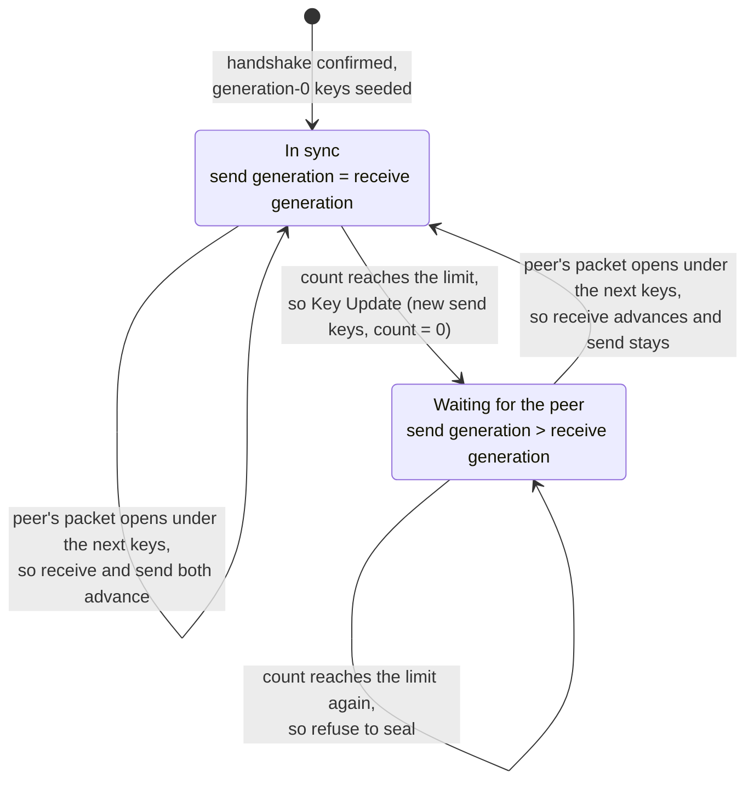

# 暗号

[ドキュメント](../README.md) › [セキュリティ設計](README.md) › 暗号

| 項目 | 内容 |
|---|---|
| 目的 | AEAD、署名、鍵共有で SDK が行う検査と、それを固定するテストを示す |
| 読む人 | 暗号のコードを変更する人、暗号の正しさをレビューする人 |
| 前提文書 | [脅威モデル](threat-model.md) |
| 関連文書 | [証明書チェーンと X.509](pki.md)、[BoringSSL のテストベクター](boringssl-vectors.md)、[Wycheproof のテストベクター](wycheproof-vectors.md) |

## 1. AEAD

QUIC はすべてのパケットを AEAD で暗号化する。対応するのは AES-128-GCM、AES-256-GCM、ChaCha20-Poly1305 である。

| 検査 | 内容 | テスト |
|---|---|---|
| タグの比較 | 早期 return のない XOR-OR の累積による定数時間の比較。タグの何バイトが一致したかは応答時間から漏れない。共通のヘルパーは `common/bytes/util/ct.h` で、GCM と ChaCha20-Poly1305 が使う | `test_gcm_tamper_rejects`、`test_aead_tamper_rejects` |
| ラウンドトリップ | GCM と ChaCha20-Poly1305 を RFC と NIST のベクターで確かめる | `test_gcm_nist`、`test_chapoly_rfc` |
| MAC | HMAC(ipad/opad)を通すので、長さ拡張攻撃は成り立たない | `test_hmac` スイート |
| Poly1305 | `r` をクランプし、ワンタイム鍵をカウンター 0 で導出する(RFC 8439) | `test_poly1305` スイート |
| ファジング | `fuzz/fuzz_tlsmsg.c` と `fuzz/fuzz_frames.c` が AEAD まわりのフレーミングとハンドシェイクメッセージのパースを対象にする。push ごとに `just fuzz-smoke`、夜間に `just fuzz-ci` | — |

## 2. AEAD の使用上限と Key Update

RFC 9001 6.6 は 1 つの鍵で暗号化するパケット数(機密性の上限)に達する前に鍵を更新し、偽造パケットの数(完全性の上限)に達したら接続を閉じることを求める。

| 暗号 | 送信側の上限 | 定数 |
|---|---|---|
| AES-GCM | 2^23 パケット | `AEAD_LIMIT_AESGCM` |
| ChaCha20-Poly1305 | 2^62 パケット | `AEAD_LIMIT_CHACHA` |

Key Update(RFC 9001 6)では、送信側が次の世代の鍵を導出し、パケットヘッダーの Key Phase ビットを反転させる。RFC 9001 6.1 は、新しい鍵で送ったパケットが確認応答されるまで次の更新を禁じる。wired はピア自身が新しい鍵で送ってくるまで待ち、これでこの条件を満たす。

| 振る舞い | テスト |
|---|---|
| 機密性の上限に達すると、本番の送信経路 `wired_srvloop_send_onertt` が、古い鍵で次のパケットを暗号化する前に Key Update を始める | `test_srvloop_send_at_aead_limit_initiates_key_update` |
| ピアが最初の更新に追いつくまで、2 回目の更新を拒否する | `test_srvloop_no_second_update_before_peer_follows` |
| 完全性の上限(復号に失敗したパケットの数)に達すると、`AEAD_LIMIT_REACHED`(0x0f)で接続を閉じる | `test_srvrun_closes_with_aead_limit_reached_on_step`、`test_srvloop_recv_auth_failure_counts_toward_integrity_limit` |

送信側の状態は次のとおりである。

更新できるのは、ハンドシェイクが確定し、送信の世代と受信の世代が等しいときだけである(`ku_can_initiate`)。上限は鍵ごとに適用するので、Key Update のたびにパケット数を 0 に戻す。

既知の制限: 更新がまだ確定していないときに上限に達すると、暗号化を止める(RFC 9001 6.2 / 6.6)。その接続は専用のクローズではなく、アイドルタイムアウトで終わる。

## 3. 署名と楕円曲線

TLS サーバーは証明書の鍵でハンドシェイクに署名する。検証器が不正な形の署名を受け入れると、誰でもサーバーになりすませる。

| 検査 | 内容 | テスト |
|---|---|---|
| ECDSA のスカラー | `r = 0` や `s = 0` を拒否し、両方のスカラーが `[1, n)` にあることを求める。"Psychic Signature" のクラス(CVE-2022-21449。すべてゼロの署名がどの鍵に対しても検証を通った)を防ぐ | `test_ecdsa_verify` スイート |
| ECDSA-Sig-Value の DER | 末尾の余分なバイト、余分な要素、大きすぎる・負の・空の整数、最小でない長さや整数のエンコーディングを拒否する(CVE-2018-1000180 のクラスの展性) | `test_sig_decode_rejects_trailing_data`、`test_sig_decode_rejects_oversized_integer`、`test_sig_decode_rejects_nonminimal_length`、`test_sig_decode_integer_padding`、`test_sig_decode_golden` |
| ECDSA の署名の生成 | SDK が作る署名は low-S に正規化する(RFC 6979 の慣行)。検証では high-S の署名も受け入れる | — |
| ECDSA の nonce | HMAC-DRBG(RFC 6979)で決定的に作る。乱数源が弱くても秘密鍵は漏れない | — |
| Ed25519 | 非正規のスカラーと、小さい位数または非正規の `A` 点・`R` 点を拒否する | `test_ed25519_verify_rejects_small_order_key`、`test_ed25519_verify_rejects_small_order_r`、`test_ed25519_verify_rejects_noncanonical_key`、`test_ed25519_verify_rejects_noncanonical_r` |
| 公開鍵 | 曲線上にあり、無限遠点でないことを求める | — |
| 体の剰余計算 | limb の境界での繰り上がりのバグ(`fe_reduce_wide` / `fe6_reduce_wide` が `m<<256` / `m<<384` の境界で剰余を取りきれない)を修正した | `test_modexp_limb_boundary_square`、`test_p256_field_mul_all_ones_limbs`、`test_p384_field_mul_all_ones_limbs` |
| P-256 の高速な検証経路 | 固定ベースのテーブルとモンゴメリ剰余の経路を、低速な参照実装との差分テストで確かめる | `test_ecdsadiff_valid`、`test_ecdsadiff_tampered`、`test_ecdsadiff_edges` |
| ファジング | `fuzz/fuzz_x509.c` が署名と DER のデコードを push ごとと夜間に対象にする | — |

既知の制限は次のとおりである。

- P-256/P-384 の limb 境界のバグは契約上のバグだった。それを起こす広い入力を渡す呼び出し元は修正の時点でなく、到達できる検証の迂回ではなかった。
- P-256 の公開鍵の読み込みは、曲線上の検査の前に `x` や `y` が `>= p` であることを拒否しない。そうした点も曲線上の検査で拒否するので、迂回にはならない。

## 4. X25519

低位数の点は、秘密のスカラーが何であっても結果をごく小さな集合(ここではすべてゼロ)に押し込む公開値である。攻撃者はその共有の秘密を知ることができる。

| 検査 | 内容 | テスト |
|---|---|---|
| ゼロの共有秘密 | 共有の秘密がすべてゼロのときは拒否する。低位数のピアの点はこの値を生む(RFC 7748 6.1) | `test_x25519_low_order_rejected` |
| ハンドシェイク | この拒否は ECDHE を呼ぶすべての箇所に伝わり、ハンドシェイクはゼロの秘密から鍵を導出せずに中断する | `test_x25519_ecdhe` |
| クランプ | スカラーを RFC 7748 のとおりにクランプする | `test_x25519_clamp_rfc7748`、`test_x25519_clamp_does_not_mutate_input` |
| 体の元の剰余 | 値が `p` に等しい境界を含めて、`p = 2^255 - 19` で完全に剰余を取る(`p` は 19 ではなく 0 になる)。そのため低位数の点はすべてゼロの秘密を生み、上の検査がそれを見つける | `test_x25519_noncanonical_u_reduced` |
| RFC 7748 のベクター | 1 回と 1000 回の反復、Alice/Bob の交換 | `test_x25519_rfc_v1`、`test_x25519_rfc_iterate_1000`、`test_x25519_rfc_dh_alice_bob` |

## 5. プリミティブごとの検査の種類

検査の種類は 3 つある。RFC や FIPS に載っている入出力の例から作った wired のテスト(既知解)、BoringSSL のベクター、Wycheproof のベクターである。第三者のベクターを使う理由は [セキュリティ設計](README.md) にある。

| プリミティブ | RFC / FIPS のテスト | BoringSSL | Wycheproof |
|---|---|---|---|
| AES-128-GCM | yes | yes | yes |
| AES-256-GCM | no (1) | yes | yes |
| ChaCha20-Poly1305 | yes | yes | yes |
| X25519 | yes | yes | yes |
| Ed25519 | yes | yes | yes |
| ECDSA P-256 | yes | yes | yes |
| ECDSA P-384 | no (1) | yes | yes(SHA-384 と SHA-512) |
| ECDSA P-521 | no (1) | yes | yes(SHA-512) |
| RSA PKCS#1 v1.5 / PSS の検証 | no (1) | no (2) | yes(e = 65537) (5) |
| HMAC-SHA256 / 384 / 512 | yes | yes | SHA256 のみ |
| HKDF-SHA256 | yes | no (3) | yes |
| SHA-256 / 384 / 512 | yes (4) | HMAC 経由 (6) | ECDSA / RSA / HMAC / HKDF 経由 (6) |

1. AES-256-GCM、P-384、P-521、RSA にも専用のテストがある。ただし期待値は OpenSSL や Python で生成したもので、RFC や FIPS の既知解ではない。この穴を第三者のベクターで埋める。P-521 は証明書チェーンの検証にだけ使う。
2. 取り込みを許可した BoringSSL のベクターファイルに RSA のベクターがない。
3. BoringSSL は HKDF のベクターを C++ のテストソースへ移したので、固定したコミットに HKDF のベクターファイルがない。
4. SHA-512 の FIPS 180-4 既知解は 1 件だけである(空文字列のダイジェスト)。
5. wired は公開指数 e = 65537 だけを検証する。
6. そのハッシュ専用のベクターはないが、挙げたプリミティブのどのケースも入力を先にハッシュする。ダイジェストが誤っていれば、それらのケースが失敗する。

TLS ハンドシェイクの中で X25519 と SHA-256 が何をするかは、ガイドの [X25519 鍵交換](https://hakkadaikon.github.io/wired/guide/ja/tls/x25519/) と [SHA-256](https://hakkadaikon.github.io/wired/guide/ja/tls/sha256/) にある。
