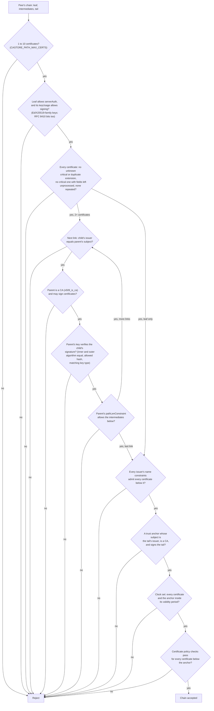

# 証明書チェーンと X.509

[ドキュメント](../README.md) › [セキュリティ設計](README.md) › 証明書チェーンと X.509

| 項目 | 内容 |
|---|---|
| 目的 | 証明書チェーンの検証の順序と、X.509・DER のパースの検査を示す |
| 読む人 | PKI のコードを変更する人、証明書の検証をレビューする人 |
| 前提文書 | [脅威モデル](threat-model.md) |
| 関連文書 | [暗号](crypto.md)、[機能がないために該当しない脆弱性](feature-gaps.md) |

## 1. チェーンの検証の順序

ピアはリーフ証明書と、それに署名した中間 CA の証明書を送る。検証器は各証明書を発行者につなぎ、トラストアンカーで終わることを確かめる。証明書の読み込み方はガイドの [証明書の読み込み](https://hakkadaikon.github.io/wired/guide/ja/tls/certificates/) にある。

`castore_validate_chain` の検査の順序は次のとおりである。リンクごとの検査はリーフから末尾まで隣り合う組ごとに繰り返す。

## 2. 検査の一覧

| 検査 | 内容 | テスト |
|---|---|---|
| リンク | 子の issuer が親の subject と等しいこと(RFC 4518 の caseIgnoreMatch で比べる。アンカーの検索も同じ)、親の鍵が子に署名していること、末尾が信頼のルートにつながっていることを確かめる(`castore_validate_chain`、`castore_verify_signed_by`) | — |
| CA | すべての発行者は `basicConstraints cA = TRUE` を持つ(RFC 5280 6.1.4)。`x509_is_ca` が検査する。リーフは CA でなくてよい | — |
| 署名アルゴリズム | 内側の `tbsCertificate.signatureAlgorithm` と外側の署名アルゴリズムの OID が等しくなければ拒否する(RFC 5280 4.1.1.2) | — |
| 名前制約 | RFC 5280 4.2.1.10。チェーン全体で積み重なる。対象は dNSName、iPAddress(アドレス/マスク。アドレスファミリーの不一致と長さが不正なサブツリーはどちらも拒否する(fail closed))、DirectoryName(大文字小文字を区別しない前方一致) | `test_ncsan_excluded_dns_wildcard_rejects`、`test_ncsan_permitted_ip4_outside_rejects`、`test_nc_excluded_dn_case_mismatch_rejects`、`test_ncx_excluded_in_a_survives_permitted_in_b`、`test_ncx_permitted_in_b_after_excluded_only_a_rejects` |
| subject の CN | dNSName の SAN がないときの代わりとしてだけ使う | `test_ncsan_cn_fallback_outside_rejects`、`test_ncsan_san_present_cn_ignored` |
| ホスト名の照合 | SAN に URI-ID か SRV-ID があれば CN を使わない。`xn--` の A ラベルの中の `*` はワイルドカードとして扱わない | `test_san_uri_srv_suppress_cn_fallback`、`test_san_alabel_wildcard_no_match` |
| 上限 | チェーンの長さと名前制約のサブツリーの数に上限がある。悪意のあるチェーンで CPU を使い果たせない(CVE-2018-16875 / CVE-2024-34702 のクラス) | `test_chain_over_cap_rejects`、`test_ncsan_subtree_count_over_cap_rejects` |
| 拡張の重複 | 拒否する(RFC 5280 4.2) | `test_x509_duplicate_extension_rejected` |
| PEM の base64 | 秘密のバイトで引くテーブルではなく、分岐のないバイト分類器でデコードする | `test_pem_every_byte_classified` |
| DER の長さ | すべての長さを境界で検査する。長形式は `0x81` / `0x82` だけを受け付け、最小でない長形式の長さは X.690 10.1 に従って拒否する | `test_sig_decode_rejects_nonminimal_length` |
| ファジング | `fuzz/fuzz_x509.c` が証明書と DER のデコードを push ごとと夜間に対象にする | — |

## 3. 有効期間とホスト名の検査

有効期間の検査(`x509_validity_ok`)とホスト名/SAN の照合(`x509_san_matches`)には、アプリケーションの時計と、接続しようとしたホスト名が要る。`x509_validity_ok` はリーフに対して行い、`castore_validate_chain` の中ではすべての証明書とアンカーに対して行う。

| 役割 | 誰が実行するか |
|---|---|
| クライアント | SDK がデフォルトで強制し、無効にする手段はない。クライアントはピアを認証する前に `fullhs_set_policy()` を呼ぶ |
| サーバー、または `fullhs` のコアを単体で使う場合 | SDK はどちらの検査も行わない。呼び出し側が用意する |

## 4. 既知の制限

- 失効確認は実装していない([脅威モデル](threat-model.md) の 3.1)。
- URI SAN の名前制約は URI のパターン照合をせず、一律に拒否する(fail closed)。テスト: `test_ncsan_uri_excluded_with_uri_san_rejects`。

層ごとの既知の制限は [既知の制限](limitations/README.md) にある。
