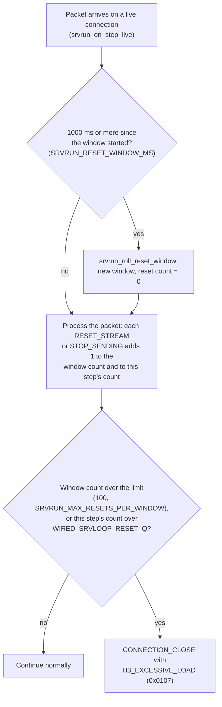
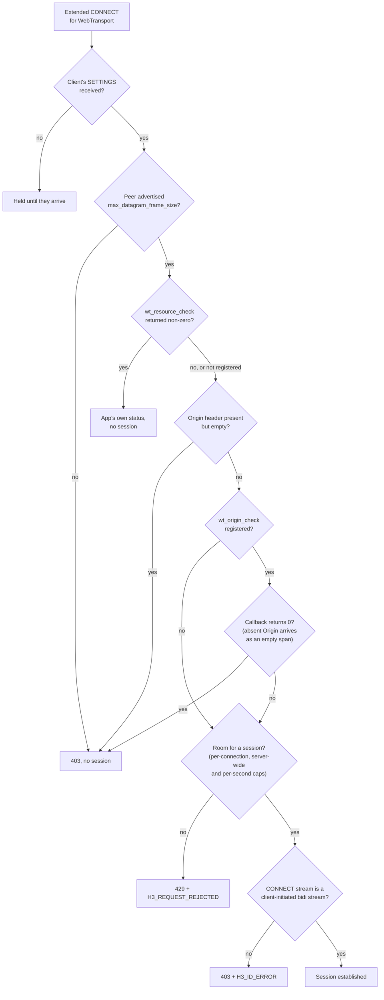

# プロトコルごとの防御

[ドキュメント](../README.md) › [セキュリティ設計](README.md) › プロトコルごとの防御

| 項目 | 内容 |
|---|---|
| 目的 | QUIC、HTTP/3、WebTransport、MoQT の各層で SDK が行う検査と、それを固定するテストを示す |
| 読む人 | プロトコルのコードを変更する人、リソースとパーサーの安全性をレビューする人 |
| 前提文書 | [脅威モデル](threat-model.md) |
| 関連文書 | [暗号](crypto.md)、[既知の制限](limitations/README.md) |

## 1. QUIC

QUIC は送信元アドレスを偽装しやすい UDP の上で動く。ここでの検査の多くは、ピアがサーバーを第三者への攻撃に使うことと、サーバーの固定サイズのテーブルを使い果たすことを防ぐ。

### 1.1 アドレスとトークン

増幅攻撃対策の上限(RFC 9000 8.1)は、クライアントが自分のアドレスの持ち主だと証明するまで、サーバーが送るバイト数を受け取ったバイト数の 3 倍に抑える。

| 検査 | 内容 | テスト |
|---|---|---|
| 増幅攻撃対策の上限 | アドレスの検証前に送るバイト数を抑える。0-RTT の受け入れとハンドシェイク中の応答量も同じ検査で制限する | `test_srvrun_default_config_gates_response_volume_pre_validation`、`test_srvrun_0rtt_accept_requires_or_limits_unvalidated_address` |
| Initial パケットのパディング | 1200 バイトまでパディングする(RFC 9001 9.3)。クライアントの最初のパケットで、サーバーは応答に足りる送信枠を得る | `test_initpad`、`test_client_initial_padded` |
| チケットと Retry トークンの鍵 | 起動時に CSPRNG から取ったシードから導出し、バイナリの中のバイトからは導出しない | `test_srvkeys_random_and_distinct` |
| ステートレスリセットのシークレット | 起動時の署名鍵に固定する。証明書を再読み込みしても、すでに配ったトークンは変わらない | `test_srvrun_stateless_reset_survives_cert_reload` |
| Retry トークンとステートレスリセットのトークン | HMAC で導出し、定数時間で比較し、不正な入力の長さを検査する | `test_retrytoken_wire_verify_rejects_short_token`、`test_newtoken_wire_verify_rejects_long_token`、`test_retry_second_discarded` |

### 1.2 ECN

ピアは ECN の印の数を ACK で報告する。数を偽るピアは輻輳を隠せるので、数を使う前に検証する。

| 検査 | 内容 | テスト |
|---|---|---|
| 数の検証 | RFC 9000 13.4.2.1 に従う。ECT(0)+CE の増加が新たに確認応答されたパケット数より少ない報告は、抑制として拒否する。数は減ってはならない。確認応答された最大のパケットを進めない順序の入れ替わった ACK は、ECN の検証に使わない | `test_ecn_suppressed_counts_fail_validation`、`test_ecn_counts_valid_rejects_decrease_wired`、`test_srvloop_note_ecn_keeps_largest_ack` |
| 輻輳制御への反映 | 検証済みの CE の増加は、最小ウィンドウを下限として輻輳制御に渡す | `test_ecn_inflated_ce_floors_at_min_window`、`test_srvrun_feed_acks_ecn_ce_shrinks_cwnd` |

### 1.3 ストリームと接続の上限

| 検査 | 内容 | テスト |
|---|---|---|
| フロー制御 | MAX_DATA、MAX_STREAM_DATA、MAX_STREAMS を超えるデータを拒否する | — |
| STREAM と STOP_SENDING | STREAM の final size のオーバーフローと、向きを間違えて送られた STREAM フレームや STOP_SENDING フレームを拒否する(RFC 9000 19.5 / 19.8 / 4.5) | `test_frame_stream_final_size_overflow_rejected`、`test_srvrun_receive_only_stream_frames_close` |
| 接続の移行 | 新しいパスでの新しい PATH_CHALLENGE を求める(RFC 9000 8.2.1 / 9.3) | `test_srvrun_path_wire_both_challenged` |
| バージョンと接続 ID | バージョンのダウングレードを検出する。接続 ID は乱数生成器から作る | — |
| 起動の期限 | 認証前に少しずつデータを送る接続(Slowloris 型)に期限を強制する | `test_srvrun_slow_trickle_preauth_evicted` |
| スロットの再利用 | 前の利用者のバッファーを完全に消去する | `test_srvrun_slot_reuse_clears_prior_connection_buffer` |
| ファジング | `fuzz/fuzz_header.c`、`fuzz/fuzz_onertt.c`、`fuzz/fuzz_tlsmsg.c`、`fuzz/fuzz_frames.c` が varint、フレーム、0-RTT、ハンドシェイクメッセージのデコードを対象にする。push ごとに 1 回(`just fuzz-smoke`)、夜間は決まった実時間の範囲で(`just fuzz-ci`)実行する | — |

### 1.4 Rapid Reset

Rapid Reset(CVE-2023-44487)は、リクエストを開いてはすぐに取り消すことを繰り返す攻撃である。取り消すのでクライアントは同時ストリーム数の上限に掛からず、サーバーには処理の負担が残る。

wired はピアの RESET_STREAM フレームと STOP_SENDING フレームを、接続ごとに 1 秒の固定ウィンドウで数える。上限を超えると `H3_EXCESSIVE_LOAD`(0x0107)で接続を閉じる。デフォルトの上限はウィンドウあたり 100 である。

| クライアント | 1 秒あたりの取り消し |
|---|---|
| 通常のクライアント | 数個 |
| 攻撃者 | 数千 |

確立済みの接続での 1 ステップは次のとおりである。

ウィンドウの切り替えはパケットを処理する前に行うので、そのパケットのリセットは本来属するウィンドウで数える。2 つ目の条件は 1 ステップでキューに入れられる数(`WIRED_SRVLOOP_RESET_Q`。追跡するストリームのスロット 1 つにつき 2 つ)より多いリセットを 1 つのパケットで送る場合を捕まえる。

テスト: `test_srvrun_reset_flood_over_threshold_closes_excessive_load`。

| 呼び出し側の責任 | 補足 |
|---|---|
| この組み込みのリセットカウンターを超えるリクエストのレート制限 | — |
| Retry トークンの TTL | — |
| リセットの上限の変更 | `wired_srvrun_env` を通してだけ変更できる。公開の `wired_srvrun_opt` のフィールドにはなっていない |

## 2. HTTP/3 と QPACK

圧縮爆弾(decompression bomb)は、小さな入力が巨大な出力に展開されるか、デコードに多くの CPU を使わせる入力である。次の検査は出力の大きさとデコードの処理量の両方を抑える。

| 検査 | 内容 | テスト |
|---|---|---|
| 出力のあふれ | QPACK のデコードは出力のあふれを拒否し、ハフマンと整数のデコードは読み過ぎを防ぐ | `test_huffman_overflow` |
| 動的テーブル | 大きさに上限がある | `test_qpack_dyntable_bounded_by_max_entries` |
| ハフマンの処理量 | フィールドセクションの固定の上限と、テーブル自身の符号長の最大値 30 ビットで抑える(RFC 9114 10.5.5 / QPACK 7、圧縮の処理量による DoS) | `test_qpack_huffman_decode_cost_bounded` |
| varint とフレーム | すべての読み込みを残りのバッファーの範囲に収める | — |
| リクエストの body | アプリが `wired_srvrun_handler.on_body` でストリーミングしない body は、固定のウィンドウ 1 つ(`BODYWIN_CAP`、10240 バイト。8000 オクテットのリクエストターゲットが収まる大きさ。RFC 9110 4.1)にバッファリングする。あふれたら `413` で応答する(RFC 9110 15.5.14)。アプリの `on_body` が 0 を返したときも同じ応答である | `test_srvrun_full_window_body_gets_413`、`test_srvrun_on_body_reject_answers_413`、`test_srvrun_early_413_also_stops_sending` |
| 先頭の HEADERS フレーム | 大きすぎるときは `431` で応答する(RFC 6585 5) | `test_srvrun_full_window_headers_get_431` |
| ファジング | `fuzz/fuzz_qpack.c` が QPACK のデコードを対象にする。push ごとに `just fuzz-smoke`、夜間に `just fuzz-ci` | — |

既知の制限: `test_qpack_huffman_decode_cost_bounded` は、`HUFF_MAXLEN` のガードを書き換えるミューテーションを入れても失敗しない。正準ハフマンテーブルの最長の符号は、そのガードに届く前に終わるからである。このテストは悪意のある入力に対してデコード時間が抑えられることを示すが、ガード自体は実行しない(V-0448)。

## 3. WebTransport

CONNECT ストリームはカプセル(フロー制御の更新やセッションの終了などの、型の付いたメッセージ)も運ぶ。節番号は -16 と書いたものを除き draft-ietf-webtrans-http3-15 のものである。引用している規則は 2 つの版の間で変わっていない。

| 検査 | 内容 | テスト |
|---|---|---|
| フロー制御 | カプセルのデコードはフロー制御につながっている。複数のセッションが 1 つの QUIC 接続を共有するとき、セッションはフロー制御を強制する(5.1 MUST) | `test_srvrun_wt_session_sharing_enables_flow_control`、`test_srvrun_wt_rx_max_data_capsule_via_dispatch_unblocks_send` |
| 未知・不正なカプセル | 未知のカプセルは読み飛ばす(RFC 9297 3.2)。不正な形か途中で切れたカプセルの body はセッションを閉じる(3.3)。上限を増やさないフロー制御のカプセルは WT_FLOW_CONTROL_ERROR でセッションを閉じる(-16 の 5.6.2 / 5.6.4) | `test_srvrun_wt_rx_unknown_capsule_via_dispatch_skipped`、`test_srvrun_wt_rx_truncated_capsule_via_dispatch_closes_session`、`test_srvrun_wt_nonincreasing_flow_control_capsule_closes_session` |
| セッションの数 | `WT_CLOSE_SESSION` でセッションを終える。作成は接続ごとにレート制限する(1 秒のウィンドウあたり 10 セッション)。サーバー全体の上限が、すべての接続にわたる同時セッション数を抑える。セッション、ストリーム、データグラムの使用量のカウンターを公開する | `test_srvrun_wt_close_session_capsule_received`、`test_srvrun_connect_concurrency_limit_enforced`、`test_srvrun_wt_session_creation_rate_limited`、`test_srvrun_wt_usage_counters_exposed` |
| 一度きりの制御フレーム | `WT_CLOSE_SESSION`、GOAWAY、アプリが求めた RESET_STREAM、早期応答の STOP_SENDING は、確認応答されるまで保持し、失われたら再送する。パケットを落とすピアがこれらを落としても、セッションやリクエストは開いたままにならない。再送の予算の範囲で確認応答しないピアは接続ごと切断する | `test_srvrun_wt_close_capsule_retransmitted_after_loss`、`test_srvrun_control_packets_kept_until_acked`、`test_srvrun_rst_budget_exhausted_tears_down` |
| ファジング | `fuzz/fuzz_capsule.c` がカプセルを push ごとと夜間に対象にする | — |

### 3.1 Origin の検査

ブラウザーは WebTransport の CONNECT のたびにページの `Origin` ヘッダーを送る。これを検査すると、別のサイトのページが訪問者のブラウザーを使ってサーバーにセッションを開くことを防げる。CONNECT を拒否する判定の順序は次のとおりで、`Origin` の判定はクライアントの SETTINGS とトランスポートパラメーターの検査のあとにある。

| 条件 | 扱い | テスト |
|---|---|---|
| `Origin` があって空 | 空であってはならない(3.6)。アプリのコールバックの前に、SDK が `wt_origin_ok` で `403` を返す | `test_srvrun_wt_connect_origin_ok_establishes`、`test_srvrun_wt_connect_origin_malformed_403` |
| `Origin` がない | 拒否の理由にしない。ブラウザー以外のクライアントは送らない | — |
| アプリの許可リスト | `wired_srvrun_opt.wt_origin_check` で組み込む(3.1)。0 を返すとセッションを作らずに `403` で応答する。設定していないときは、正しい形の `Origin` をすべて受け入れる | `test_srvrun_wt_origin_check_allowed_establishes`、`test_srvrun_wt_origin_check_disallowed_403`、`test_srvrun_wt_origin_check_absent_empty_span`、`test_srvrun_wt_origin_check_unset_unchanged` |

コールバックの書き方はガイドの [Origin ヘッダーの検査](https://hakkadaikon.github.io/wired/guide/ja/wt/origin/) にある。

### 3.2 ドレイン

ピアの `WT_DRAIN_SESSION` カプセルはセッションごとに 1 回 `wired_srvrun_opt.wt_on_session_draining` でアプリに届く(4.7)。値を持つドレインのカプセルは不正な形(Length は 0 でなければならない)で、セッションを閉じる。

テスト: `test_srvrun_wt_drain_rx_notifies_app`、`test_srvrun_wt_drain_rx_with_value_closes`。

### 3.3 既知の制限

- `WT_DRAIN_SESSION` は勧告である。SDK はアプリに知らせるが、自分でセッションを閉じない。
- アプリが `wt_origin_check` を登録しない限り、`Origin` の検証は正しい形の空でない値をすべて受け入れる。デフォルトの許可リストはない。

## 4. MoQT

`src/app/moqt/` は WebTransport のセッションの上で MoQT(draft-ietf-moq-transport-18、-19、-22、-23。セッションごとに WebTransport のサブプロトコルから選ぶ)を実装する。節番号は draft-19 のものである。

MoQT はそのセッションの TLS 1.3 による機密性、完全性、エンドポイントの認証を引き継ぎ、MoQT の層に独自の暗号はない。

| 検査 | 内容 | テスト |
|---|---|---|
| 長さのオーバーフロー | Object とプロパティの長さの検査は、2^64 で一周しない引き算(`len > buf.n - *at`)で範囲外の読み込みと無限ループを防ぐ | `test_moqdata_obj_take_len_wrap`、`test_moqdata_obj_take_payload_len_boundary`、`test_moqvi_put_at_capacity_edge` |
| `AUTHORIZATION_TOKEN`(0x03) | SUBSCRIBE と PUBLISH のパラメーターでデコードする(10.2.2)。認可フックがルーティングの前にすべての SUBSCRIBE を通すかを決める(13.3: "Relays will verify the token") | `test_moqctl_params_auth_token_use_value_decode`、`test_moqctl_params_auth_token_scope_violation`、`test_moqtrun_subscribe_requires_authorization`、`test_moqtrun_subscribe_alias_token_rejected` |
| ファジング | `fuzz/fuzz_moqt.c` が MoQT のデコードを push ごと(`just fuzz-smoke`)と夜間(`just fuzz-ci`)に対象にする。シードコーパスは、上の長さのオーバーフローを起こす入力を含む | — |

認可フックはどれもオプトインで、デフォルトのハブはすべてのリクエストを通す。フックの登録方法はガイドの [購読者の認可](https://hakkadaikon.github.io/wired/guide/ja/moqt/authorize/) にある。

| リクエスト | フック |
|---|---|
| SUBSCRIBE、TRACK_STATUS | `authorize_subscribe` |
| PUBLISH | `authorize_publish` |
| PUBLISH_NAMESPACE、SUBSCRIBE_NAMESPACE | `authorize_namespace` |

`authorize_publish` は draft-22 16.3.4 "Preventing Impersonation" に従う。テスト: `test_moqtrun_publish_requires_authorization`。

呼び出し側の責任: `AUTHORIZATION_TOKEN` の値が何を認可するかと、購読リクエストのレート制限(draft-19 13.1、Subscription Amplification)はアプリケーション層で決める。SDK が提供するのはワイヤーフォーマットとフックで、ポリシーではない。

既知の制限は次のとおりである。

- サンプルのハブは `authorize_subscribe == 0` のまま出荷しているので、すべての購読を通す。
- 1 つのメッセージの中で重複した `AUTHORIZATION_TOKEN` は仕様の "MAY be repeated" に従わず、一般的なパラメーター重複の違反として拒否する。
