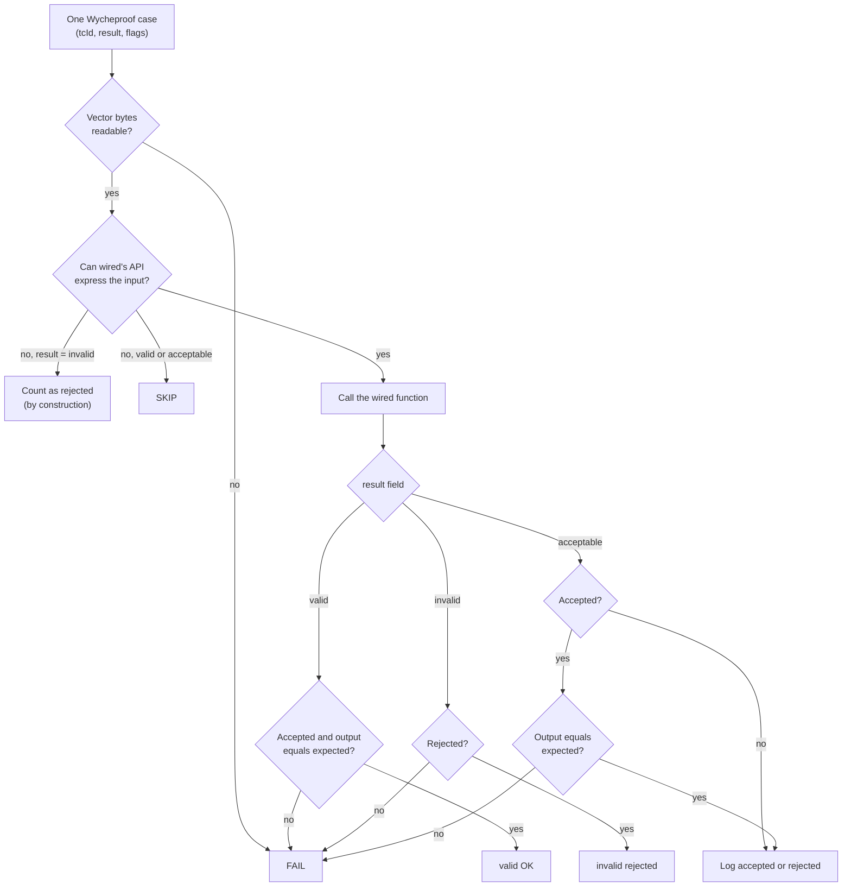

# Wycheproof vectors: results

This page answers one question: when wired's crypto is fed known attack
inputs written by someone else, does it accept what it must accept and reject
what it must reject? It is for anyone reviewing wired's security evidence, and
it also says where the counts prove less than they seem to.

## What Wycheproof is

[Project Wycheproof](https://github.com/C2SP/wycheproof) is a collection of
crypto test vectors, started at Google and now kept by C2SP. Each vector is an
edge case or a known attack: a tampered authentication tag, a signature that
can be re-encoded into a second valid-looking one, a low-order public key that
forces an all-zero shared secret, and so on. Implementations that pass plain
RFC vectors often fail some of these.

wired uses them as a **third-party oracle**: the expected answer for each case
comes from the Wycheproof JSON, never from wired. This matters because a test
where wired checks its own output against itself cannot catch a bug that both
sides share. Wycheproof runs beside the RFC / FIPS tests and the BoringSSL
vectors ([boringssl-vectors.md](boringssl-vectors.md)).

The vectors are the `testvectors_v1/` files of C2SP/wycheproof, pinned at
commit `3fa63dd0344abb611f1fb1d77e119938603ea230`. Where they came from, how
they are turned into C arrays, and the skip list are in
[`tests/vectors/wycheproof/README.md`](../../tests/vectors/wycheproof/README.md).

## How to read a vector

Every case in a Wycheproof file carries three fields that the tables below
refer to:

- **`tcId`**: the case's number inside its file. A failure is reported as
  file + `tcId`, so you can look the exact input up in the JSON.
- **`result`**: what a correct implementation must do with it. It is one of
  the three values listed next.
- **`flags`**: short names for what the case attacks, such as `ModifiedTag`
  (the authentication tag of an AEAD cipher,
  such as AES-GCM, was changed) or `SignatureMalleability`. A case may carry
  several.

The three `result` values:

- `valid`: must accept, and produce exactly the expected output (the
  plaintext, the shared secret, a verified signature).
- `invalid`: must reject. Accepting it would be a forgery or a spec
  violation.
- `acceptable`: the spec allows either answer (for example, aborting on an
  all-zero X25519 shared secret). Accepting and rejecting are both allowed.
  The X25519 test also fails a case that is accepted with a wrong shared
  secret. wired's choice is logged as
  `wyc <file> tcId <n> acceptable: accepted|rejected`.

The AEAD, HMAC, HKDF and RSA drivers follow the diagram below for `valid` and
`invalid` cases. The "wrong output" check on `acceptable` cases applies only to
X25519, the one primitive whose acceptable cases produce an output. Look at the
two exits on the "Can wired's API express the input?" node: they are where
**Skip** and the "by construction" rejections below come from. The Ed25519 /
X25519 / ECDSA driver has no Skip: an input its API cannot take is simply
rejected, which is why those rows show Skip 0.

A failure prints `FAIL <file> tcId <n> flags=<flags>` and fails the whole
`just test` run.

## Results (last updated 2026-10-10)

The suite was first imported on 2026-10-05; the P-521 row was added on
2026-10-10. Every row below was re-checked against the `wyc` summary lines of
`just test` on 2026-10-15 and still matches.

Column meanings: **Added** is the number of cases in the file(s); **valid OK**
and **invalid rejected** count cases that got the required answer;
**acceptable** is the number of such cases, split into how many wired
accepted and how many it rejected; **Fail** counts cases that got the wrong
answer; **Skip** counts `valid` or `acceptable` cases that wired's API cannot
express (see the Skips paragraph below).

| Primitive | File(s) | Added | valid OK | invalid rejected | acceptable (accepted / rejected) | Fail | Skip |
|---|---|---:|---:|---:|---|---:|---:|
| AES-GCM | `aes_gcm_test.json` | 316 | 79 | 87 | 0 | 0 | 150 |
| ChaCha20-Poly1305 | `chacha20_poly1305_test.json` | 325 | 256 | 69 | 0 | 0 | 0 |
| X25519 | `x25519_test.json` | 518 | 264 | 0 | 254 (223 / 31) | 0 | 0 |
| Ed25519 | `ed25519_test.json` | 151 | 88 | 63 | 0 | 0 | 0 |
| ECDSA P-256 / SHA-256 | `ecdsa_secp256r1_sha256_test.json` | 484 | 174 | 310 | 0 | 0 | 0 |
| ECDSA P-384 / SHA-384 | `ecdsa_secp384r1_sha384_test.json` | 504 | 194 | 310 | 0 | 0 | 0 |
| ECDSA P-384 / SHA-512 | `ecdsa_secp384r1_sha512_test.json` | 542 | 231 | 311 | 0 | 0 | 0 |
| ECDSA P-521 / SHA-512 | `ecdsa_secp521r1_sha512_test.json` (added 2026-10-10) | 542 | 232 | 310 | 0 | 0 | 0 |
| RSA PKCS#1 v1.5 | `rsa_signature_{2048,3072,4096}_sha{256,384,512}_test.json` (9) | 2330 | 63 | 2253 | 9 (0 / 9) | 0 | 5 |
| RSA-PSS | `rsa_pss_{2048,3072,4096}_sha256_mgf1_32_test.json` (3) | 324 | 189 | 135 | 0 | 0 | 0 |
| HMAC-SHA256 | `hmac_sha256_test.json` | 174 | 66 | 108 | 0 | 0 | 0 |
| HKDF-SHA256 | `hkdf_sha256_test.json` | 86 | 83 | 3 | 0 | 0 | 0 |
| SHA-2 | (no own file; digest of every ECDSA / RSA / HMAC / HKDF case) | — | — | — | — | — | — |
| **Total** | 22 files | **6296** | **1919** | **3959** | **263 (223 / 40)** | **0** | **155** |

Failed tcIds and flags: **none**.

SHA-2 has no Wycheproof file of its own here. It is still exercised: every
ECDSA and RSA case hashes its message first, so a wrong digest would show up
as a failing `valid` signature.

**Skips.** AES-GCM skips the AES-192 groups and the `valid` cases with a nonce
that is not 96 bits, because wired's AEAD API takes only a 96-bit nonce and a
128-bit tag. RSA PKCS#1 skips the `valid` cases whose public exponent is
e = 3 (2048_sha256: 2, 2048_sha512: 1, 3072_sha256: 1, 3072_sha512: 1),
because wired verifies only e = 65537.

**Acceptable outcomes.** RSA tcId 8 (`MissingNull`: the ASN.1 structure that
wraps the hash inside the signature, called DigestInfo, leaves out an empty
NULL field that is normally present; RFC 8017 lets verifiers accept or reject
this) is rejected in all 9 files. X25519 rejects tcIds 32, 33, 63–86, 117, 118,
154, 165 and 166 and accepts the other 223. The rejected ones are low-order
public keys that give an all-zero shared secret, which RFC 7748 6.1 and RFC
8446 7.4.2 allow an implementation to abort on. See the guide's [X25519
page](https://hakkadaikon.github.io/wired/guide/en/tls/x25519/) for what X25519
does in the handshake.

## What "invalid rejected" does and does not prove

Rejecting an `invalid` case is the required behavior. Wycheproof marks a case
`invalid` when a correct implementation must refuse it: a modified tag, a
malleable or mis-encoded signature, broken RSA padding, or an HKDF output
longer than 255 × 32 bytes (255 times the SHA-256 output size, the most
RFC 5869 allows). Two limits apply to the **invalid rejected**
counts above.

### 1. Only the outcome is checked, not the reason

A case counts as rejected when wired returns failure. The test does not check
*which* check refused it. A case built to hit, say, an ECDSA range check also
passes if verification fails later for another reason, such as a digest
mismatch. This is Wycheproof's own pass criterion, but it does not prove that
every individual check exists in wired.

HMAC is a special case. wired has no HMAC verify function, so the test
computes the MAC with wired, truncates it to the tag length, and compares it
with the forged tag in constant time. Its 108 rejections come from that
comparison.

### 2. Some invalid inputs cannot be expressed through wired's API

Some `invalid` inputs cannot even be passed to wired. For example, wired's
ChaCha20-Poly1305 function takes a fixed 96-bit nonce, so a 64-bit nonce has
no way in. The test counts such a case as rejected **by construction**: the
answer is correct, but no wired code ran to produce it. These are the
"no, result = invalid" exit in the diagram above.

| Primitive | Cases | Why not expressible | Flags |
|---|---:|---|---|
| AES-GCM | 29 | AES-192 key (not implemented) | ModifiedTag (27), ZeroLengthIv (2) |
| AES-GCM | 4 | zero-length IV (API takes a 96-bit nonce) | ZeroLengthIv |
| ChaCha20-Poly1305 | 9 | nonce of 0/64/88/104/112/128/160/192/256 bits (API takes 96 bits) | InvalidNonceSize |
| Ed25519 | 12 | signature not 64 bytes (`ed25519_verify` takes a fixed 64-byte signature) | TruncatedSignature, CompressedSignature, SignatureWithGarbage |

So the rejections that actually went through wired's code are: AES-GCM 54 of
87, ChaCha20-Poly1305 60 of 69, Ed25519 51 of 63, and all of the rest. ECDSA
goes through wired's DER signature decoder `ecdsasig_decode` and then verify,
RSA through `rsa_pkcs1_verify` / `rsa_pss_verify`, and HKDF through
`hkdf_expand`.

## Flag-named tests

Besides the per-file totals, some flags get a test of their own, named after
the flag. Such a test runs only the `invalid` cases that carry that flag, so a
regression in one attack class shows up by name instead of as one more
failure in a large total.

The import set out six flags to get a test of their own: LowOrderPublic,
NonCanonical, ZeroOrderPublic, SmallPublicKey, ModifiedTag and ShortMac. Each
gets a test named after it when it appears on `invalid` cases:

| Test | invalid cases | rejected |
|---|---:|---:|
| `test_wyc_aesgcm_invalid_ModifiedTag_rejected` | 81 | 81 (54 through wired, 27 AES-192 by construction) |
| `test_wyc_chacha20poly1305_invalid_ModifiedTag_rejected` | 60 | 60 |
| `test_wyc_hmac_invalid_ModifiedTag_rejected` | 108 | 108 |

The other listed flags never appear on an `invalid` case in the pinned files,
so they have no test to run:

- LowOrderPublic, SmallPublicKey and NonCanonicalPublic (the files' name
  for the NonCanonical attack) occur in
  `x25519_test.json` only on `acceptable` cases (that file has no `invalid`
  case).
- SmallPublicKey occurs in the RSA PKCS#1 files only on the 5 `valid`
  e = 3 cases, which are the 5 Skips above.
- ZeroOrderPublic and ShortMac do not occur in any of the 22 files.

More per-flag rejection loops run for flags that do mark `invalid` cases, and
every one of them rejects every case it finds:

- Ed25519: SignatureMalleability, CompressedSignature, InvalidEncoding,
  TruncatedSignature, SignatureWithGarbage.
- ECDSA: BerEncodedSignature, InvalidEncoding, IntegerOverflow, RangeCheck,
  MissingZero.
