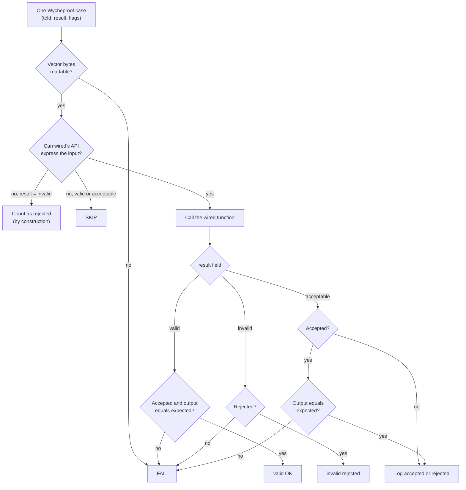

# Wycheproof のテストベクター

[ドキュメント](../README.md) › [セキュリティ設計](README.md) › Wycheproof のテストベクター

| 項目 | 内容 |
|---|---|
| 目的 | 既知の攻撃入力を与えたとき、wired の暗号が受け入れるべきものを受け入れ、拒否すべきものを拒否するかの結果と、件数が示さない範囲を示す |
| 読む人 | wired のセキュリティの根拠をレビューする人 |
| 前提文書 | [セキュリティ設計](README.md)(第三者のテストベクターを使う理由) |
| 関連文書 | [BoringSSL のテストベクター](boringssl-vectors.md)、[暗号](crypto.md) |

## 1. 出どころ

[Project Wycheproof](https://github.com/C2SP/wycheproof) は暗号のテストベクター集で、Google で始まり、いまは C2SP が管理する。各ベクターはエッジケースか既知の攻撃である(改ざんした認証タグ、正しそうに見える 2 つ目の署名へ再エンコードできる署名、共有秘密をすべてゼロにする低位数の公開鍵など)。RFC の通常のベクターを通る実装でも、このうちいくつかに失敗することがある。

| 項目 | 内容 |
|---|---|
| 期待値 | Wycheproof の JSON から取る。wired から取らない |
| ファイル | C2SP/wycheproof の `testvectors_v1/`。コミット `3fa63dd0344abb611f1fb1d77e119938603ea230` に固定 |
| 出どころ、C の配列への変換方法、skip の一覧 | [`tests/vectors/wycheproof/README.md`](../../tests/vectors/wycheproof/README.md) |

## 2. ベクターの読み方

| フィールド | 中身 |
|---|---|
| `tcId` | ファイル内でのケースの番号。失敗はファイル名 + `tcId` で報告するので、JSON で入力を引ける |
| `result` | 正しい実装がそのケースをどう扱うべきか(下の表) |
| `flags` | そのケースが何を攻撃しているかの短い名前。たとえば `ModifiedTag`(AEAD の認証タグを書き換えた)や `SignatureMalleability`。1 つのケースが複数を持つこともある |

| `result` | 求められる振る舞い |
|---|---|
| `valid` | 受け入れ、期待どおりの出力(平文、共有秘密、検証済みの署名)を出す |
| `invalid` | 拒否する。受け入れると偽造の成立か仕様違反になる |
| `acceptable` | 仕様がどちらの答えも認める(たとえば X25519 の共有秘密がすべてゼロのときに中断する)。X25519 のテストは、受け入れたうえで共有秘密が誤っているケースを失敗にする。wired の選択は `wyc <file> tcId <n> acceptable: accepted\|rejected` としてログに出る |

AEAD、HMAC、HKDF、RSA のドライバーは、次の図のとおりに動く。

- `acceptable` のケースへの出力の検査は X25519 にだけ当てはまる。acceptable なケースが出力を生むプリミティブは X25519 だけである。
- Skip と構造上の拒否は「Can wired's API express the input?」の 2 つの出口から生まれる。Ed25519 / X25519 / ECDSA のドライバーには Skip がない。API が受け取れない入力は拒否されるので、それらの行の Skip は 0 である。
- 失敗すると `FAIL <file> tcId <n> flags=<flags>` を出力し、`just test` の実行全体が失敗する。

## 3. 結果(最終更新 2026-10-10)

このスイートは 2026-10-05 に取り込み、P-521 の行を 2026-10-10 に追加した。2026-10-15 に、すべての行を `just test` の `wyc` サマリー行と照らして確かめ直し、一致している。

| 列 | 意味 |
|---|---|
| Added | ファイル内のケース数 |
| valid OK、invalid rejected | 求められた答えを返したケースの数 |
| acceptable | acceptable のケースの数。wired が受け入れた数と拒否した数に分ける |
| Fail | 誤った答えを返したケースの数 |
| Skip | wired の API で表現できない `valid` または `acceptable` のケースの数 |

| プリミティブ | ファイル | Added | valid OK | invalid rejected | acceptable (accepted / rejected) | Fail | Skip |
|---|---|---:|---:|---:|---|---:|---:|
| AES-GCM | `aes_gcm_test.json` | 316 | 79 | 87 | 0 | 0 | 150 |
| ChaCha20-Poly1305 | `chacha20_poly1305_test.json` | 325 | 256 | 69 | 0 | 0 | 0 |
| X25519 | `x25519_test.json` | 518 | 264 | 0 | 254 (223 / 31) | 0 | 0 |
| Ed25519 | `ed25519_test.json` | 151 | 88 | 63 | 0 | 0 | 0 |
| ECDSA P-256 / SHA-256 | `ecdsa_secp256r1_sha256_test.json` | 484 | 174 | 310 | 0 | 0 | 0 |
| ECDSA P-384 / SHA-384 | `ecdsa_secp384r1_sha384_test.json` | 504 | 194 | 310 | 0 | 0 | 0 |
| ECDSA P-384 / SHA-512 | `ecdsa_secp384r1_sha512_test.json` | 542 | 231 | 311 | 0 | 0 | 0 |
| ECDSA P-521 / SHA-512 | `ecdsa_secp521r1_sha512_test.json`(2026-10-10 に追加) | 542 | 232 | 310 | 0 | 0 | 0 |
| RSA PKCS#1 v1.5 | `rsa_signature_{2048,3072,4096}_sha{256,384,512}_test.json`(9) | 2330 | 63 | 2253 | 9 (0 / 9) | 0 | 5 |
| RSA-PSS | `rsa_pss_{2048,3072,4096}_sha256_mgf1_32_test.json`(3) | 324 | 189 | 135 | 0 | 0 | 0 |
| HMAC-SHA256 | `hmac_sha256_test.json` | 174 | 66 | 108 | 0 | 0 | 0 |
| HKDF-SHA256 | `hkdf_sha256_test.json` | 86 | 83 | 3 | 0 | 0 | 0 |
| SHA-2 | (専用のファイルなし。ECDSA / RSA / HMAC / HKDF の全ケースのダイジェスト) | — | — | — | — | — | — |
| **合計** | 22 ファイル | **6296** | **1919** | **3959** | **263 (223 / 40)** | **0** | **155** |

失敗した tcId とフラグはない。

SHA-2 専用の Wycheproof ファイルはない。ECDSA と RSA のどのケースもメッセージを先にハッシュするので、ダイジェストが誤っていれば `valid` な署名が失敗として現れる。

### 3.1 Skip

| プリミティブ | skip するケース | 理由 |
|---|---|---|
| AES-GCM | AES-192 のグループと、96 ビットでない nonce を持つ `valid` なケース | wired の AEAD API は 96 ビットの nonce と 128 ビットのタグしか受け取らない |
| RSA PKCS#1 | 公開指数が e = 3 の `valid` なケース(2048_sha256: 2、2048_sha512: 1、3072_sha256: 1、3072_sha512: 1) | wired は e = 65537 しか検証しない |

### 3.2 acceptable の結果

| プリミティブ | 拒否したケース | 理由 |
|---|---|---|
| RSA | tcId 8(`MissingNull`)を 9 ファイルすべてで拒否 | 署名の中でハッシュを包む ASN.1 構造 DigestInfo が、通常はある空の NULL フィールドを省いている。RFC 8017 は検証側が受け入れても拒否してもよいとする |
| X25519 | tcId 32、33、63–86、117、118、154、165、166 を拒否し、残りの 223 件を受け入れる | 拒否したのは共有秘密がすべてゼロになる低位数の公開鍵である。RFC 7748 6.1 と RFC 8446 7.4.2 は、実装がこのとき中断することを認める |

ハンドシェイクの中で X25519 が何をするかは、ガイドの [X25519 鍵交換](https://hakkadaikon.github.io/wired/guide/ja/tls/x25519/) にある。

## 4. 「invalid rejected」が示す範囲

Wycheproof は、正しい実装が拒否しなければならないケースを `invalid` とする。書き換えたタグ、展性(malleability)のある署名や誤ったエンコードの署名、壊れた RSA パディング、255 × 32 バイト(SHA-256 の出力サイズの 255 倍で、RFC 5869 が認める最大)より長い HKDF の出力などである。

invalid rejected の件数には 2 つの限界がある。

### 4.1 確かめているのは結果だけで、理由ではない

wired が失敗を返せば、そのケースを拒否として数える。どの検査が拒否したかは確かめない。たとえば ECDSA の範囲検査に当たるよう作ったケースも、別の理由(ダイジェストの不一致など)で検証に失敗すれば通る。これは Wycheproof 自身の合格基準だが、個々の検査がすべて wired にあることの証明にはならない。

HMAC は扱いが違う。wired には HMAC の検証関数がないので、テストは wired で MAC を計算し、タグの長さに切り詰め、偽造タグと定数時間で比較する。108 件の拒否はこの比較による。

### 4.2 wired の API では表現できない invalid な入力

`invalid` な入力の一部は wired に渡せない。たとえば wired の ChaCha20-Poly1305 関数は 96 ビット固定の nonce を受け取るので、64 ビットの nonce を渡す手段がない。テストはこうしたケースを構造上の拒否として数える(2 章の図の「no, result = invalid」の出口)。答えは正しいが、wired のコードは動いていない。

| プリミティブ | ケース数 | 表現できない理由 | フラグ |
|---|---:|---|---|
| AES-GCM | 29 | AES-192 の鍵(実装していない) | ModifiedTag (27), ZeroLengthIv (2) |
| AES-GCM | 4 | 長さゼロの IV(API は 96 ビットの nonce を受け取る) | ZeroLengthIv |
| ChaCha20-Poly1305 | 9 | 0/64/88/104/112/128/160/192/256 ビットの nonce(API は 96 ビットを受け取る) | InvalidNonceSize |
| Ed25519 | 12 | 64 バイトでない署名(`ed25519_verify` は 64 バイト固定の署名を受け取る) | TruncatedSignature, CompressedSignature, SignatureWithGarbage |

wired のコードを通った拒否は次のとおりである。

| プリミティブ | 通った拒否 | 通る関数 |
|---|---|---|
| AES-GCM | 87 件中 54 件 | — |
| ChaCha20-Poly1305 | 69 件中 60 件 | — |
| Ed25519 | 63 件中 51 件 | — |
| ECDSA | 全件 | DER 署名デコーダー `ecdsasig_decode` を通ってから検証へ進む |
| RSA | 全件 | `rsa_pkcs1_verify` / `rsa_pss_verify` |
| HKDF | 全件 | `hkdf_expand` |
| ほかのプリミティブ | 全件 | — |

## 5. フラグ名のテスト

一部のフラグには、その名前を付けた専用のテストがある。そのフラグを持つ `invalid` なケースだけを実行するので、ある攻撃の種類でリグレッションが起きると、合計の中の失敗 1 件ではなく名前で分かる。

取り込みの際に、専用のテストを持たせるフラグを 6 つ決めた。LowOrderPublic、NonCanonical、ZeroOrderPublic、SmallPublicKey、ModifiedTag、ShortMac である。`invalid` なケースに現れるフラグが、その名前のテストを持つ。

| テスト | invalid なケース | 拒否 |
|---|---:|---:|
| `test_wyc_aesgcm_invalid_ModifiedTag_rejected` | 81 | 81(wired を通ったもの 54、AES-192 で構造上の拒否 27) |
| `test_wyc_chacha20poly1305_invalid_ModifiedTag_rejected` | 60 | 60 |
| `test_wyc_hmac_invalid_ModifiedTag_rejected` | 108 | 108 |

残りのフラグは固定したファイルの `invalid` なケースに現れないので、実行するテストがない。

| フラグ | 現れる場所 |
|---|---|
| LowOrderPublic、SmallPublicKey、NonCanonicalPublic(NonCanonical の攻撃のファイル上の名前) | `x25519_test.json` の `acceptable` なケースだけ(このファイルに `invalid` なケースはない) |
| SmallPublicKey | RSA PKCS#1 のファイルでは e = 3 の `valid` なケース 5 件だけ。3.1 の Skip 5 件にあたる |
| ZeroOrderPublic、ShortMac | 22 ファイルのどれにも現れない |

`invalid` なケースに付いているフラグについては、フラグごとの拒否ループもほかに動いており、どれも見つけたすべてのケースを拒否している。

| ドライバー | フラグ |
|---|---|
| Ed25519 | SignatureMalleability, CompressedSignature, InvalidEncoding, TruncatedSignature, SignatureWithGarbage |
| ECDSA | BerEncodedSignature, InvalidEncoding, IntegerOverflow, RangeCheck, MissingZero |
