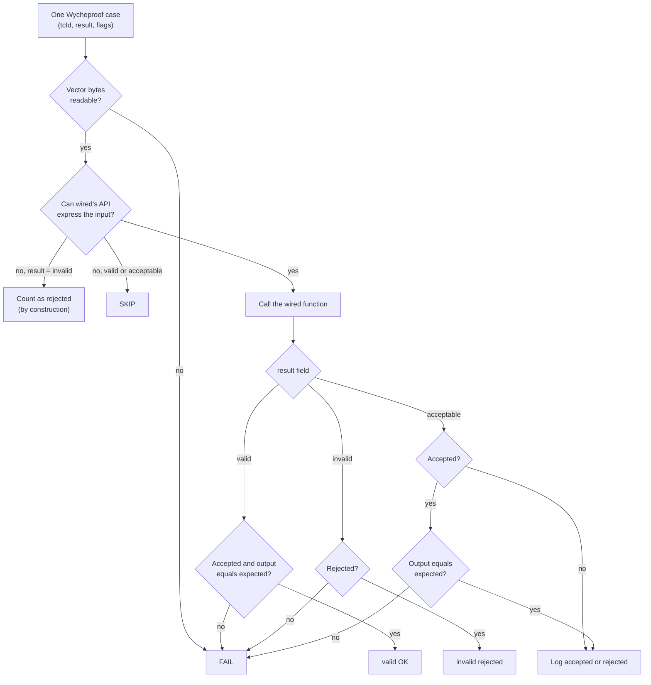

# Wycheproof ベクターの結果

このページが答える問いは 1 つです。他者が書いた既知の攻撃入力を wired の暗号に与えたとき、受け入れるべきものを受け入れ、拒否すべきものを拒否するか。
wired のセキュリティの根拠をレビューする人に向けた文書で、件数が見かけほどには証明していない箇所も示しています。

## Wycheproof とは

[Project Wycheproof](https://github.com/C2SP/wycheproof) は暗号のテストベクター集で、Google で始まり、いまは C2SP が管理しています。
各ベクターはエッジケースか既知の攻撃です。改ざんした認証タグ、正しそうに見える 2 つ目の署名へ再エンコードできる署名、共有秘密をすべてゼロにしてしまう低位数の公開鍵などがあります。
RFC にある通常のベクターを通過する実装でも、このうちいくつかに失敗することがよくあります。

wired はこれを **第三者オラクル** として使います。各ケースの期待される答えは Wycheproof の JSON から取り、wired から取ることはありません。
wired が自分の出力を自分と照らすテストでは、両側に共通するバグを捕まえられないので、この点が重要です。
Wycheproof は RFC / FIPS のテストと BoringSSL のベクター([第三者オラクルとしての BoringSSL テストベクター](boringssl-vectors.md))と並んで動きます。

ベクターは C2SP/wycheproof の `testvectors_v1/` のファイルで、コミット `3fa63dd0344abb611f1fb1d77e119938603ea230` に固定しています。
出どころ、C の配列への変換方法、skip の一覧は [`tests/vectors/wycheproof/README.md`](../../tests/vectors/wycheproof/README.md) にあります。

## ベクターの読み方

Wycheproof のファイルの各ケースには、下の表で参照する 3 つのフィールドがあります。

- **`tcId`**: ファイル内でのケースの番号。失敗はファイル名 + `tcId` で報告されるので、JSON で正確な入力を引ける。
- **`result`**: 正しい実装がそのケースをどう扱うべきか。次に挙げる 3 つの値のどれか。
- **`flags`**: そのケースが何を攻撃しているかを表す短い名前。たとえば `ModifiedTag`(AES-GCM のような AEAD 暗号の認証タグを書き換えた)や `SignatureMalleability`。1 つのケースが複数を持つこともある。

`result` の 3 つの値:

- `valid`: 受け入れ、期待どおりの出力(平文、共有秘密、検証済みの署名)を正確に出さなければならない。
- `invalid`: 拒否しなければならない。受け入れると偽造の成立か仕様違反になる。
- `acceptable`: 仕様がどちらの答えも認めている(たとえば、X25519 の共有秘密がすべてゼロのときに中断する)。受け入れても拒否してもよい。X25519 のテストは、受け入れたうえで共有秘密が誤っているケースも失敗にする。wired がどちらを選んだかは `wyc <file> tcId <n> acceptable: accepted|rejected` としてログに出る。

AEAD、HMAC、HKDF、RSA のドライバーは、`valid` と `invalid` のケースについて下の図のとおりに動きます。
`acceptable` のケースへの「出力の誤り」の検査は X25519 にだけ当てはまります。acceptable なケースが出力を生むプリミティブは X25519 だけだからです。
「Can wired's API express the input?」のノードから出る 2 つの出口に注目してください。下に出てくる **Skip** と「構造上の」拒否は、ここから生まれます。
Ed25519 / X25519 / ECDSA のドライバーには Skip がありません。API が受け取れない入力は単に拒否されるので、それらの行は Skip が 0 になっています。

失敗すると `FAIL <file> tcId <n> flags=<flags>` を出力し、`just test` の実行全体が失敗します。

## 結果(最終更新 2026-10-10)

このスイートは 2026-10-05 に最初に取り込み、P-521 の行は 2026-10-10 に追加しました。
下のすべての行は 2026-10-15 に `just test` の `wyc` サマリー行と照らして確かめ直し、今も一致しています。

列の意味: **Added** はファイル内のケース数です。**valid OK** と **invalid rejected** は、求められた答えを返したケースの数です。**acceptable** はそうしたケースの数で、wired が受け入れた数と拒否した数に分けています。**Fail** は誤った答えを返したケースの数です。**Skip** は、wired の API で表現できない `valid` または `acceptable` のケースの数です(下の Skip の段落を参照)。

| プリミティブ | ファイル | Added | valid OK | invalid rejected | acceptable (accepted / rejected) | Fail | Skip |
|---|---|---:|---:|---:|---|---:|---:|
| AES-GCM | `aes_gcm_test.json` | 316 | 79 | 87 | 0 | 0 | 150 |
| ChaCha20-Poly1305 | `chacha20_poly1305_test.json` | 325 | 256 | 69 | 0 | 0 | 0 |
| X25519 | `x25519_test.json` | 518 | 264 | 0 | 254 (223 / 31) | 0 | 0 |
| Ed25519 | `ed25519_test.json` | 151 | 88 | 63 | 0 | 0 | 0 |
| ECDSA P-256 / SHA-256 | `ecdsa_secp256r1_sha256_test.json` | 484 | 174 | 310 | 0 | 0 | 0 |
| ECDSA P-384 / SHA-384 | `ecdsa_secp384r1_sha384_test.json` | 504 | 194 | 310 | 0 | 0 | 0 |
| ECDSA P-384 / SHA-512 | `ecdsa_secp384r1_sha512_test.json` | 542 | 231 | 311 | 0 | 0 | 0 |
| ECDSA P-521 / SHA-512 | `ecdsa_secp521r1_sha512_test.json`(2026-10-10 に追加) | 542 | 232 | 310 | 0 | 0 | 0 |
| RSA PKCS#1 v1.5 | `rsa_signature_{2048,3072,4096}_sha{256,384,512}_test.json`(9) | 2330 | 63 | 2253 | 9 (0 / 9) | 0 | 5 |
| RSA-PSS | `rsa_pss_{2048,3072,4096}_sha256_mgf1_32_test.json`(3) | 324 | 189 | 135 | 0 | 0 | 0 |
| HMAC-SHA256 | `hmac_sha256_test.json` | 174 | 66 | 108 | 0 | 0 | 0 |
| HKDF-SHA256 | `hkdf_sha256_test.json` | 86 | 83 | 3 | 0 | 0 | 0 |
| SHA-2 | (専用のファイルなし。ECDSA / RSA / HMAC / HKDF の全ケースのダイジェスト) | — | — | — | — | — | — |
| **合計** | 22 ファイル | **6296** | **1919** | **3959** | **263 (223 / 40)** | **0** | **155** |

失敗した tcId とフラグ: **なし**。

ここでは SHA-2 専用の Wycheproof ファイルはありません。
それでも検査はしています。ECDSA と RSA のどのケースもメッセージを先にハッシュするので、ダイジェストが誤っていれば `valid` な署名が失敗として現れます。

**Skip**。AES-GCM は AES-192 のグループと、96 ビットでない nonce を持つ `valid` なケースを skip します。wired の AEAD API は 96 ビットの nonce と 128 ビットのタグしか受け取らないからです。
RSA PKCS#1 は、公開指数が e = 3 の `valid` なケース(2048_sha256: 2、2048_sha512: 1、3072_sha256: 1、3072_sha512: 1)を skip します。wired は e = 65537 しか検証しないからです。

**acceptable の結果**。RSA の tcId 8(`MissingNull`: 署名の中でハッシュを包む ASN.1 構造 DigestInfo が、通常はある空の NULL フィールドを省いているもの。RFC 8017 は検証側が受け入れても拒否してもよいとしている)は、9 ファイルすべてで拒否しています。
X25519 は tcId 32、33、63–86、117、118、154、165、166 を拒否し、残りの 223 件を受け入れます。
拒否したのは共有秘密がすべてゼロになる低位数の公開鍵で、RFC 7748 6.1 と RFC 8446 7.4.2 は、実装がこのとき中断することを認めています。
ハンドシェイクの中で X25519 が何をしているかは、ガイドの [X25519 鍵交換](https://hakkadaikon.github.io/wired/guide/ja/tls/x25519/) のページを見てください。

## 「invalid rejected」が証明すること、しないこと

`invalid` なケースを拒否するのは、求められた振る舞いです。
Wycheproof は、正しい実装が拒否しなければならないケースを `invalid` とします。書き換えたタグ、展性(malleability)のある署名や誤ったエンコードの署名、壊れた RSA パディング、255 × 32 バイト(SHA-256 の出力サイズの 255 倍で、RFC 5869 が認める最大)より長い HKDF の出力などです。
上の **invalid rejected** の件数には、2 つの限界があります。

### 1. 確かめているのは結果だけで、理由は確かめていない

wired が失敗を返せば、そのケースは拒否として数えます。
テストは、*どの* 検査が拒否したかを確かめていません。
たとえば ECDSA の範囲検査に当たるよう作ったケースも、あとで別の理由(ダイジェストの不一致など)で検証に失敗すれば通過します。
これは Wycheproof 自身の合格基準ですが、個々の検査がすべて wired に存在することの証明にはなりません。

HMAC は特別な扱いです。
wired には HMAC の検証関数がないので、テストは wired で MAC を計算し、タグの長さに切り詰め、偽造タグと定数時間で比較します。
108 件の拒否はこの比較によるものです。

### 2. wired の API では表現できない invalid な入力がある

`invalid` な入力の中には、そもそも wired に渡せないものがあります。
たとえば wired の ChaCha20-Poly1305 関数は 96 ビット固定の nonce を受け取るので、64 ビットの nonce を渡す手段がありません。
テストはこうしたケースを **構造上の** 拒否として数えます。答えは正しいものの、その答えを出すために wired のコードは何も動いていません。
上の図の「no, result = invalid」の出口がこれにあたります。

| プリミティブ | ケース数 | 表現できない理由 | フラグ |
|---|---:|---|---|
| AES-GCM | 29 | AES-192 の鍵(実装していない) | ModifiedTag (27), ZeroLengthIv (2) |
| AES-GCM | 4 | 長さゼロの IV(API は 96 ビットの nonce を受け取る) | ZeroLengthIv |
| ChaCha20-Poly1305 | 9 | 0/64/88/104/112/128/160/192/256 ビットの nonce(API は 96 ビットを受け取る) | InvalidNonceSize |
| Ed25519 | 12 | 64 バイトでない署名(`ed25519_verify` は 64 バイト固定の署名を受け取る) | TruncatedSignature, CompressedSignature, SignatureWithGarbage |

したがって、実際に wired のコードを通った拒否は、AES-GCM が 87 件中 54 件、ChaCha20-Poly1305 が 69 件中 60 件、Ed25519 が 63 件中 51 件で、ほかのプリミティブは全件です。
ECDSA は wired の DER 署名デコーダー `ecdsasig_decode` を通ってから検証へ進み、RSA は `rsa_pkcs1_verify` / `rsa_pss_verify` を、HKDF は `hkdf_expand` を通ります。

## フラグ名のテスト

ファイルごとの合計とは別に、一部のフラグには、そのフラグの名前を付けた専用のテストがあります。
そうしたテストはそのフラグを持つ `invalid` なケースだけを実行します。そのため、ある攻撃の種類で回帰が起きると、大きな合計の中の失敗 1 件としてではなく、名前で分かります。

取り込みの際、専用のテストを持たせるフラグとして 6 つを決めました。LowOrderPublic、NonCanonical、ZeroOrderPublic、SmallPublicKey、ModifiedTag、ShortMac です。
それぞれ、`invalid` なケースに現れる場合に、その名前を付けたテストを持ちます。

| テスト | invalid なケース | 拒否 |
|---|---:|---:|
| `test_wyc_aesgcm_invalid_ModifiedTag_rejected` | 81 | 81(wired を通ったもの 54、AES-192 で構造上の拒否 27) |
| `test_wyc_chacha20poly1305_invalid_ModifiedTag_rejected` | 60 | 60 |
| `test_wyc_hmac_invalid_ModifiedTag_rejected` | 108 | 108 |

挙げたフラグのうち残りは、固定したファイルの `invalid` なケースに一度も現れないので、実行するテストがありません。

- LowOrderPublic、SmallPublicKey、NonCanonicalPublic(NonCanonical の攻撃をファイル上ではこう呼ぶ)は、`x25519_test.json` の `acceptable` なケースにしか現れない(このファイルには `invalid` なケースがない)。
- SmallPublicKey は RSA PKCS#1 のファイルでは e = 3 の `valid` なケース 5 件にしか現れず、それらは上の Skip 5 件にあたる。
- ZeroOrderPublic と ShortMac は、22 ファイルのどれにも現れない。

`invalid` なケースに実際に付いているフラグについては、フラグごとの拒否ループがほかにも動いており、どれも見つけたすべてのケースを拒否しています。

- Ed25519: SignatureMalleability, CompressedSignature, InvalidEncoding, TruncatedSignature, SignatureWithGarbage。
- ECDSA: BerEncodedSignature, InvalidEncoding, IntegerOverflow, RangeCheck, MissingZero。
