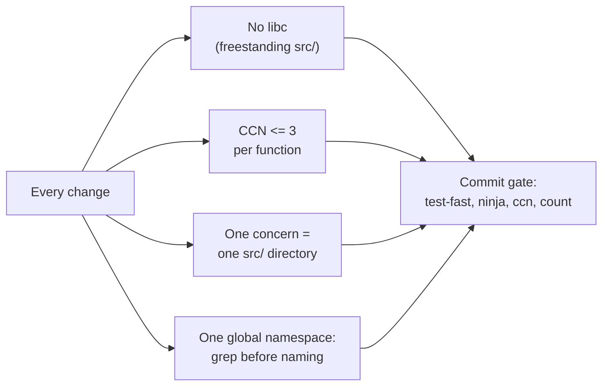

# 開発標準

[ドキュメント](../README.md) › 開発標準

| 項目 | 内容 |
|---|---|
| 目的 | `src/` と `tests/` を変更するときの規則と手順を定める |
| 読む人 | コントリビューター |
| 前提文書 | [開発環境の準備](setup.md) |
| 関連文書 | [アーキテクチャとデータの流れ](../arch/overview.md)、[レイヤー構成](../arch/layers.md) |

## 文書の構成

| 文書 | 内容 | 読むとき |
|---|---|---|
| [開発環境の準備](setup.md) | ツールチェーン、ビルドとテスト、サンプルの起動 | 最初にチェックアウトしたとき |
| [コーディング規約](coding.md) | 必ず守る制約と、その確かめ方 | コードを書く前 |
| [ビルド](build.md) | 2 つのビルド方式とレシピ | ビルドやテストを実行する前 |
| [コミットゲート](commit-gate.md) | コミット前と push 前の検査 | コミットする前 |
| [ドメインの追加](add-domain.md) | 新しいドメインを足す手順 | ディレクトリを増やすとき |
| [テスト](testing.md) | 検証の層の選び方とテストの書き方 | 設計を決めるとき、テストを書くとき |
| [ドキュメント規約](documentation.md) | 文書の構成と書き方 | 文書を書く・直すとき |

## 守る規則の要約

各規則の詳細と確かめ方は [コーディング規約](coding.md) にある。

## 作業の流れ

1. 実装する RFC の節を読み、公開されているテストベクターを探す。
2. テストを先に書き、通る最小のコードを書く。
3. 新しいヘルパーを書く前に、`src/common/bytes/util/`、varint のヘルパー、`fsm_step` で足りないか確かめる。
4. [コミットゲート](commit-gate.md) を通し、30〜50 行のマイクロコミットにする。

コミットメッセージは conventional commit の形式で、関係する RFC の節を書く。`feat(<domain>):` と `test(<domain>):` は別のコミットにする。

`fsm_step` は `src/transport/conn/lifecycle/fsm/` にあるテーブル駆動の状態機械エンジンである。ストリームと接続の状態機械が共有している。
