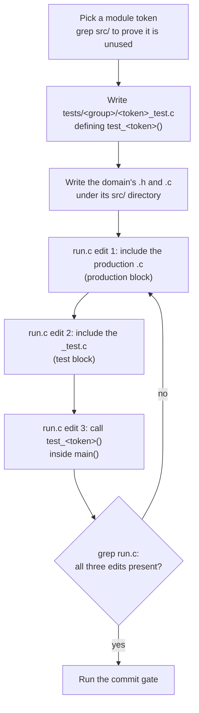

# ドメインの追加

[ドキュメント](../README.md) › [開発標準](README.md) › ドメインの追加

| 項目 | 内容 |
|---|---|
| 目的 | 新しいドメインを足し、テストのビルドに組み込む手順を定める |
| 読む人 | `src/` にディレクトリを足すコントリビューター |
| 前提文書 | [コーディング規約](coding.md)、[ビルド](build.md) |
| 関連文書 | [テスト](testing.md)、[コミットゲート](commit-gate.md) |

## 1. ドメインとは

`src/` の末端のディレクトリで、ヘッダー(型、定数、プロトタイプ)と `.c` の実装を持つ。

| 例 | パス |
|---|---|
| 実装 | `src/common/bytes/varint/varint.{h,c}` |
| テスト | `tests/common/varint_test.c` |

以下、`<token>` は `varint` のようなモジュールのトークンである。

## 2. 手順

1. **トークンを決める。** 内部 API は `<token>_*`、アプリケーションが呼ぶものだけ `wired_<token>_*` にする。`src/` を grep して未使用を確かめる。
2. **テストを先に書く。** `tests/<group>/<token>_test.c` に `void test_<token>(void)` を定義し、`tests/test.h` の `CHECK(...)` を使う。書く内容は [テスト](testing.md#3-テストに入れる検査) にある。
3. **ドメインを書く。** テストを通す最小のコードを書く。
4. **`tests/run.c` を 3 か所編集する。**

   | 場所 | 足す行 |
   |---|---|
   | 本番のブロック | `#include "<path>/<file>.c"` |
   | テストのブロック | `#include "<group>/<token>_test.c"` |
   | `main()` の中 | `test_<token>();` |

   本番の `.c` は、それを使うテストより前に置く。1 つの翻訳単位なので、上で見たものしか呼べない。
5. **編集が入ったか grep で確かめる。** スクリプトでの編集が黙って失敗し、数十のソースがビルドされないまま残ったことがある。
6. **[コミットゲート](commit-gate.md) を通す。** CCN が超えたら関数を分け、名前が衝突したら付け直す。
