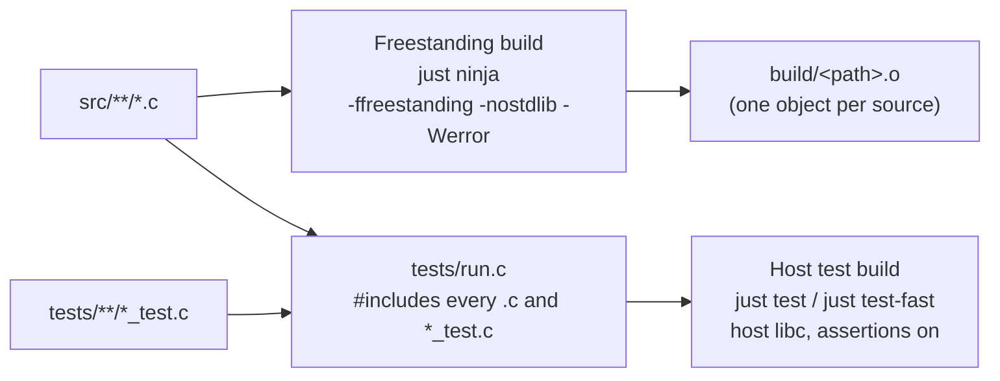

# ビルド

[ドキュメント](../README.md) › [開発標準](README.md) › ビルド

| 項目 | 内容 |
|---|---|
| 目的 | ビルドの 2 つの方式と、レシピの使い分けを定める |
| 読む人 | ビルドやテストを実行するコントリビューター |
| 前提文書 | [はじめに](../getting-started.md)(`just setup` と `nix develop`) |
| 関連文書 | [コミットゲート](commit-gate.md)、[コーディング規約](coding.md) |

## 1. 2 つのビルド方式

| 方式 | レシピ | 確かめること |
|---|---|---|
| Freestanding | `just ninja` | `src/` が libc なしでコンパイルできる |
| ホスト向けテスト | `just test`、`just test-fast` | テストが通る(結果の表示に libc を使う) |

2 つの方式では有効な警告が違う。片方が通っても、もう片方が失敗することがある。

オブジェクト名はソースのフルパスを含む(`build/src/<path>.o`)。`frame.c` のように basename が同じソースが上書きし合わないためである。

## 2. ユニティビルド

`tests/run.c` は、本番の `.c` と `*_test.c` をすべて 1 回ずつ `#include` する 1 つの翻訳単位である。テストはモックではなく本物の実装を動かす。

その代わり、すべての名前が 1 つの名前空間に入る。`static put_bytes` を持つ 2 つのファイルは単独ならコンパイルでき、`run.c` に入った時点で衝突する。

`run.c` は手で編集する。`justfile` は `src/**/*.c` を自動で見つけるが、`run.c` は見つけない。編集の手順は [ドメインの追加](add-domain.md) にある。

## 3. `test` と `test-fast`

| レシピ | `run.c` のコンパイル | ファイルをまたぐ `static`/`typedef`/マクロの衝突 | 使う場面 |
|---|---|---|---|
| `just test` | 1 つの翻訳単位(CI と同じ) | 検出する | 新しい名前を足した差分の push 前 |
| `just test-fast` | 8 つのシャードに分けて並列(`scripts/gen_shards.py`) | 同じシャード内だけ | コミットごと(約 3 倍速い) |

非 `static` の関数の重複はリンクで衝突するので、`test-fast` でも検出できる。どちらも先に `just fmt` を実行し、ソースをその場で整形する。

## 4. レシピ

ビルドと検査はレシピ経由で実行し、`lizard`、`ninja`、`clang`、`clang-format`、`clang-tidy` を直接実行しない。レシピはフラグを固定し、`build.ninja` を作り直し、必要なところで Nix の devShell に切り替える。これでローカルの結果が CI と一致する。

コンパイラーフラグは `scripts/just/flags.sh` の 1 か所で定義する。レシピの本体は 1〜2 行で、長いものは `scripts/just/` のスクリプトである。

### 4.1 ビルド

| レシピ | 内容 |
|---|---|
| `setup` | 初回だけ。Nix がなければ入れる |
| `nix <recipe>` | 固定した devShell の中で任意のレシピを実行する |
| `build` | devShell の中で `fmt` + `ninja` + `lint` |
| `gen-ninja` | ソースの一覧から `build.ninja` を作り直す |
| `ninja [targets]` | freestanding でコンパイルする。ターゲットの例: `examples/word_list/wired_server`、`guide`、`build/src/<path>.o` |
| `lib` | SDK のオブジェクトを `build/libwired.a` にまとめる。`_start` の `sys.o` は含めない |
| `compdb` | clangd 用の `compile_commands.json` を出す |
| `docs` | doxygen の API リファレンスを `docs/sdk/` に作る。公開宣言に doxygen コメントがないと失敗する |

### 4.2 テスト

| レシピ | 内容 |
|---|---|
| `test` / `test-fast` | ユニティテスト(3 章) |
| `check` | `ccn` + `test` |
| `wire-check` | 全ソースが `run.c` に 1 回ずつあり、オブジェクトを 1 つずつ作るか |
| `cov` | ユニティテストの行カバレッジ |
| `valgrind` | ユニティテストを valgrind で動かす。ときどき起きるハングは、まず未初期化の変数を疑う |
| `test-san` | ASan + UBSan 下のユニティテスト。CI の `sanitize` ジョブで実行する |
| `san-check [ids]` | UBSan と境界検査をトラップにした本番ビルドで guide のスニペットを動かす。go と node 22 が要る |
| `golden-check` | `tests/app/moqt_golden.h` がベクターと一致するか |
| `fuzz-smoke` | 各ファズハーネスをビルドして 1 回ずつ動かす |
| `fuzz-ci [secs]` | 各ファズハーネスを `secs` 秒ずつ動かす(既定 120) |
| `guide-verify [ids]` | guide のスニペットを動かし、`golden.txt` と比べる |
| `cbmc` / `cbmc-mutate` | WebTransport セッション参照のライフサイクルを有界モデル検査する。`cbmc-mutate` は仕込んだ 5 つのバグで検査の効きを確かめる |

### 4.3 静的検査と整形

| レシピ | 内容 |
|---|---|
| `fmt` / `fmt-check` | 固定した clang-format で整形する / 整形を確かめる |
| `lint` | clang-tidy(CERT C、`bugprone-*`、`clang-analyzer-*`)。警告 1 つで失敗する |
| `ccn [paths]` | CCN とネストの深さ |
| `halstead-check` | Halstead などの上限([コーディング規約](coding.md#41-上限の値)) |
| `view-check` | 長寿命の状態に保存するビューが、指す先のストレージクラスを明記しているか(`py-check` からも実行) |
