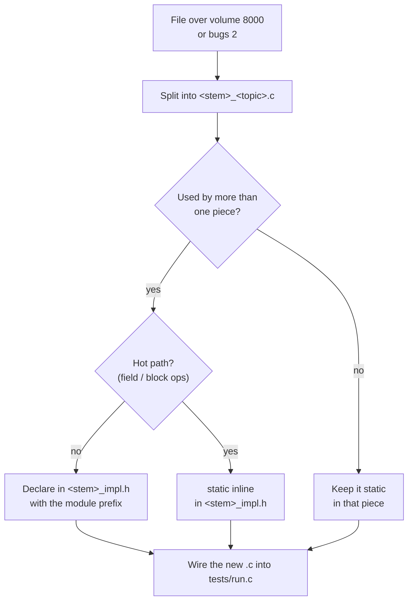
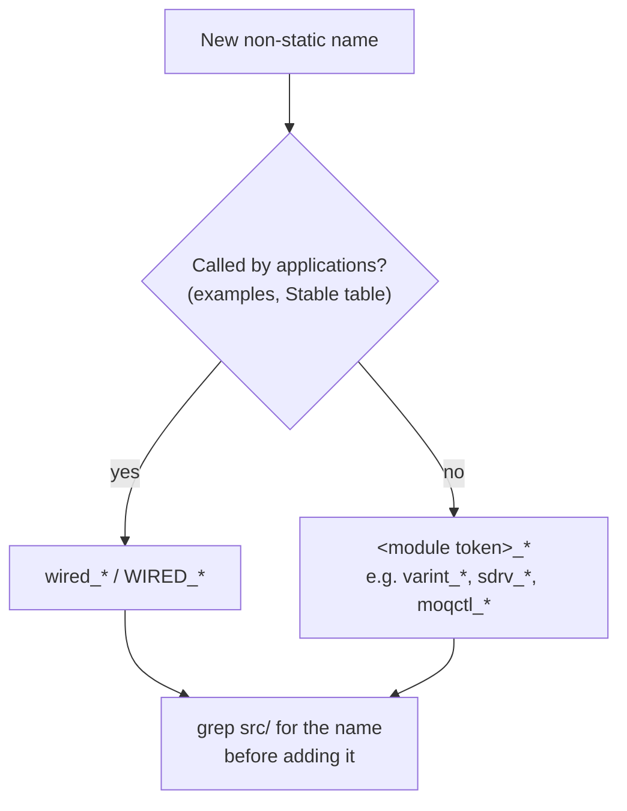

# コーディング規約

[ドキュメント](../README.md) › [開発標準](README.md) › コーディング規約

| 項目 | 内容 |
|---|---|
| 目的 | `src/` のコードが必ず守る制約と、その確かめ方を定める |
| 読む人 | `src/` を変更するコントリビューター |
| 前提文書 | [開発標準](README.md) |
| 関連文書 | [ビルド](build.md)、[コミットゲート](commit-gate.md)、[API の安定性](../api-stability.md) |

## 1. 制約の一覧

1 つでも破った変更は完了扱いにしない。

| 制約 | 理由 | 確かめ方 |
|---|---|---|
| libc と CRT を使わない | 振る舞いとメモリ使用量をホストの libc に左右させない | 下の grep 1 が空、`just ninja` が通る |
| `util/` のヘルパーを再利用する | ユニティビルドで `static` の複製が衝突する | `just test` |
| ISA 固有のコードは `common/arch/` だけに置く | ドメインのコードを移植可能に保つ | 下の grep 2・3 が空 |
| 関数の CCN 3 以下 | RFC の節と並べて小さく読める | `just ccn` |
| ネストの深さ 2 以下 | 同上 | `just ccn` |
| 認知的複雑度 4 以下 | 同上 | `just lint` |
| Halstead・MI・出口・引数・ファイルサイズの上限 | 長すぎる関数とファイルを止める | `just halstead-check` |
| 1 つの関心事は `src/` の 1 ディレクトリ | 振る舞いのコードを 1 回の grep で見つけられる | レビュー |
| 名前は 1 つのグローバル名前空間で一意 | テストはユニティビルドで、全ソースが 1 つの翻訳単位に入る | 名前を付ける前に grep、`just test` |

```sh
# 1: system / standard headers (libc)
grep -rn '#include <' src/
# 2: inline asm and CPU builtins outside common/arch/
grep -rn '__asm__\|__builtin_ia32' src/ | grep -v common/arch/
# 3: raw syscalls outside common/arch/
grep -rn 'syscall[1-6](\|SYS_[a-z]' src/ | grep -v common/arch/
```

## 2. libc を使わない

`src/` はリポジトリのヘッダーだけをインクルードする。システムの型と呼び出しには、リポジトリ独自のファサード `common/platform/sys/syscall.h` を使う(libc の `<sys/syscall.h>` ではない)。

2 つの仕組みで漏れを止める。

| 仕組み | 止めるもの |
|---|---|
| `src/` を `-ffreestanding -nostdlib` でコンパイル | 標準ライブラリに頼る構文 |
| examples と guide を `-nostdlib -static` でリンク | `memcpy` などの libc 呼び出し(リンクで失敗) |

`#include <string.h>` だけはコンパイルが通ってしまうので、grep 1 で検出する。コンパイルを通すために標準ヘッダーを足さず、コードを直す。

## 3. 共有ヘルパーとアーキテクチャ層

### 3.1 `util/`

`src/common/bytes/util/` の inline ヘルパーを使い、同じ `static` を書かない。同じ小さなヘルパーを 2 回目に書くときは、`util/` に inline で移す。

| ヘッダー | 中身 |
|---|---|
| `bytes.h` | バイトのコピー、put、take |
| `be.h` | ビッグエンディアンの格納と読み出し |
| `ct.h` | 定数時間の比較 |
| `num.h` | `u64_max` などの数値ヘルパー |

### 3.2 `common/arch/`

インラインアセンブリ、CPU の builtin、生のシステムコールは `src/common/arch/` に置き、`wired_arch_*` の名前で包む。ドメインのコードは `sysops.h` の型付きラッパーを呼ぶ。

新しいシステムコールは次の順に足す。

1. `x8664/x8664.h` に番号を足す。
2. `sysops.h` にラッパーを足す。
3. [システムコール](../syscalls.md) の表に行を足す。

## 4. 複雑さの上限

### 4.1 上限の値

| 指標 | 単位 | 上限 | レシピ |
|---|---|---|---|
| CCN | 関数 | 3 | `just ccn` |
| ネストの深さ | 関数 | 2 | `just ccn` |
| 認知的複雑度 | 関数 | 4 | `just lint` |
| Halstead volume / difficulty / 推定バグ数 | 関数 | 1000 / 30 / 0.5 | `just halstead-check` |
| MI | 関数 | 65 以上 | `just halstead-check` |
| 出口 / 引数 | 関数 | 4 / 7 | `just halstead-check` |
| Halstead volume / 推定バグ数 | `.c`/`.h` ファイル | 8000 / 2 | `just halstead-check` |

`just metrics`、`just cognitive`、`just halstead` は値を表示するだけである。上限に近い関数を探すときに使う。

### 4.2 CCN を 3 以下に収める書き方

lizard は `if`、`for`、`while`、`&&`、`||`、`?:` をそれぞれ 1 と数える。書く前に分岐を数える。

| よくある形 | 直し方 |
|---|---|
| `if (!take(...) \|\| cond)` のような複合条件 | 条件を名前付きの述語ヘルパーに移す |
| `if (!put(...)) return 0;` が 3 つ以上続く | head と body の 2 つのヘルパーに分ける |
| 長い `if`/`else` や `switch` | 関数ポインターのテーブルで引く |

### 4.3 ファイルが上限を超えたとき

ファイルを `<stem>_<topic>.c` に分ける。



ホットなヘルパーを `static inline` にしないと、オブジェクトごとのビルドでインライン化されず遅くなる。

## 5. ディレクトリと名前

### 5.1 1 つの関心事に 1 つのディレクトリ

1 つの関心事を複数のディレクトリに散らさず、2 つの関心事を 1 つのディレクトリにまとめない。ディレクトリの構成は [アーキテクチャとデータの流れ](../arch/overview.md) を見る。

「処理がない」と思ったら、まず `grep -rn` で探す。部品はあるのに呼ばれていないだけのことが多いからである。

### 5.2 名前の接頭辞



どちらに属するかは [API の安定性](../api-stability.md) の Stable の表で決める。モジュールのトークンはほかのモジュールと重ならないものにする。

### 5.3 名前の衝突

テストのビルドは全ソースを 1 つの翻訳単位にまとめる。そのため `static` 関数、`typedef`、マクロ、定数も含めて、すべての名前が衝突しうる。名前を足す前に grep する。

```sh
grep -rn '<module>_<name>' src/
```

この仕組みは [ビルド](build.md#2-ユニティビルド) にある。
