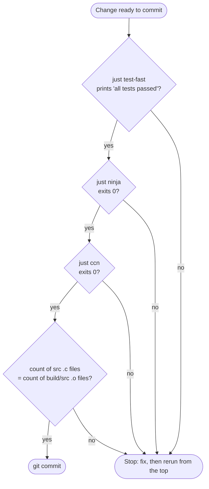

# コミットゲート

[ドキュメント](../README.md) › [開発標準](README.md) › コミットゲート

| 項目 | 内容 |
|---|---|
| 目的 | コミット前と push 前に通す検査を定める |
| 読む人 | コミットするコントリビューター |
| 前提文書 | [ビルド](build.md) |
| 関連文書 | [コーディング規約](coding.md)、`.github/workflows/` |

## 1. コミット前の検査

4 つの検査を順に実行する。どれかが赤なら、直して最初からやり直す。



| 検査 | 止めるもの |
|---|---|
| `just test-fast` | テストの失敗 |
| `just ninja` | freestanding でだけ出るコンパイルエラーと警告 |
| `just ccn` | CCN とネストの深さの超過 |
| ソース数 = オブジェクト数 | `run.c` やビルドに組み込まれず、一度もコンパイルされないソース |

どの検査も、飛ばしたせいで壊れたコミットが `main` に入ったことから足したものである。

## 2. 実行のしかた

赤の結果がコミットに届かないよう、1 つのガード付きコマンドで実行する。

```sh
if just test-fast 2>&1 | grep -q "all tests passed" \
   && just ninja >/dev/null 2>&1 \
   && just ccn \
   && [ "$(find src -name '*.c' | wc -l)" = "$(find build/src -name '*.o' | wc -l)" ]; then
    git commit -m "..."
fi
```

数えるのは `build/src` だけである。`build/shards/` の `test-fast` 用オブジェクトを含めると数がずれる。

次の書き方は、赤でもコミットが進んでしまう。

| 書き方 | 起きること |
|---|---|
| `just check \| tail && git commit` | パイプの終了ステータスが `tail` のものになり、失敗が消える |
| `just check; git commit` | `;` は失敗を無視する |

## 3. push 前の検査

コミットゲートは CI の一部である。差分が下の表のファイルに触れるときは、対応するレシピも実行する。

| CI のジョブ | レシピ | 実行するとき |
|---|---|---|
| test(1 つの翻訳単位) | `just test` | 新しい名前を足した |
| fmt-check | `just fmt-check` | `.c` か `.h` を変えた |
| lint | `just lint` | `src/` を変えた |
| halstead-check | `just halstead-check` | `src/`、examples の C、`scripts/` を変えた |
| golden-check | `just golden-check` | MoQT のテストベクターを変えた |
| fuzz smoke | `just fuzz-smoke` | `src/` の関数シグネチャを変えた |
| py-check | `just py-check` | `scripts/**/*.py` か `tests/scripts/` を変えた |
| sh-check | `just sh-check` | `.sh` か `justfile` を変えた |
| js | `just js-check` | moqt_chat の frontend か e2e を変えた |
| docs(`docs.yml`) | `just docs` | 公開ヘッダーの宣言やコメントを変えた |
| guide snippets(`guide.yml`) | `just guide-verify` | guide のスニペットの出力が変わりうる |

`ccn`、`halstead-check`、`lint` は examples の C も対象にする。frontend と e2e の上限は `js-check` が別に持つ(frontend の CCN は 10 以下、ほかは `scripts/halstead.py` の `PROFILES`)。

ワークフローの全一覧は `find .github/workflows -type f` で確かめる。
