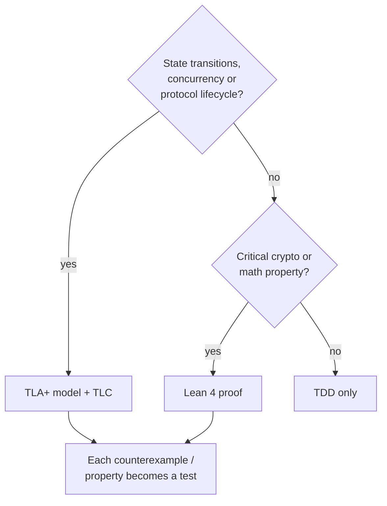

# テスト

[ドキュメント](../README.md) › [開発標準](README.md) › テスト

| 項目 | 内容 |
|---|---|
| 目的 | 検証の層の選び方と、テストに入れる検査を定める |
| 読む人 | 設計を決める、またはテストを書くコントリビューター |
| 前提文書 | [ドメインの追加](add-domain.md) |
| 関連文書 | [テストカバレッジ](../verification/coverage.md)、[要件台帳](../features/README.md) |

## 1. 検証の層の選び方

層はコードを書く前に決める。単純なロジックに重い層を使うのは過剰である。

| 層 | 対象の例 |
|---|---|
| TLA+ | ストリーム、接続、ハンドシェイク、パケット番号空間、クローズと draining、鍵更新、パス、バージョンネゴシエーション、Retry、HTTP/3 の制御状態 |
| Lean 4 | varint のエンコード、パケット番号のデコード、AEAD のラウンドトリップ、輻輳ウィンドウ、RTT の推定、Ed25519 の署名方程式 |
| TDD | それ以外のすべて |

TLA+ の仕様には、わざとバグを入れて検査器が捕まえるかも確かめる。Lean の証明に未完了の `sorry` はない。

仕様と証明はリポジトリの外に置く。リポジトリに入るのは、そこから導いたコードとテストである。性質や反例は、TDD のテストリストの 1 項目ずつに対応させる。

## 2. TDD の手順

1. テストリストを書く。
2. テストが失敗することを確かめる。
3. 通す最小のコードを書く。
4. リファクタリングする。

## 3. テストに入れる検査

各ドメインのテストは、RFC に照らして次の 4 種を含める。

| 検査 | 内容 |
|---|---|
| 公式のゴールデンベクター | RFC や FIPS のベクター。テストに入れる前に手で計算し直す |
| ラウンドトリップ | エンコードしてデコードすると入力に戻る |
| 境界値と同値分割 | 長さ、オフセット、varint のサイズクラス、接続 ID の長さの両端 |
| 不正な入力の拒否 | 切り詰め、改ざん、範囲外の入力を拒否する |

### 3.1 ベクターの扱い

外部から得たベクターが間違っていたことがある(XOR を誤った nonce、途中で切れた ClientHello)。XOR、長さ、オフセットは手で確かめる。

完全なベクターが手に入らないときは、ラウンドトリップ、部分要素のベクター、手計算できる部分を組み合わせる。その組み合わせを、完全なベクターとの一致として扱わない。

### 3.2 バッファーの大きさ

サイズや境界を試すテストは、本番と同じバッファーサイズを共有の定数で使う。本番より大きいテスト用バッファーが、本物のサーバーを壊すオーバーフローを隠していたことがある。
