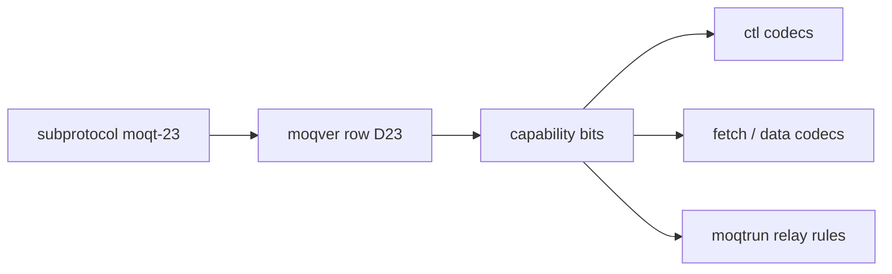

# MoQT draft-23 対応

[ドキュメント](../../README.md) › superpowers › MoQT draft-23 対応

| 項目 | 内容 |
|---|---|
| 目的 | ハブが draft-ietf-moq-transport-23 を話すための設計書 |
| 読む人 | コントリビューター |
| 前提文書 | [draft-22 の要件台帳](../../features/draft-moq-transport-22.md) |
| 関連文書 | [app の詳細設計](../../design/app.md)、[実装している仕様](../../design/specs.md) |

状態: 設計(2026-11-07)。依頼は IETF 公式の draft-23(2026-11-02 公開)への対応である。

## 1. 目標と範囲

| 項目 | 内容 |
|---|---|
| 目標 | WebTransport のサブプロトコルと raw QUIC の ALPN `moqt-23` で、draft-23 のセッションを受ける |
| 既存の版 | draft-18、19、22 はそのまま残す。版ごとの動作は変えない |
| 役割 | これまでと同じく、ハブはセッションのサーバーでありリレーである。クライアント専用の規則は対象外 |
| 対象 | draft-22 からの変更履歴 35 項目と、draft-23 で新しくなった規範文 131 文 |

## 2. 方式

- `moqver` の表に `moqt-23` の行を足す。draft-22 の能力ビットをすべて持ち、差分ごとに新しいビットを持つ。
- 各処理は版番号ではなく能力ビットで分岐する。既存の規約(moqver.h の冒頭)と同じである。
- 差分が出そろうまで、`moqt-23` はサーバーの提示リストに載せない。最後の作業で載せる。

## 3. 裁定

仕様の記述から一つに決まらない点は、次のように決めた。

| 点 | 決定 |
|---|---|
| FETCH の相対 Location filter | Table 6 で relative とあるのは Type 0x01 だけなので、0x01 だけを INVALID_RANGE にする |
| Setup Option 0x09 の符号化 | 奇数の Type なので Length とバイト列で送られ、その中身は vi64 1 つである。余りや不足、65535 未満の値は MALFORMED_KEY_VALUE |
| 実験用の SSTS_ALGORITHMS(0x09) | draft-23 のセッションでだけ別の番号へ移す |
| REDIRECT の Error Detail が 2 つ以上あるとき | 最初のものを使い、残りは無視する |
| SUBSCRIBE_TRACKS の prefix を広げたとき | 新しく一致した既存の Track にも PUBLISH を送る。その要求で PUBLISH 済みの Track には送らない |
| クライアントの PUBLISH に SUBSCRIBE_TRACKS_ID があるとき | ハブは SUBSCRIBE_TRACKS を送らないので、INVALID_PARAMETER で閉じる |
| 上流へ SUBSCRIBE する相手 | §7.7 の MUST に従い、一致する prefix を告知した発行者すべてに送る(§4.1 の SHOULD より優先) |
| 待っている上流の応答が失敗したとき | 待っている下流の要求すべてに REQUEST_ERROR を返す。コードは上流のものを使い、セッションが失われたときは INTERNAL_ERROR にする |
| REQUEST_UPDATE がエラーになったとき | どのエラーでも、その要求を終える。終わった後に届いた REQUEST_UPDATE には応答せずに捨てる |
| まとめて処理した REQUEST_UPDATE が失敗したとき | REQUEST_ERROR 1 件で、まとめた更新すべてに答える |
| 上流の応答を待つ時間 | 上流ごとのタイムアウトは設けない。落ちた上流はセッションごと閉じて INTERNAL_ERROR を返し、黙り続ける上流はその要求を塞ぐ(draft-22 と同じ) |
| MAX_REQUEST_UPDATES の数え方 | 要求が終わった後も数える。捨てた更新は応答待ちのまま残り、まとめた REQUEST_ERROR は覆った更新の数だけ枠を戻す |
| 受信する制御メッセージの上限 | すべての版で 65535 バイトにする。1 KiB を超えるメッセージは、共有の 64 KiB バッファーを借りて組み立てる。借りられないときは INTERNAL_ERROR で閉じる |

## 4. 作業の分け方

| 順 | 内容 | 検証 |
|---|---|---|
| 1 | `moqt-23` の版の行と能力ビット | TDD |
| 2 | 制御メッセージの Length を vi64 にし、受信上限を 65535 にする | TDD |
| 3 | Setup Option 0x09 MAX_CONTROL_MESSAGE_SIZE | TDD |
| 4 | セッションのエラーコード表を draft-23 版にする | TDD |
| 5 | リクエストエラー、PUBLISH_DONE、ストリームリセットのコード | TDD |
| 6 | REQUEST_ERROR の Error Details(REDIRECT、UNSUPPORTED_PROPERTY) | TDD |
| 7 | FETCH への応答を REQUEST_OK にし、相対 filter を INVALID_RANGE にする | TDD |
| 8 | FETCH ストリームの符号化(Object の delta +2、End of Range の差分、0x40C、0x80、0x81) | TDD |
| 9 | FETCH と fill の送り側(End of Group、End of Track、Gone の扱い) | TDD |
| 10 | Gone と存在しない Object のキャッシュの意味 | TDD |
| 11 | FORWARD 0x10 を PAUSED 0x11 に置き換える | TDD |
| 12 | パラメーターの出現範囲の表、FILL_PARAMETERS の個数符号化、NAMESPACE の Parameters | TDD |
| 13 | 重なる名前空間購読、SUBSCRIBE_TRACKS_ID、prefix の更新 | 状態機械のモデル検査と TDD |
| 14 | 同じ prefix の PUBLISH_NAMESPACE の重複 | 13 と同じモデルで検査する |
| 15 | REQUEST_UPDATE を順に処理して順に返す | 状態機械のモデル検査と TDD |
| 16 | リレーが返す LARGEST_OBJECT の計算 | 状態機械のモデル検査と TDD |
| 17 | Property(grease、多重度、範囲外) | TDD |
| 18 | リクエストストリーム上の GOAWAY | TDD |
| 19 | 空の Track Name、NEW_GROUP_REQUEST の送信条件 | TDD |
| 20 | `moqt-23` を提示リストに載せ、draft-23 の要件台帳を作る | 相互運用性テスト(相手実装があれば) |

## 5. 対象外

- draft-23 が 6.1 節で書く、h3 と MOQT の ALPN を 1 つの QUIC 接続で選ぶ方式は、今回は扱わない。
