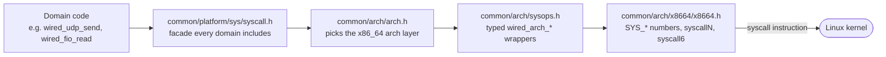

# システムコール

[ドキュメント](README.md) › [参照資料](reference/README.md) › システムコール

| 項目 | 内容 |
|---|---|
| 目的 | SDK が発行する Linux のシステムコールのすべてと、それぞれを呼ぶ箇所と理由を示す |
| 読む人 | システムコールを追加・削除するコントリビューター、seccomp などのポリシーを用意する人 |
| 前提文書 | [概要](overview/README.md)(libc を使わない理由) |
| 関連文書 | [コーディング規約](standards/coding.md)、[I/O ドライバー](architecture/io-drivers.md) |

## 1. 概要

`wired` は libc なし(`-ffreestanding -nostdlib`)でビルドするので、すべてのシステムコールを自分で発行する。数は 42 で、7 つのグループに分かれる。2 つのグループで使うシステムコールは、表には 1 か所にだけ載せる。

| グループ | 用途 | システムコール |
|---|---|---|
| UDP ソケット | ワイヤーループ | `poll`, `socket`, `connect`, `sendto`, `recvfrom`, `sendmsg`, `bind`, `setsockopt`, `fcntl`, `recvmmsg` |
| ファイル I/O | 証明書、ログ、静的ファイル | `read`, `write`, `close`, `pread64`, `openat`, `mkdirat`, `newfstatat` |
| AF_XDP のセットアップ | リングと BPF | `mmap`, `munmap`, `getsockopt`, `bpf`(ほかに `socket`, `bind`, `setsockopt`, `sendto`) |
| スレッドとプロセス | マルチコアのドライバー | `mprotect`, `getpid`, `clone`, `fork`, `exit`, `wait4`, `getppid`, `prctl`, `gettid`, `futex`, `sched_setaffinity`, `sched_getaffinity`, `exit_group` |
| シグナル | グレースフルシャットダウン | `rt_sigaction`, `rt_sigprocmask`, `rt_sigreturn`, `kill`, `rt_sigtimedwait` |
| メモリ | 閉じた接続のページの返却 | `madvise` |
| ユーティリティ | 時計、乱数 | `clock_gettime`, `getrandom` |

## 2. コードの中の置き場所

x86_64 に固有の部分(arch 層)は `src/common/arch/` にまとめてある。SDK のほかの部分はレジスターや呼び出し番号に触れない。

| ファイル | 中身 | 使う場所 |
|---|---|---|
| `src/common/platform/sys/syscall.h` | すべてのドメインがインクルードするファサード。`common/arch/arch.h` を通して arch 層を取り込む | すべてのドメイン |
| `src/common/arch/sysops.h` | システムコールごとに 1 つの型付きラッパー `wired_arch_<name>`(例: `wired_arch_openat`) | ドメインのコード |
| `src/common/arch/x8664/x8664.h` | `SYS_*` の呼び出し番号、生の `syscallN` マクロ、命令を実行するインラインアセンブリの `syscall6` | `src/common/arch/` の中だけ |

次の 2 つは単純な C のラッパーにできないので、`src/common/arch/x8664/` に手書きのアセンブリで置く。理由は表のそれぞれの行にある。

| 関数 | 用途 |
|---|---|
| `wired_arch_clone_raw` | 新しいスレッドが新しいスタックで動き始める |
| `wired_arch_sigreturn_restorer` | シグナルハンドラーからの戻り道 |

## 3. マルチコアのドライバー

表の行は 2 つのマルチコアのドライバーのどちらかを名前で示す。各ドライバーの仕組みは [I/O ドライバー](architecture/io-drivers.md) にある。

| ドライバー | フラグ | 構成 | ソース |
|---|---|---|---|
| フォーク型ワーカードライバー | `--workers N` | N 個のプロセスをフォークし、スーパーバイザープロセスが見守る | `app/http3/server/srvworkers/srvworkers.c` |
| スレッドドライバー | `--cores a,b,c` | 1 つのプロセスの中で CPU ごとに 1 スレッドを動かし、制御スレッドがまとめる | `app/http3/server/srvthreads/srvthreads.c` |

## 4. 表

1 行に 1 つのシステムコールを、システムコール番号の順に並べる。グループごとの一覧は 1 章にある。

「定義場所」列はどの行も `syscall.h`(2 章のファサード)で、番号そのものは `x8664.h` で定義する。表のパスは `src/` からの相対パスで、ファイルが初めて出てくるときだけフルパスで書く。

| システムコール | 番号 | 定義場所 | 説明 | `wired` が呼ぶ理由 |
|---|---|---|---|---|
| `read` | 0 | `syscall.h` | ファイルディスクリプターからバイトを読む。 | `common/platform/fio/fio.c`: `wired_fio_read` がループで呼び出し側のバッファーを埋め(`fio_fill`)、バッファーより大きいファイルを見つけるために 1 バイトのあふれ検査をする(`fio_full_result`)。例: 証明書・鍵の PEM ファイルの読み込み。 |
| `write` | 1 | `syscall.h` | ファイルディスクリプターにバイトを書く。 | `fio.c`: `wired_fio_append`(チケット・ログの保存)と `wired_fio_write_new`(ファイル全体の置き換え)が、書き込みが途中までで返ったときにループで書き続ける。`common/platform/debug/debug.c`: `wired_log_str`/`wired_log_ts` が整形したトレース行を fd 2(stderr)に書く。`common/fmt/fmt.c`: `wired_dprintf` が整形した出力を任意の fd に書く。`common/bytes/text/text.c`: `wired_dump_text` と 16 進ダンプが生のバイトや 16 進にしたバイトを書き、どちらも途中までで返った書き込みをループで続ける。 |
| `close` | 3 | `syscall.h` | ファイルディスクリプターを閉じる。 | 後始末: `wired_fio_read`/`wired_fio_append`/`wired_fio_write_new`/`wired_fio_close` が自分で開いたファイルを閉じる。`wired_udp_close` が UDP ソケットを閉じる。`client_close`(`tls/handshake/roles/client/client.c`)/ `wired_server_close`(`tls/handshake/roles/server/serverio.c`)が、接続のソケット fd が設定されていれば閉じる。`xsksetup_unwind` が AF_XDP ソケットを閉じ、`srvxdpbpf_close_fd`(`app/http3/server/srvxdpbpf/srvxdpbpf.c`)が XSKMAP と XDP プログラムの fd を閉じる。 |
| `poll` | 7 | `syscall.h` | 少数のファイルディスクリプターのイベントをタイムアウト付きで待つ。 | `poll_wait_readable`(`transport/io/socket/poll/wait.c`)が 1 つの fd(UDP ソケット)で、読めるようになるか `timeout_ms` が過ぎるまでブロックし、サーバーのワイヤーループ(`app/http3/server/srvrun/srvrun.c`)を動かす。サーバーが優先アドレスのソケットでも待ち受けるときは、`poll_wait_readable2` が 1 回の呼び出しで両方を見張る。`srvworkers.c` のスーパーバイザーは、`wait4` が失敗したとき(例: `ECHILD`)だけ、fd 0 個の `poll` で 100 ms 休む。 |
| `mmap` | 9 | `syscall.h` | ファイル・fd か無名メモリを裏付けにして、ページをプロセスのアドレス空間にマップする。 | `xsksetup_mmap`/`xsksetup_umem`(`transport/io/xdp/xsksetup/xsksetup.c`)が UMEM(無名の領域 1 つ)と 4 つの AF_XDP リングを、ソケットのリングごとの `pgoff` でマップする。これでドライバーはカーネルと共有するメモリを直接指すポインターを得る。スレッドのランタイム(`common/platform/thread/thread.c`)が各ワーカースレッドのスタックをマップする。スレッドドライバー(`srvthreads.c`)が、ワーカーごとの env テーブルと N*N のブロードキャスト受信箱のメッシュを、コア数に合わせた大きさでマップする。 |
| `mprotect` | 10 | `syscall.h` | マップしたページの保護属性を変える。 | スレッドのランタイムが各スレッドのスタックの最下位ページを `PROT_NONE` のガードページにする。スタックがあふれたときに、隣のマッピングを気づかないうちに壊さず、フォールトになる。 |
| `munmap` | 11 | `syscall.h` | マップした領域を解除する。 | `xsksetup_munmap` は `xsksetup_unwind`/`xsksetup_close`(`xsksetup.c`)から呼ばれ、後始末のときや、`xsksetup_open` の後のほうの段階がセットアップの途中で失敗したときに、UMEM とリングのマッピングを解放する。スレッドのランタイムが join したスレッドのスタックのマップを解除する。`srvthreads.c` が後始末で 2 つのマップを両方解放する。 |
| `rt_sigaction` | 13 | `syscall.h` | シグナルハンドラーを登録する。 | `app/http3/server/sigterm/sigterm.c`: `wired_sigterm_install` / `wired_sighup_install` が `SIGTERM` と `SIGHUP` のハンドラー(サーバーのグレースフルシャットダウン / 設定の再読み込み)を `SA_RESTORER` 付きで登録する。x86_64 のカーネルには既定の戻り道がないため、restorer のないハンドラーにシグナルを届けると、プロセスが `SIGSEGV` で終了する。 |
| `rt_sigprocmask` | 14 | `syscall.h` | 呼び出したスレッドへのシグナル配送をブロック・解除する。 | シグナルを失ったり誤った相手に届けたりしないよう、3 か所で `SIGTERM`/`SIGHUP`(と `SIGCHLD`)をブロックする。スレッドドライバーではワーカーの作成の前後(`sigterm.c` の `wired_sigmask_block_shutdown`/`wired_sigmask_unblock_shutdown`)、フォーク型ワーカードライバーでは各 `fork` の前後と各 `wait4` の前。[競合を避ける順序](#5-競合を避ける順序)を参照。 |
| `rt_sigreturn` | 15 | `syscall.h` | シグナルハンドラーから割り込まれたコンテキストへ戻る。 | `wired_arch_sigreturn_restorer`(`common/arch/x8664/sigret.c`): `sigterm.c` が `SA_RESTORER` の行き先として渡す、手書きの naked asm のトランポリン。libc の `restore_rt` の代わり(freestanding では、それを用意する libc がない)。 |
| `pread64` | 17 | `syscall.h` | ファイル位置を動かさずに、指定したオフセットからファイルディスクリプターを読む。 | `fio.c`: `wired_fio_pread` がファイルの 1 チャンクを明示したオフセットから読む。`examples/word_list` はこれで、大きな静的ファイル全体を読み込まずに、レスポンスごとの body のバッファーへ流し込む。 |
| `madvise` | 28 | `syscall.h` | メモリ範囲についてカーネルに助言する。`MADV_DONTNEED` はその範囲のページを捨て、次に触れたときにはゼロとして読める。 | `wired_arch_madvise`(`common/arch/sysops.h`)は、接続を閉じるたびに `srvrun_release_tables`(`srvrun_free.c`)から 1 回呼ばれ、閉じたスロットのリクエスト / WT ストリームのテーブル、受信した DATAGRAM、WT の送信用の一時領域、respstore の行を返却する。これで、アイドル状態のサーバーの常駐メモリはピークのまま残らず、下がる。 |
| `getpid` | 39 | `syscall.h` | 呼び出したプロセスの ID を返す。 | `srvworkers.c` が各 `fork` の前にスーパーバイザーの pid を保存し、ワーカーがそれを `getppid` と比べられるようにする。 |
| `socket` | 41 | `syscall.h` | ソケットを作る。 | `wired_udp_socket`(`transport/io/socket/io/udp.c`)がデュアルスタックの `AF_INET6` UDP ソケットを作り(IPv4 のピアは v4-mapped アドレスで届く)、IPv6 が使えないとき(`EAFNOSUPPORT`)は `AF_INET` に切り替える。クライアントとサーバー(`wired_server_listen`)の両方のセットアップで使う。`xsksetup_open` が `AF_XDP` ソケットを作る。`wired_udp_path_mtu`(`udp.c`)がピアへの経路のカーネルの path MTU を読むために使い捨ての UDP ソケットを開く(読んだらすぐ閉じる)。 |
| `connect` | 42 | `syscall.h` | ソケットの既定の相手を設定する。 | `wired_udp_path_mtu`(`transport/io/socket/io/udp.c`)が使い捨ての UDP ソケットをピアに connect し、`IP_MTU`/`IPV6_MTU` を読めるようにする(これらは connect 済みのソケットでないと読めない)。サーバーは接続ごと、新しい経路ごと(`srvrun_pmtu_start`)にこれを呼び、DPLPMTUD の探索の上限をローカルのリンクで抑える(RFC 8899 3.5)。データグラムは送らない。 |
| `sendto` | 44 | `syscall.h` | データグラムを送る。宛先のアドレスを明示してもよい。 | `wired_udp_send`(`udp.c`)が UDP データグラムを 1 つ送る。GSO が使えないときの `wired_udp_send_batch` の、セグメントごとの代替ループでも使う。`xsksetup_kick_tx`(`xsksetup.c`)が空の `MSG_DONTWAIT` 送信を出してカーネルを起こし、AF_XDP の TX リングを送信させる。 |
| `recvfrom` | 45 | `syscall.h` | データグラムを受け取る。送信元のアドレスを取得してもよい。 | `udp.c` の `wired_udp_recv`(送信元が不要なとき)と `wired_udp_recvfrom`(ピアのアドレスを取得する)。`recvmmsg` が使えないときの `wired_udp_recvmmsg_fallback` の、メッセージごとの代替ループでも使う。 |
| `sendmsg` | 46 | `syscall.h` | `struct msghdr` で記述したメッセージを送る(補助データ / cmsg を付けられる)。 | `wired_udp_send_gso`(`udp_cmsg.c`)が `UDP_SEGMENT` 制御メッセージを付け、1 回のシステムコールで GSO で分割したデータグラムの一群をまとめて送り出す。`wired_udp_send_tos`(`udp_tos.c`)が `IP_TOS`/`IPV6_TCLASS` の cmsg の組を付けて 1 つのデータグラムの ECN ビットを設定し、`wired_udp_send_gso_tos` はその組を `UDP_SEGMENT` の後ろに置いて、GSO の一群全体を Not-ECT で送り出す。 |
| `bind` | 49 | `syscall.h` | ソケットをローカルのアドレスに結びつける。 | `wired_udp_bind`(`udp.c`)が待ち受けポートに bind する。サーバー側では `wired_server_listen` から呼ばれる。`xsksetup.c` が AF_XDP ソケットをインターフェースのキューに bind する。 |
| `setsockopt` | 54 | `syscall.h` | ソケットオプションを設定する。 | `udp.c`: デュアルスタック(`wired_udp_socket` での `IPV6_V6ONLY`=0)、ECN の付与と受信(`wired_udp_ect0_enable`, `wired_udp_recvtos_enable`)、Path-MTU の探索のためにカーネルの PMTU を止めて DF ビットを立てる設定(`IP_MTU_DISCOVER`/`IPV6_MTU_DISCOVER` = `IP_PMTUDISC_PROBE`, `wired_udp_pmtu_probe_enable`)、ワーカーごとのソケットのための `SO_REUSEPORT`(`wired_udp_reuseport_enable`)、ビジーポーリング(`wired_udp_busy_poll_enable` とその仲間)、`SO_INCOMING_CPU`(`wired_udp_incoming_cpu_set`)。`xsksetup.c`: AF_XDP の UMEM の登録(`XDP_UMEM_REG`)とリングのサイズ設定(`xsksetup_ring_size`)。 |
| `getsockopt` | 55 | `syscall.h` | ソケットオプションを読む。 | `xsksetup_get_offsets`(`xsksetup.c`)が `XDP_MMAP_OFFSETS` を読み、各リングを mmap する前に producer/consumer/ディスクリプターのバイトオフセットを知る。`xsksetup_stats` が `XDP_STATISTICS` を読み、AF_XDP ソケットのカーネル側のドロップ・フィルのカウンターを報告する。`wired_udp_path_mtu`(`udp.c`)が connect 済みの使い捨てソケットで `IP_MTU`/`IPV6_MTU` を読み、DPLPMTUD の上限にする。 |
| `clone` | 56 | `syscall.h` | フラグに応じて呼び出し元のアドレス空間を共有する、新しいスレッド(またはプロセス)を作る。 | `wired_thread_start`(`thread.c`)が、mmap したばかりのスタックでワーカースレッドを 1 つ起動する(`CLONE_VM\|FS\|FILES\|SIGHAND\|THREAD\|SYSVSEM\|PARENT_SETTID\|CHILD_CLEARTID`)。asm のトランポリン `wired_arch_clone_raw`(`common/arch/x8664/clone.c`)を通す。子は新しいスタックの上で戻るので、単純な C のラッパーでは発行できない。`PARENT_SETTID` を使う理由は[競合を避ける順序](#5-競合を避ける順序)を参照。 |
| `fork` | 57 | `syscall.h` | 呼び出し元を複製した子プロセスを作る。 | `srvworkers.c`: `wired_srvworkers_run` がフォーク型ワーカードライバーのために、何も共有しない N 個のワーカープロセスをフォークする。各ワーカーは `SO_REUSEPORT` で同じポートに bind する。親は残って、ワーカーを再起動するスーパーバイザーになる。 |
| `exit` | 60 | `syscall.h` | 呼び出したプロセス(またはスレッド。最後のスレッドが終わるとプロセスが終わる)を終了する。 | `common/platform/sys/sys.c` の汎用の freestanding な `_start` が、処理を終えたら `exit(0)` を呼ぶ。`wired.h` がアプリケーションのバイナリに出力する `WIRED_MAIN` の `_start` スタブは、`wired_main` の戻り値で終了する。`wired_die`(`common/platform/exit/exit.c`)が致命的なエラーで `exit(1)` を呼ぶ。clone のトランポリン `wired_arch_clone_raw`(`common/arch/x8664/clone.c`)が終わったワーカースレッドを終了させ、これで `CHILD_CLEARTID` の wake が発火する。 |
| `wait4` | 61 | `syscall.h` | 子プロセスの状態が変わるのを待つ。 | `srvworkers.c` のスーパーバイザーのループが `wait4(-1, ..., WNOHANG)` でワーカーを回収し、クラッシュしたワーカーの代わりを再びフォークする。フォーク型ワーカードライバーをクラッシュから立ち直らせるためのもの。0 で終了したワーカーと、`SIGTERM` 後のワーカーは置き換えない。 |
| `kill` | 62 | `syscall.h` | プロセスにシグナルを送る。 | `srvworkers.c` のスーパーバイザーが自分で `SIGTERM` を受け取ったあと、生きている各ワーカーに `SIGTERM` を 1 回ずつ転送する。これで、スーパーバイザーが終了する前にワーカーがドレインを済ませる。 |
| `fcntl` | 72 | `syscall.h` | ファイルディスクリプターのフラグを読む・設定する。 | `poll_set_nonblock`(`transport/io/socket/poll/nonblock.c`)が UDP ソケットに `O_NONBLOCK` を設定し、送受信の呼び出しがブロックせずにすぐ戻るようにする。これで、待ちはすべて `poll` で動くループが受け持つ。 |
| `getppid` | 110 | `syscall.h` | 親プロセスの ID を返す。 | 起動したばかりの `srvworkers.c` のワーカーは、`getppid` が `fork` の前に保存した pid と一致しなければ(`PR_SET_PDEATHSIG` を設定する前にスーパーバイザーが死んだ)、すぐに終了する。 |
| `rt_sigtimedwait` | 128 | `syscall.h` | ブロックしたシグナルの集合のどれかを待ち、それを消費する。 | `srvworkers.c` のスーパーバイザーが `SIGCHLD`/`SIGTERM` をブロックし、終了したワーカーがいないときはここで眠る。目を覚ますのはワーカーが終了したときかシャットダウンを求められたときだけで、定期的には起きない。 |
| `prctl` | 157 | `syscall.h` | プロセス制御の操作。 | `srvworkers.c`: 各ワーカーが `PR_SET_PDEATHSIG(SIGTERM)` を設定し、スーパーバイザーが死んだらドレインするようにする。 |
| `gettid` | 186 | `syscall.h` | 呼び出したスレッドのカーネルのスレッド ID を返す。 | `wired_thread_tid`(`thread.c`): スレッドローカルストレージを使わずに、呼び出したワーカーを特定する(例: ブロードキャストを送信元ワーカーの受信箱の行に対応づける)。 |
| `futex` | 202 | `syscall.h` | ユーザー空間の 32 ビットのワードで待つ / 起こす(メモリ上のワードをカーネルの助けを借りて待つ)。 | `wired_thread_join`(`thread.c`)がスレッドの tid ワードで `FUTEX_WAIT` して眠り、カーネルの `CHILD_CLEARTID` の終了処理がそのワードをゼロにして待っているスレッドを起こすまで待つ。スレッドドライバーの制御スレッド(`srvthreads.c`)も、アイドル時のティックとしてシャットダウン用のワードをタイムアウト付きで待つ。 |
| `sched_setaffinity` | 203 | `syscall.h` | スレッドを CPU の集合に固定する。 | `app/http3/server/srvpin/srvpin.c`: `wired_srvpin_bind_self` が呼び出したワーカーを 1 つのコアに固定する。`--pin-core`、`--pin-cores`、`--cores` は最終的にこれになる。 |
| `sched_getaffinity` | 204 | `syscall.h` | スレッドが使ってよい CPU の集合を読む。 | `srvpin.c`: `wired_srvpin_cpu_count` がプロセスの動ける CPU を数える。これが `--workers 0` のときの既定のワーカー数になる。 |
| `clock_gettime` | 228 | `syscall.h` | システムの時計を読む。 | `common/platform/clock/clock.c` の `clock_ymdhms` が、クライアントの証明書の有効期間の検査(`tls/handshake/roles/client/client.c`。呼び出し元はここだけ)のために `CLOCK_REALTIME` を読む。同じファイルの `wired_clock_epoch_secs` が、セッションチケットと Retry トークンの鍵のローテーション、チケットの発行時刻と鮮度の検査(RFC 8446 4.6.1)のために、`CLOCK_REALTIME` を Unix 秒で読む。`common/platform/clock/mono.c` の `clock_mono_ms` が、間隔の計測(接続のアイドル時間、RFC 9000 10.1)のために `CLOCK_MONOTONIC` を読む。`debug.c` の `wired_log_ts` がトレース行にタイムスタンプを付けるために `CLOCK_REALTIME` を読む。 |
| `exit_group` | 231 | `syscall.h` | 呼び出したプロセスのすべてのスレッドを終了する。 | `srvworkers.c`: フォークしたワーカーのサーブループが戻ったら、`exit_group(0)` でプロセス全体を終了する。これで、スーパーバイザーの `wait4` には半分死んだ子ではなく、正常な終了が見える。 |
| `openat` | 257 | `syscall.h` | ディレクトリ fd からの相対でファイルを開く(または作る)。 | `fio.c`: `wired_fio_read`/`wired_fio_open` がファイルを読み取り専用で開く(例: 証明書・鍵の PEM、流し込む静的ファイル)。`wired_fio_append` がファイルを追記用に開く(なければ作る。例: チケット・ログの保存)。`wired_fio_write_new` が `O_TRUNC`(モード 0644)で開き、ファイルの中身を置き換える(例: 受け取った WebTransport のアップロードの保存)。どれも `AT_FDCWD` からの相対で開く。 |
| `mkdirat` | 258 | `syscall.h` | ディレクトリ fd からの相対でディレクトリを作る。 | `fio.c`: `wired_fio_mkdir` が出力先のディレクトリ(モード 0755。`EEXIST` は成功として扱う)を `AT_FDCWD` からの相対で作る。例: `wired_fio_write_new` の結果を置く、エンドポイントごとのダウンロードディレクトリ。 |
| `newfstatat` | 262 | `syscall.h` | ディレクトリ fd からの相対でファイルの stat を取る。 | `fio.c`: `wired_fio_size` が配信する前にファイルのサイズを読む。これで、静的ファイルのレスポンスはファイル全体を先に読まなくても、サイズを決めてチャンクに分けられる。 |
| `recvmmsg` | 299 | `syscall.h` | 1 回のシステムコールで複数のデータグラムを受け取る。 | `wired_udp_recvmmsg`(`udp.c`)が 1 回の呼び出しで最大 `WIRED_RECVMMSG_MAX` 個(64。スタックに置ける大きさの固定の上限。QUIC で一度にまとめて読む数は少ない)のデータグラムを取り出し、負荷が高いときのシステムコールのオーバーヘッドを減らす。`wired_udp_recvmmsg_nowait` は同じことを `MSG_DONTWAIT` 付きで行い、キューに何もなければすぐ戻る。 |
| `getrandom` | 318 | `syscall.h` | カーネルの CSPRNG(暗号論的に安全な乱数生成器)の乱数でバッファーを埋める。 | `common/platform/rng/rng.c` の `rng_bytes` が SDK の唯一の乱数源で、接続 ID、鍵の材料、nonce に使う。求めた長さが埋まるまでループする。 |
| `bpf` | 321 | `syscall.h` | `bpf(2)` のコマンドを発行する(マップの作成・更新、プログラムのロード、リンクの作成)。 | `transport/io/xdp/xdpbpf/xdpbpf.c` が AF_XDP へのリダイレクトを用意する。`xdpbpf_map_create`(`BPF_MAP_CREATE`)が XSKMAP を作り、`xdpbpf_map_set`(`BPF_MAP_UPDATE_ELEM`)が 1 つのキューのソケット fd をそこに入れ、`xdpbpf_prog_load`(`BPF_PROG_LOAD`)が `xdpbpf_prog_build` で組み立てた XDP プログラムをロードし、`xdpbpf_link_create`(`BPF_LINK_CREATE`)がそれをインターフェースに取り付ける。 |

## 5. 競合を避ける順序

表のいくつかの行は決まった順序で処理をする。どの順序も、シグナルやスレッド ID が失われる競合をふさぐ。

| 対象 | 順序 | ふさぐ競合 |
|---|---|---|
| スレッド ID のワード(`clone`) | `PARENT_SETTID` を付け、子が動き出す前にカーネルが新しい tid をワードに書く。`wired_thread_join` は、スレッドの終了時にカーネルがそのワードをゼロにする(`CHILD_CLEARTID`)まで待つ | `clone()` が戻ったあとで親が tid を書くと、子がもう終了してワードがゼロになっていることがある。親の遅れた書き込みがそのゼロを上書きし、join が終わらない |
| スレッドが受け継ぐシグナルマスク(`rt_sigprocmask`、スレッドドライバー) | ワーカースレッドを作る前に `SIGTERM`/`SIGHUP` をブロックする。新しいスレッドはマスクを受け継ぐ。そのあと制御スレッドだけがブロックを解除する | ワーカーがこれらのシグナルを受け取る隙間がない。プロセス宛てのシャットダウンと再読み込みのシグナルを受け取るのは制御スレッドだけになる |
| `fork` の前後のマスク(フォーク型ワーカードライバー) | スーパーバイザーは各 `fork` の前後でシグナルをブロックする | 起動したばかりのワーカーに転送した `SIGTERM` は、そのワーカーがハンドラーを既定に戻すまで保留される |
| `wait4` の前のマスク(フォーク型ワーカードライバー) | スーパーバイザーは各 `wait4` の前に `SIGCHLD`/`SIGTERM` をブロックする | `wait4` から `rt_sigtimedwait` で眠るまでの間に上がったシグナルは保留され、その眠りを起こすので、失われない |

## 6. `epoll` ではなく `poll` を使う理由

`epoll` が `poll` より有利なのは、1 つのループが多くの fd を見張るときである。カーネルが見張りのリストを持つので、待つたびにリストを渡し直さずに済む。その代わり、fd が 1 つ増え、用意のために `epoll_create`/`epoll_ctl` の呼び出しが要る。

`wired` のワイヤーループが見張る fd は 1 つか 2 つである。QUIC はすべての接続を 1 つの UDP ソケットで運び、接続 ID で区別するので、サーバーのループ(`srvrun.c`)は 1 つのソケットで待つ。

2 つ目のソケットを足すのは優先アドレス(RFC 9000 9.6)を広告するときだけで、そのときは `poll_wait_readable2` が同じ呼び出しで両方を見張る。

fd が 1 つか 2 つなら、`poll` の負担は `epoll` と変わらず、管理する fd も増えない。マルチコアのドライバーは 1 つのループに見張らせる fd を増やさずに、それぞれ自分のソケットを持つループの数を増やす。この選択を見直す条件は、1 つのループが多くの fd を待つようになったときである。

## 7. 新しいシステムコールの追加

番号と命令は arch 層に置き、ドメインのコードには型付きのラッパーだけを見せる。

1. `#define SYS_<name> <number>` を `src/common/arch/x8664/x8664.h` に追加する。番号はすべて arch 層に置き、呼び出し箇所の近くには置かない。
1. 型付きの `wired_arch_<name>` ラッパーを `src/common/arch/sysops.h` に追加する。引数はカーネルの順に並べ、構造体のポインターは `void*` にし、戻り値は負の値が -errno を表す生の i64 のままにする。ドメインからはそのラッパーだけを呼ぶ。`src/common/arch/` の外では生の `syscallN` や `__asm__("syscall")` を使わない。
1. 4 章の表に行を追加する。システムコール名、番号、定義場所、そのシステムコールが何をするかの 1 行の説明、`wired` がそれを必要とする理由(どのサブシステムの、どの呼び出し箇所で、何を可能にするか)を書く。
