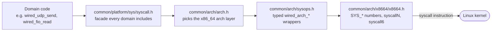

# Syscalls

[Docs](README.md) › Syscalls

This page lists every Linux system call the `wired` SDK makes, what each
one does, and which part of the SDK needs it. Read it when you want to know
what the SDK asks of the kernel (for a sandbox or a seccomp policy, the
Linux filter that limits which syscalls a process may make), or
when you add or remove a syscall yourself.

> **At a glance** — 41 syscalls total, in six groups: UDP sockets (the wire
> loop), file I/O (certs, logs, static files), AF_XDP setup (rings and BPF),
> threads and processes (the multi-core drivers), signals (graceful
> shutdown), and utilities (clock, randomness). The table below is a lookup
> reference — you don't need to read it top to bottom.

## What a syscall is, and why `wired` issues its own

A syscall (system call) is how a program asks the operating system kernel
to do something it cannot do alone: open a file, send a UDP packet, start a
thread, read the clock. The program puts a call number and its arguments in
CPU registers and executes a special instruction (`syscall` on x86_64); the
kernel does the work and returns a result, or a negative error code.

Most C programs never see this, because the C standard library (libc)
wraps each syscall in a function such as `read()` or `sendto()`. `wired`
is built without libc (`-ffreestanding -nostdlib`), so nothing provides
those functions. The SDK issues every syscall itself, which is why it can
list all of them here.

## Where syscalls live in the code

The x86_64-specific parts, called the arch layer below, are kept in one
corner, `src/common/arch/`, so the rest of the SDK never touches registers
or call numbers:

- **`src/common/platform/sys/syscall.h`** is the facade every domain
  includes. It pulls in the arch layer through `common/arch/arch.h`.
- **`src/common/arch/sysops.h`** holds one typed `wired_arch_<name>`
  wrapper per syscall, e.g. `wired_arch_openat`. Domain code calls only
  these.
- **`src/common/arch/x8664/x8664.h`** holds the `SYS_*` call numbers, the
  raw `syscallN` macros, and `syscall6`, the inline-asm sequence that
  executes the instruction. Only code inside `src/common/arch/` uses them.

Follow the arrows to see how a call such as `wired_udp_send` reaches the
kernel. Each box between the domain code and the kernel is one header; only
`x8664.h`, the last of them, knows it runs on x86_64.

Two calls cannot be plain C wrappers and are hand-written assembly in
`src/common/arch/x8664/`: `wired_arch_clone_raw` (the new thread starts on
a new stack) and `wired_arch_sigreturn_restorer` (the return path from a
signal handler). Their table rows below say why.

## Terms used in the table

A few kernel features appear in many rows:

- **AF_XDP** is a Linux path that passes packets straight from the network
  card into memory shared with the program, skipping most of the normal socket
  stack. **UMEM** is that shared memory, split into frames; four **rings** (RX,
  TX, Fill, Completion) hand frame addresses back and forth. An **XDP program**
  is a small program the kernel runs on each arriving packet. It is written in
  BPF, a bytecode the kernel checks for safety and then runs inside the kernel.
  The **XSKMAP** is the BPF map the program uses to route a packet to an AF_XDP
  socket. See [How a packet reaches the application: I/O
  drivers](arch/overview.md#how-a-packet-reaches-the-application-io-drivers).
- **GSO** (Generic Segmentation Offload): the program hands the kernel one
  large buffer and the kernel splits it into many datagrams, saving one
  syscall per datagram.
- **ECN** (Explicit Congestion Notification): two bits in the IP header
  that routers set to signal congestion instead of dropping packets.
- **Path-MTU probing**: sending a larger packet with the "don't fragment"
  (DF) bit set to learn the biggest packet the network path carries.

The SDK has two multi-core server drivers, and the rows name them
explicitly. The **forked-workers driver** (`--workers N`) forks N processes
watched by a supervisor process (`app/http3/server/srvworkers/srvworkers.c`).
The **threads driver** (`--cores a,b,c`) runs one thread per CPU in a
single process, coordinated by a control thread
(`app/http3/server/srvthreads/srvthreads.c`). See
[Choosing an I/O driver](getting-started.md#choosing-an-io-driver).

## The table

One row per syscall, sorted by syscall number. To look one up by group
instead, use this index (a syscall that serves two groups is listed once):

- **UDP sockets**: `poll`, `socket`, `connect`, `sendto`, `recvfrom`,
  `sendmsg`, `bind`, `setsockopt`, `fcntl`, `recvmmsg`
- **File I/O**: `read`, `write`, `close`, `pread64`, `openat`, `mkdirat`,
  `newfstatat`
- **AF_XDP setup**: `mmap`, `munmap`, `getsockopt`, `bpf` (plus `socket`,
  `bind`, `setsockopt`, `sendto`)
- **Threads and processes**: `mprotect`, `getpid`, `clone`, `fork`, `exit`,
  `wait4`, `getppid`, `prctl`, `gettid`, `futex`, `sched_setaffinity`,
  `sched_getaffinity`, `exit_group`
- **Signals**: `rt_sigaction`, `rt_sigprocmask`, `rt_sigreturn`, `kill`,
  `rt_sigtimedwait`
- **Utilities**: `clock_gettime`, `getrandom`

The Defined column reads `syscall.h` in every row. It names the shared
facade described above; the numbers themselves are defined in `x8664.h`.
Paths in the table are relative to `src/`, given in full the first time a
file appears.

| Syscall | Number | Defined | Description | Why `wired` calls it |
|---|---|---|---|---|
| `read` | 0 | `syscall.h` | Read bytes from a file descriptor. | `common/platform/fio/fio.c`: `wired_fio_read` fills the caller's buffer in a loop (`fio_fill`) and does a 1-byte overflow probe (`fio_full_result`) to detect a file larger than the buffer, e.g. loading a cert/key PEM file. |
| `write` | 1 | `syscall.h` | Write bytes to a file descriptor. | `fio.c`: `wired_fio_append` (ticket/log persistence) and `wired_fio_write_new` (whole-file replace) loop over short writes. `common/platform/debug/debug.c`: `wired_log_str`/`wired_log_ts` write formatted trace lines to fd 2 (stderr); `common/fmt/fmt.c`: `wired_dprintf` writes formatted output to any fd; `common/bytes/text/text.c`: `wired_dump_text` and the hex dump write raw/hexed bytes, both looping over short writes. |
| `close` | 3 | `syscall.h` | Close a file descriptor. | Cleanup: `wired_fio_read`/`wired_fio_append`/`wired_fio_write_new`/`wired_fio_close` close the file they opened; `wired_udp_close` closes the UDP socket; `client_close` (`tls/handshake/roles/client/client.c`) / `wired_server_close` (`tls/handshake/roles/server/serverio.c`) close the connection's socket fd when set; `xsksetup_unwind` closes the AF_XDP socket, and `srvxdpbpf_close_fd` (`app/http3/server/srvxdpbpf/srvxdpbpf.c`) closes the XSKMAP and XDP-program fds. |
| `poll` | 7 | `syscall.h` | Wait for events on a small set of file descriptors with a timeout. | `poll_wait_readable` (`transport/io/socket/poll/wait.c`) blocks on one fd (the UDP socket) until it is readable or `timeout_ms` elapses, driving both the client (`transport/conn/loop/connrunner/connrunner.c`) and server (`app/http3/server/srvrun/srvrun.c`) wire loops; when the server also listens on a preferred-address socket, `poll_wait_readable2` watches both in one call. `srvworkers.c`'s supervisor naps in a zero-fd `poll` for 100 ms only when `wait4` fails (e.g. `ECHILD`). |
| `mmap` | 9 | `syscall.h` | Map pages into the process's address space, backed by a file/fd or anonymous memory. | `xsksetup_mmap`/`xsksetup_umem` (`transport/io/xdp/xsksetup/xsksetup.c`) map the UMEM (one anonymous region) and each of the four AF_XDP rings at the socket's per-ring `pgoff`, so the driver gets direct pointers into kernel-shared memory. The thread runtime (`common/platform/thread/thread.c`) maps each worker thread's stack. The threads driver (`srvthreads.c`) maps its per-worker env table and the N*N broadcast inbox mesh, sized to the core count. |
| `mprotect` | 10 | `syscall.h` | Change protection of mapped pages. | The thread runtime turns the lowest page of each thread stack into a `PROT_NONE` guard page, so a stack overflow faults instead of silently corrupting the adjacent mapping. |
| `munmap` | 11 | `syscall.h` | Unmap a previously mapped region. | `xsksetup_munmap`, called from `xsksetup_unwind`/`xsksetup_close` (`xsksetup.c`), releases the UMEM and ring mappings on teardown or when a later step of `xsksetup_open` fails partway through setup. The thread runtime unmaps a joined thread's stack; `srvthreads.c` releases both of its maps on teardown. |
| `rt_sigaction` | 13 | `syscall.h` | Install a signal handler. | `app/http3/server/sigterm/sigterm.c`: `wired_sigterm_install` / `wired_sighup_install` register a handler for `SIGTERM` and `SIGHUP` (graceful server shutdown / config reload), with `SA_RESTORER` set: on x86_64 the kernel has no default return path, so delivering a signal to a handler without a restorer kills the process with `SIGSEGV`. |
| `rt_sigprocmask` | 14 | `syscall.h` | Block/unblock signal delivery for the calling thread. | Blocks `SIGTERM`/`SIGHUP` (and `SIGCHLD`) at three points so no signal is lost or misdelivered: in the threads driver around worker creation (`sigterm.c`'s `wired_sigmask_block_shutdown`/`wired_sigmask_unblock_shutdown`), and in the forked-workers driver around each `fork` and before each `wait4`. See [Ordering that avoids races](#ordering-that-avoids-races). |
| `rt_sigreturn` | 15 | `syscall.h` | Return from a signal handler back to interrupted context. | `wired_arch_sigreturn_restorer` (`common/arch/x8664/sigret.c`): a hand-written naked-asm trampoline passed as the `SA_RESTORER` target by `sigterm.c`, standing in for libc's `restore_rt` (freestanding has no libc to provide one). |
| `pread64` | 17 | `syscall.h` | Read from a file descriptor at a given offset, without moving the file position. | `fio.c`: `wired_fio_pread` reads one chunk of a file at an explicit offset — how `examples/word_list` streams a large static file into per-response body buffers without loading the whole file. |
| `getpid` | 39 | `syscall.h` | Return the calling process id. | `srvworkers.c` saves the supervisor's pid before each `fork` so the worker can compare it against `getppid`. |
| `socket` | 41 | `syscall.h` | Create a socket. | `wired_udp_socket` (`transport/io/socket/io/udp.c`) creates a dual-stack `AF_INET6` UDP socket (IPv4 peers arrive v4-mapped), falling back to `AF_INET` when IPv6 is unavailable (`EAFNOSUPPORT`); used by both client and server (`wired_server_listen`) setup. `xsksetup_open` creates the `AF_XDP` socket. `wired_udp_path_mtu` (`udp.c`) opens a throwaway UDP socket to read the kernel path MTU toward a peer (closed right after). |
| `connect` | 42 | `syscall.h` | Set a socket's default peer. | `wired_udp_path_mtu` (`transport/io/socket/io/udp.c`) connects its throwaway UDP socket to the peer so `IP_MTU`/`IPV6_MTU` can be read (they need a connected socket); the server calls it per connection and per new path (`srvrun_pmtu_start`) to bound the DPLPMTUD search ceiling by the local link (RFC 8899 3.5). No datagram is sent. |
| `sendto` | 44 | `syscall.h` | Send a datagram, optionally to an explicit address. | `wired_udp_send` (`udp.c`) sends one UDP datagram; also the per-segment fallback loop in `wired_udp_send_batch` when GSO is unavailable. `xsksetup_kick_tx` (`xsksetup.c`) issues an empty `MSG_DONTWAIT` send to wake the kernel to transmit the AF_XDP TX ring. |
| `recvfrom` | 45 | `syscall.h` | Receive a datagram, optionally capturing the sender's address. | `wired_udp_recv` (no sender needed) and `wired_udp_recvfrom` (captures the peer address) in `udp.c`; also the per-message fallback loop in `wired_udp_recvmmsg_fallback` when `recvmmsg` is unavailable. |
| `sendmsg` | 46 | `syscall.h` | Send a message described by a `struct msghdr` (supports ancillary data / cmsg). | `wired_udp_send_gso` (`udp.c`) attaches a `UDP_SEGMENT` control message so one syscall emits a whole GSO-segmented batch of datagrams; `wired_udp_send_tos` attaches an `IP_TOS`/`IPV6_TCLASS` cmsg pair to set one datagram's ECN bits. |
| `bind` | 49 | `syscall.h` | Bind a socket to a local address. | `wired_udp_bind` (`udp.c`) binds the listening port; called from `wired_server_listen` on the server side. `xsksetup.c` binds the AF_XDP socket to its interface queue. |
| `setsockopt` | 54 | `syscall.h` | Set a socket option. | `udp.c`: dual stack (`IPV6_V6ONLY`=0 in `wired_udp_socket`), ECN marking and receiving (`wired_udp_ect0_enable`, `wired_udp_recvtos_enable`), the DF bit with the kernel PMTU suspended for path-MTU probing (`IP_MTU_DISCOVER`/`IPV6_MTU_DISCOVER` = `IP_PMTUDISC_PROBE`, `wired_udp_pmtu_probe_enable`), `SO_REUSEPORT` for per-worker sockets (`wired_udp_reuseport_enable`), busy polling (`wired_udp_busy_poll_enable` and siblings), and `SO_INCOMING_CPU` (`wired_udp_incoming_cpu_set`). `xsksetup.c`: AF_XDP UMEM registration (`XDP_UMEM_REG`) and ring sizing (`xsksetup_ring_size`). |
| `getsockopt` | 55 | `syscall.h` | Get a socket option. | `xsksetup_get_offsets` (`xsksetup.c`) reads `XDP_MMAP_OFFSETS` to learn each ring's producer/consumer/descriptor byte offsets before mmap'ing it; `xsksetup_stats` reads `XDP_STATISTICS` to report kernel-side drop/fill counters for the AF_XDP socket. `wired_udp_path_mtu` (`udp.c`) reads `IP_MTU`/`IPV6_MTU` on its connected throwaway socket for the DPLPMTUD ceiling. |
| `clone` | 56 | `syscall.h` | Create a new thread (or process) sharing the caller's address space per flags. | `wired_thread_start` (`thread.c`) spawns one worker thread (`CLONE_VM\|FS\|FILES\|SIGHAND\|THREAD\|SYSVSEM\|PARENT_SETTID\|CHILD_CLEARTID`) on a freshly mmap'd stack, via the asm trampoline `wired_arch_clone_raw` (`common/arch/x8664/clone.c`): the child returns on the new stack, so a plain C wrapper cannot issue it. Why `PARENT_SETTID`: see [Ordering that avoids races](#ordering-that-avoids-races). |
| `fork` | 57 | `syscall.h` | Create a child process duplicating the caller. | `srvworkers.c`: `wired_srvworkers_run` forks N shared-nothing worker processes for the forked-workers driver, each binding the same port via `SO_REUSEPORT`; the parent stays behind as their restart supervisor. |
| `exit` | 60 | `syscall.h` | Terminate the calling process (or thread: the last thread exiting ends the process). | `common/platform/sys/sys.c`'s generic freestanding `_start` calls `exit(0)` once done; the `WIRED_MAIN` `_start` stub `wired.h` emits into an application binary exits with `wired_main`'s return value; `wired_die` (`common/platform/exit/exit.c`) calls `exit(1)` on a fatal error; the clone trampoline `wired_arch_clone_raw` (`common/arch/x8664/clone.c`) exits a finished worker thread, which fires the `CHILD_CLEARTID` wake. |
| `wait4` | 61 | `syscall.h` | Wait for a child process to change state. | `srvworkers.c`'s supervisor loop reaps workers with `wait4(-1, ..., WNOHANG)` and re-forks a replacement for one that crashed — crash resilience for the forked-workers driver; a worker that exits 0, or any worker after `SIGTERM`, is not replaced. |
| `kill` | 62 | `syscall.h` | Send a signal to a process. | `srvworkers.c`'s supervisor forwards `SIGTERM` once to every live worker after it receives `SIGTERM` itself, so the workers drain before it exits. |
| `fcntl` | 72 | `syscall.h` | Get/set file descriptor flags. | `poll_set_nonblock` (`transport/io/socket/poll/nonblock.c`) sets `O_NONBLOCK` on the UDP socket so a send/recv call returns immediately instead of blocking, letting the `poll`-driven loop own all waiting. |
| `getppid` | 110 | `syscall.h` | Return the parent process id. | A fresh `srvworkers.c` worker exits at once if `getppid` no longer matches the pid saved before `fork` (the supervisor died before `PR_SET_PDEATHSIG` was armed). |
| `rt_sigtimedwait` | 128 | `syscall.h` | Wait for one of a set of blocked signals and consume it. | `srvworkers.c`'s supervisor blocks `SIGCHLD`/`SIGTERM` and sleeps here when no worker has exited, so it wakes only when a worker exits or shutdown is requested — no periodic wakeups. |
| `prctl` | 157 | `syscall.h` | Process-control operations. | `srvworkers.c`: each worker arms `PR_SET_PDEATHSIG(SIGTERM)` so it drains if the supervisor dies. |
| `gettid` | 186 | `syscall.h` | Return the calling thread's kernel thread id. | `wired_thread_tid` (`thread.c`): identifies the calling worker (e.g. mapping a broadcast back to its source worker's inbox row) without thread-local storage. |
| `futex` | 202 | `syscall.h` | Wait on / wake a 32-bit user-space word (a kernel-assisted wait on a memory word). | `wired_thread_join` (`thread.c`) sleeps with `FUTEX_WAIT` on the thread's tid word until the kernel's `CHILD_CLEARTID` exit path zeroes it and wakes the waiter; the threads driver's control thread (`srvthreads.c`) also waits on the shutdown word with a timeout as its idle tick. |
| `sched_setaffinity` | 203 | `syscall.h` | Pin a thread to a set of CPUs. | `app/http3/server/srvpin/srvpin.c`: `wired_srvpin_bind_self` pins the calling worker to one core — what `--pin-core`, `--pin-cores`, and `--cores` resolve to. |
| `sched_getaffinity` | 204 | `syscall.h` | Read a thread's allowed-CPU set. | `srvpin.c`: `wired_srvpin_cpu_count` counts the CPUs the process may run on, the default worker count for `--workers 0`. |
| `clock_gettime` | 228 | `syscall.h` | Read a system clock. | `common/platform/clock/clock.c`'s `clock_ymdhms` reads `CLOCK_REALTIME` for the client's certificate validity check (`tls/handshake/roles/client/client.c`), its only caller; `wired_clock_epoch_secs` (same file) reads `CLOCK_REALTIME` as Unix seconds for the session-ticket and Retry-token key rotation and for a ticket's issue time and freshness check (RFC 8446 4.6.1); `common/platform/clock/mono.c`'s `clock_mono_ms` reads `CLOCK_MONOTONIC` for interval measurement (connection idle age, RFC 9000 10.1); `debug.c`'s `wired_log_ts` reads `CLOCK_REALTIME` to timestamp trace lines. |
| `exit_group` | 231 | `syscall.h` | Terminate every thread in the calling process. | `srvworkers.c`: a forked worker whose serve loop returns terminates its whole process with `exit_group(0)`, so the supervisor's `wait4` observes a clean exit rather than a half-dead child. |
| `openat` | 257 | `syscall.h` | Open (or create) a file relative to a directory fd. | `fio.c`: `wired_fio_read`/`wired_fio_open` open a file read-only (e.g. a cert/key PEM, or a static file to stream); `wired_fio_append` opens (creating if needed) a file for append (e.g. ticket/log persistence); `wired_fio_write_new` opens with `O_TRUNC` (mode 0644) to replace a file's content (e.g. saving a received WebTransport upload), all relative to `AT_FDCWD`. |
| `mkdirat` | 258 | `syscall.h` | Create a directory relative to a directory fd. | `fio.c`: `wired_fio_mkdir` creates an output directory (mode 0755, `EEXIST` treated as success) relative to `AT_FDCWD`, e.g. the per-endpoint download directory a `wired_fio_write_new` result lands in. |
| `newfstatat` | 262 | `syscall.h` | Stat a file relative to a directory fd. | `fio.c`: `wired_fio_size` reads a file's size before serving it, so a static-file response can be sized and chunked without reading the whole file first. |
| `recvmmsg` | 299 | `syscall.h` | Receive multiple datagrams in one syscall. | `wired_udp_recvmmsg` (`udp.c`) drains up to `WIRED_RECVMMSG_MAX` (64, a fixed stack-sized cap — QUIC read batches are small) datagrams per call, cutting syscall overhead under load; `wired_udp_recvmmsg_nowait` does the same with `MSG_DONTWAIT`, so it returns at once when nothing is queued. |
| `getrandom` | 318 | `syscall.h` | Fill a buffer with random bytes from the kernel CSPRNG (cryptographically secure random generator). | `common/platform/rng/rng.c`'s `rng_bytes` is the SDK's single source of randomness — connection IDs, key material, nonces — looping until the requested length is filled. |
| `bpf` | 321 | `syscall.h` | Issue a `bpf(2)` command (create/update a map, load a program, create a link). | `transport/io/xdp/xdpbpf/xdpbpf.c` sets up AF_XDP redirection: `xdpbpf_map_create` (`BPF_MAP_CREATE`) makes the XSKMAP, `xdpbpf_map_set` (`BPF_MAP_UPDATE_ELEM`) puts one queue's socket fd in it, `xdpbpf_prog_load` (`BPF_PROG_LOAD`) loads the XDP program built by `xdpbpf_prog_build`, and `xdpbpf_link_create` (`BPF_LINK_CREATE`) attaches it to the interface. |

## Ordering that avoids races

Several rows above do things in a specific order. Each order closes a race
where a signal or a thread id could be lost.

**The thread id word (`clone`).** `wired_thread_join` waits until the
kernel zeroes the new thread's tid word when the thread exits
(`CHILD_CLEARTID`). `PARENT_SETTID` makes the kernel write the new tid into
that word before the child runs. If the parent stored the tid itself after
`clone()` returned, the child could already have exited and the kernel
could already have zeroed the word; the parent's late store would then
overwrite that zero, and the join would wait forever.

**Signal mask inherited by threads (`rt_sigprocmask`, threads driver).**
The driver blocks `SIGTERM`/`SIGHUP` before it creates the worker threads.
A new thread inherits the mask, so there is no window in which a worker
could receive one of these signals. Afterwards only the control
thread unblocks them, which makes it the sole receiver of process-directed
shutdown and reload signals.

**Mask around `fork` (forked-workers driver).** The supervisor blocks the
signals around each `fork`. A `SIGTERM` forwarded to a fresh worker then
stays pending until the worker has reset its handler to the default.

**Mask before `wait4` (forked-workers driver).** The supervisor blocks
`SIGCHLD`/`SIGTERM` before each `wait4`. A signal raised between `wait4`
and the sleep in `rt_sigtimedwait` stays pending and wakes that sleep, so
it is not lost.

## Why `poll`, not `epoll`

Both `poll` and `epoll` let a program sleep until one of its file
descriptors (fds) has data. `epoll` pays off when one loop watches many
fds: the kernel keeps the watch list, so each wait does not resend it. The
price is an extra fd plus `epoll_create`/`epoll_ctl` calls to set it up.

A `wired` wire loop watches very few fds. QUIC carries every connection
over one UDP socket and tells them apart by connection ID, so the server
loop (`srvrun.c`) and the client loop (`connrunner.c`) each wait on one
socket. The server adds a second socket only when it advertises a
preferred address (RFC 9000 9.6, a second server address the client may
move to), and `poll_wait_readable2` then watches both in the same call.

With one or two fds, `poll` costs the same as `epoll` and needs no extra
fd to manage. To use more cores, the multi-core drivers run more loops,
each with its own socket, instead of making one loop watch more fds.
Revisit this choice only if a single loop ever has to wait on many fds.

## Adding a new syscall

Keep the layering above intact: the number and the instruction stay in the
arch layer, and domain code sees only a typed wrapper.

1. Add `#define SYS_<name> <number>` to `src/common/arch/x8664/x8664.h`.
   Every number lives in the arch layer, never next to a call site.
1. Add a typed `wired_arch_<name>` wrapper to `src/common/arch/sysops.h`:
   kernel argument order, struct pointers as `void*`, and the raw i64
   return where a negative value is -errno. Call only that wrapper from
   the domain, never a raw `syscallN` or `__asm__("syscall")` outside
   `src/common/arch/`.
1. Add a row to the table above: the syscall name, its number, where it is
   defined, a one-line description of what the syscall does, and why
   `wired` needs it (which subsystem, which call site, what it enables).

---

**Next:** [Architecture and Data Flow](arch/overview.md) — the code that
issues these calls. ([all docs](README.md))
