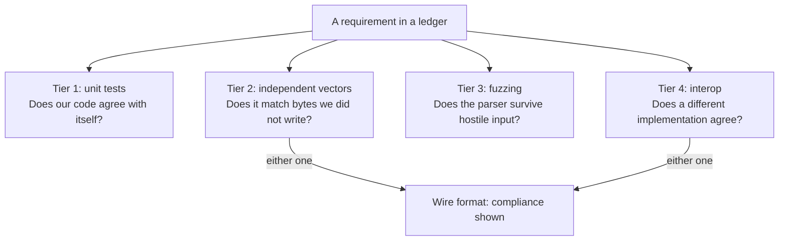

# Test Coverage

[Docs](README.md) › Test Coverage

This page answers "how do we know wired does what the specs say, and how
strongly do we know it?" Read it before trusting a feature, or before
adding a test, to see which kind of evidence a requirement already has. The
details live in two places: the per-spec feature ledgers and the interop
results. How to write and run a test is in [Development](development.md).

## Where the coverage lives

- **[Features](features/README.md)**: 45 specs (RFCs, FIPS, NIST SPs, and
  four drafts). Each one has its own requirement ledger. **1894 of 1896
  requirements are demonstrated (1649 directly tested, 245 indirectly
  tested); 2 remain untested.** The per-category tables are on that page.
- **[Interop Results](interop.md)**: runs against independent
  implementations such as quic-go and webtransport-go, driven by
  [quic-interop-runner](https://github.com/quic-interop/quic-interop-runner).

A requirement ledger is a checklist of one sentence per "shall" in the
spec. Each sentence is written in EARS style, a fixed "When X, the server
shall Y" pattern that turns prose into checkable lines. Every line either
names the test that proves it (file and function, checked by grep) or is
left as an honest gap. So the unchecked boxes with no test reference form
the visible list of what still needs testing.

"Directly tested" means one test exercises that requirement on its own.
"Indirectly tested" means real tests cover it, but only as part of a larger
path; the ledger's `- evidence:` line explains which path.

## The four evidence tiers

Not all evidence is equally strong. A test written by the same person who
wrote the code can share that person's misreading of the spec. So each tier
closes a gap that the ones before it leave open. Read the tiers in order, 1
to 4: each one answers a harder question.

The tiers are separate kinds of evidence, not a gate every requirement must
pass. A ledger line cites whichever tiers back it. Fuzzing, for instance,
covers only the nine parsers listed below. In the diagram, look at the
bottom: for anything on the wire, tier 2 or tier 4 is the bar.

### 1. Unit tests

`tests/` builds as one program with assertions on (`just test`). It runs on
every commit and in CI. It covers encode/decode round-trips, state
machines, boundary values, and rejection of malformed input.

### 2. Independent vectors and known-answer tests

A test vector is a fixed input with its exact expected output bytes. A
known-answer test (KAT) uses an input/output pair that the standard
itself publishes.
For example, FIPS 197 Appendix C.1 gives an AES key, a plaintext, and the
ciphertext every correct AES must produce.

This tier counts only bytes this project did not write. The sources are RFC
appendix vectors, NIST KATs, and the Wycheproof and BoringSSL test suites
in `tests/vectors/` (see [Wycheproof vectors](security/wycheproof-vectors.md)
and [BoringSSL vectors](security/boringssl-vectors.md)). They also include
certificate chains generated by real OpenSSL. Such vectors catch mistakes
that a round-trip misses. If the encoder and the decoder share the same
wrong byte order, a round-trip still passes, but the output does not
match the published vector.

A golden vector is a test vector whose expected bytes the project wrote
itself. It pins the byte layout against regressions, but it can carry the
author's misreading. MoQT (Media over QUIC Transport) is the main case. Its
drafts publish only one vector set: the variable-length integer example
table (Section 1.4.1), checked in `tests/app/moqvi_test.c`. Every other MoQT
golden vector in `tests/app/moqt_golden.h` is project-authored, generated
from `examples/moqt_chat/testvectors/moqt_golden.json`. So it is regression
evidence, not independent proof of compliance.

MoQT is still an Internet-Draft, and wired speaks three versions of it,
choosing one per session. So it has one ledger per draft:
draft-ietf-moq-transport-18, -19, and -22. Its code lives in fourteen
modules under `src/app/moqt/`, and 1110 test functions in
`tests/app/moq*_test.c` cover it.

### 3. Fuzzing

A fuzzer feeds a parser millions of random and mutated inputs to find
crashes. libFuzzer is the fuzzer built into clang. ASan (AddressSanitizer)
makes the program stop at the first out-of-bounds read or write, so a
memory bug cannot hide. There are nine harnesses, one per untrusted-input
parser:

| Harness | What it parses |
|---|---|
| `fuzz_header` | QUIC packet headers, incl. several packets in one UDP datagram |
| `fuzz_frames` | QUIC frames and the connection settings sent in the handshake |
| `fuzz_onertt` | encrypted QUIC packets sent after the handshake |
| `fuzz_tlsmsg` | TLS 1.3 handshake messages |
| `fuzz_x509` | X.509 certificates |
| `fuzz_qpack` | QPACK (HTTP/3 header compression): compressed header lists |
| `fuzz_capsule` | HTTP/3 frames and capsules (typed messages on an HTTP/3 stream, used by WebTransport; RFC 9297) |
| `fuzz_moqt` | MoQT messages, all three drafts |
| `fuzz_mp4frag` | fragmented MP4 video segments (the boxes inside them) |

Every push and pull request builds each harness and runs it once
(`just fuzz-smoke`). The nightly Fuzz workflow runs each one for 120
seconds (`just fuzz-ci`).

### 4. Interop

A loopback test alone cannot prove wire compatibility. That takes
independent vectors (tier 2) or a run against an independent
implementation (this tier); see [Interop Results](interop.md).

The reason is that a loopback test (our client talking to our server) runs
the same code on both ends. If both ends misread the spec the same way, the
errors cancel out and the test passes. This happened three times in this
project, and each bug passed loopback but broke a real peer:

- a wrong input to the encryption-key calculation;
- a packet number read wrongly from its shortened on-wire form;
- a mismatched connection ID (the label that tells a peer which connection
  a packet belongs to).

Each [feature ledger](features/README.md) cites which of these tiers backs
each requirement, in its `- test:` and `- evidence:` lines.

---

**Next:** [Features](features/README.md) — per-spec EARS requirement
ledgers. ([all docs](README.md))
