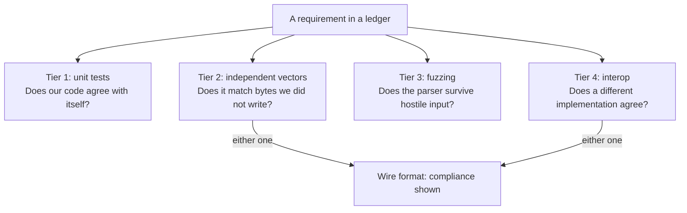

# テストカバレッジ

[ドキュメント](README.md) › テストカバレッジ

このページは「wired が仕様どおりに動くことを、どうやって、どれくらい確かに知っているのか」という問いに答えます。
機能を信頼する前やテストを足す前に読み、ある要件にどんな種類の証拠がすでにあるかを確かめてください。
詳細は 2 か所にあります。仕様ごとの機能台帳と、相互接続性の結果です。
テストの書き方と実行方法は [開発](development.md) にあります。

## カバレッジの置き場所

- **[機能](features/README.md)**: 45 の仕様(RFC、FIPS、NIST SP、4 つのドラフト)。仕様ごとに要件台帳があります。**2261 件の要件のうち 2001 件を実証済み(直接テスト 1548 件、間接テスト 453 件)で、260 件は未テストです**。カテゴリごとの表はそのページにあります。
- **[相互接続性の結果](interop.md)**: quic-go や webtransport-go のような独立した実装を相手にした実行の結果。[quic-interop-runner](https://github.com/quic-interop/quic-interop-runner) で動かしています。

要件台帳は仕様にある "shall" 1 つにつき 1 文を書いたチェックリストです。
各文は EARS 形式で書きます。EARS は「When X, the server shall Y」という決まった型で、散文を検査できる行に変えます。
各行はそれを証明するテスト(ファイルと関数。grep で検査します)を挙げるか、正直に穴として残すかのどちらかです。
そのため、チェックが入っておらずテストへの参照もない項目が、まだテストが必要なものの一覧として見える形になります。

「直接テスト」は、1 つのテストがその要件だけを確かめていることを指します。
「間接テスト」は、実際のテストがその要件を通るものの、より大きな経路の一部として通るだけであることを指します。どの経路かは台帳の `- evidence:` 行で説明しています。

## 証拠の 4 つの段階

証拠の強さはどれも同じではありません。
コードを書いた本人が書いたテストは、その人の仕様の読み違いをそのまま共有することがあります。
そこで各段階はそれより前の段階で埋まらない穴をふさぎます。
段階は 1 から 4 の順に読んでください。後の段階ほど難しい問いに答えます。

段階は別々の種類の証拠で、すべての要件が通らなければならない関門ではありません。
台帳の各行はその行を裏づける段階を挙げます。たとえばファジングが対象にするのは、下に挙げる 9 つのパーサーだけです。
図では下のほうを見てください。ワイヤー上を流れるものについては、段階 2 か段階 4 が合格の基準です。

### 1. 単体テスト

`tests/` はアサーションを有効にした 1 つのプログラムとしてビルドします(`just test`)。
コミットごとと CI で実行します。
エンコードとデコードの往復、ステートマシン、境界値、不正な入力の拒否を確かめます。

### 2. 独立したベクターと既知解テスト

テストベクターは固定の入力と、それに対して期待する出力のバイト列の組です。
既知解テスト(KAT)は、標準そのものが公開している入力と出力の組を使います。
たとえば FIPS 197 の Appendix C.1 には、AES の鍵、平文、そして正しい AES ならどれも出力しなければならない暗号文が載っています。

この段階に数えるのは、このプロジェクトが書いていないバイト列だけです。
出どころは RFC の付録のベクター、NIST の KAT、そして `tests/vectors/` にある Wycheproof と BoringSSL のテストスイートです([Wycheproof のベクター](security/wycheproof-vectors.md)と [BoringSSL のベクター](security/boringssl-vectors.md)を参照)。
本物の OpenSSL で生成した証明書チェーンも含みます。
こうしたベクターは往復テストでは見逃す誤りを捕まえます。
エンコーダーとデコーダーが同じ誤ったバイト順を共有していれば、往復テストは通ってしまいますが、出力は公開されたベクターと一致しません。

ゴールデンベクターは、期待するバイト列をプロジェクト自身が書いたテストベクターです。
バイト配置を固定してリグレッションを防げますが、書いた人の読み違いを含むことがあります。
その主な例が MoQT(Media over QUIC Transport)です。
MoQT のドラフトが公開しているベクターは 1 組だけで、可変長整数の例の表(Section 1.4.1)です。これは `tests/app/moqvi_test.c` で確かめています。
`tests/app/moqt_golden.h` にあるほかの MoQT のゴールデンベクターはすべてプロジェクトが書いたもので、`examples/moqt_chat/testvectors/moqt_golden.json` から生成しています。
したがってこれらはリグレッションを防ぐための証拠であり、準拠の独立した証明ではありません。

MoQT はまだ Internet-Draft で、wired はそのうち 3 つの版に対応し、セッションごとに 1 つを選びます。
そのため台帳はドラフトごとに 1 つあります。draft-ietf-moq-transport-18、-19、-22 です。
コードは `src/app/moqt/` の下の 14 のモジュールにあり、`tests/app/moq*_test.c` の 1110 個のテスト関数がそれを確かめています。

### 3. ファジング

ファザーは、パーサーに何百万ものランダムな入力や変異させた入力を与えて、クラッシュを探します。
libFuzzer は clang に組み込まれたファザーです。
ASan(AddressSanitizer)は、範囲外の読み書きが最初に起きた時点でプログラムを止めるので、メモリのバグが隠れたままになりません。
ハーネスは 9 つあり、信頼できない入力を扱うパーサー 1 つにつき 1 つです。

| ハーネス | 解析する対象 |
|---|---|
| `fuzz_header` | QUIC パケットのヘッダー。1 つの UDP データグラムに複数のパケットが入る場合を含む |
| `fuzz_frames` | QUIC のフレームと、ハンドシェイクで送るコネクションの設定 |
| `fuzz_onertt` | ハンドシェイク後に送る、暗号化された QUIC パケット |
| `fuzz_tlsmsg` | TLS 1.3 のハンドシェイクメッセージ |
| `fuzz_x509` | X.509 証明書 |
| `fuzz_qpack` | QPACK(HTTP/3 のヘッダー圧縮)の圧縮済みヘッダーリスト |
| `fuzz_capsule` | HTTP/3 のフレームとカプセル(HTTP/3 のストリーム上を流れる型付きメッセージ。WebTransport が使う。RFC 9297) |
| `fuzz_moqt` | MoQT のメッセージ。3 つのドラフトすべて |
| `fuzz_mp4frag` | 断片化した MP4 動画のセグメント(その中のボックス) |

プッシュとプルリクエストのたびに、各ハーネスをビルドして 1 回ずつ実行します(`just fuzz-smoke`)。
毎晩の Fuzz ワークフローは、各ハーネスを 120 秒ずつ実行します(`just fuzz-ci`)。

### 4. 相互接続性

ループバックのテストだけでは、ワイヤー上の互換性を証明できません。
証明には、独立したベクター(段階 2)か、独立した実装を相手にした実行(この段階)が要ります。[相互接続性の結果](interop.md)を見てください。

理由は、ループバックのテスト(自分のクライアントが自分のサーバーと話す)では両端で同じコードが動くことです。
両端が仕様を同じように読み違えていれば、誤りが打ち消し合ってテストは通ります。
このプロジェクトでは実際に 3 回起き、どのバグもループバックは通ったのに実際の相手とは通信できませんでした。

- 暗号鍵の計算への入力が間違っていた。
- パケット番号を、ワイヤー上の短縮形から誤って読み取っていた。
- コネクション ID(パケットがどのコネクションに属するかを相手に伝えるラベル)が食い違っていた。

各[機能台帳](features/README.md)は、要件ごとにどの段階が裏づけているかを `- test:` 行と `- evidence:` 行で示しています。

---

**次へ:** [機能](features/README.md)。仕様ごとの EARS 要件台帳です。([全ドキュメント](README.md))
