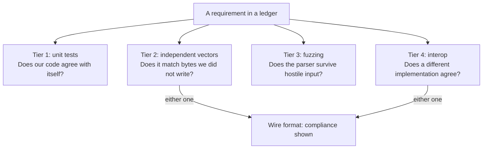

# テストの範囲

[ドキュメント](../README.md) › [試験と品質](README.md) › テストの範囲

| 項目 | 内容 |
|---|---|
| 目的 | 要件ごとの証拠の種類と、その集計を示す |
| 読む人 | 機能の裏づけを確かめる、またはテストを足すコントリビューター |
| 前提文書 | [テスト](../standards/testing.md) |
| 関連文書 | [要件台帳](../features/README.md)、[相互運用性テストの結果](interop.md) |

## 1. 要件台帳の集計

| 項目 | 数 |
|---|---|
| 仕様(RFC、FIPS、NIST SP、4 つのドラフト) | 45 |
| 要件 | 2266 |
| 実証済み | 2259(直接テスト 1958、間接テスト 301) |
| 未テスト | 7 |

カテゴリごとの表は [要件台帳](../features/README.md) にある。

要件台帳は仕様の "shall" 1 つにつき 1 文を EARS 形式で書いたチェックリストである。各行はそれを確かめるテスト(ファイルと関数。grep で検査する)を挙げるか、穴として残す。チェックもテストへの参照もない行が、テストの要る要件の一覧になる。

| 種類 | 意味 |
|---|---|
| 直接テスト | 1 つのテストがその要件だけを確かめる |
| 間接テスト | テストがその要件を、より大きな経路の一部として通る。経路は台帳の `- evidence:` 行に書く |

## 2. 証拠の 4 つの段階

コードを書いた本人のテストは、その人の仕様の読み違いを共有することがある。各段階はそれより前の段階で埋まらない穴をふさぐ。

段階は別々の種類の証拠で、すべての要件が通る関門ではない。台帳の各行はその行を裏づける段階を `- test:` 行と `- evidence:` 行で挙げる。たとえばファジングの対象は 2.3 の 9 つのパーサーだけである。

ワイヤー上を流れるものの準拠は、段階 2 か段階 4 のどちらかで示す。

### 2.1 単体テスト

`tests/` をアサーション有効の 1 つのプログラムとしてビルドする(`just test`)。コミットごとと CI で実行する。確かめるのは、エンコードとデコードの往復、ステートマシン、境界値、不正な入力の拒否である。

### 2.2 独立したベクターと既知解テスト

この段階に数えるのは、このプロジェクトが書いていないバイト列だけである。既知解テスト(KAT)は、標準が公開する入力と出力の組を使う。

| 出どころ | 例・置き場所 |
|---|---|
| RFC の付録のベクター | 各ドメインのテスト |
| NIST の KAT | FIPS 197 Appendix C.1(AES の鍵、平文、暗号文) |
| Wycheproof のテストスイート | `tests/vectors/`、[Wycheproof のベクター](../security/wycheproof-vectors.md) |
| BoringSSL のテストスイート | `tests/vectors/`、[BoringSSL のベクター](../security/boringssl-vectors.md) |
| 証明書チェーン | OpenSSL で生成したもの |

エンコーダーとデコーダーが同じ誤ったバイト順を共有すると、往復テストは通り、出力は公開されたベクターと一致しない。この段階はその誤りを検出する。

ゴールデンベクターは、期待するバイト列をプロジェクト自身が書いたテストベクターである。バイト配置を固定してリグレッションを防ぐが、書いた人の読み違いを含みうるので、この段階に数えない。

#### 2.2.1 MoQT のベクター

| 項目 | 内容 |
|---|---|
| 対応する版 | draft-ietf-moq-transport-18、-19、-22、-23。セッションごとに 1 つを選ぶ。台帳は版ごとに 1 つ |
| コード | `src/app/moqt/` の 14 のモジュール |
| テスト | `tests/app/moq*_test.c` の 1110 個のテスト関数 |
| ドラフトが公開するベクター | 可変長整数の例の表(Section 1.4.1)の 1 組だけ。`tests/app/moqvi_test.c` で確かめる |
| ゴールデンベクター | `tests/app/moqt_golden.h` のほかのベクターはすべてプロジェクトが書いたもの。`examples/moqt_chat/testvectors/moqt_golden.json` から生成する |

MoQT のゴールデンベクターはリグレッションを防ぐ証拠で、準拠の独立した証明ではない。

### 2.3 ファジング

libFuzzer(clang に組み込まれたファザー)と ASan で、パーサーにランダムな入力と変異させた入力を与え、クラッシュを探す。ASan は範囲外の読み書きが最初に起きた時点でプログラムを止める。ハーネスは信頼できない入力を扱うパーサー 1 つにつき 1 つで、9 つある。

| ハーネス | 解析する対象 |
|---|---|
| `fuzz_header` | QUIC パケットのヘッダー。1 つの UDP データグラムに複数のパケットを結合した場合を含む |
| `fuzz_frames` | QUIC のフレームと、ハンドシェイクで送るトランスポートパラメーター |
| `fuzz_onertt` | ハンドシェイク後の暗号化された QUIC パケット |
| `fuzz_tlsmsg` | TLS 1.3 のハンドシェイクメッセージ |
| `fuzz_x509` | X.509 証明書 |
| `fuzz_qpack` | QPACK で圧縮したヘッダーリスト |
| `fuzz_capsule` | HTTP/3 のフレームとカプセル(RFC 9297。WebTransport が使う) |
| `fuzz_moqt` | MoQT のメッセージ。3 つのドラフトすべて |
| `fuzz_mp4frag` | 断片化した MP4 動画のセグメントの中のボックス |

| 実行の時期 | 内容 |
|---|---|
| push とプルリクエストのたび | 各ハーネスをビルドして 1 回ずつ実行する(`just fuzz-smoke`) |
| 毎晩(Fuzz ワークフロー) | 各ハーネスを 120 秒ずつ実行する(`just fuzz-ci`) |

### 2.4 相互運用性

ループバックのテスト(wired のクライアントと wired のサーバー)では、両端で同じコードが動く。両端が仕様を同じように読み違えると誤りが打ち消し合い、テストは通る。このプロジェクトでは、ループバックは通り実際のピアとは通信できなかったバグが 3 件あった。

- 暗号鍵の計算への入力が誤っていた。
- パケット番号を、ワイヤー上の短縮形から誤って復元していた。
- 接続 ID が両端で食い違っていた。

独立した実装を相手にした結果は [相互運用性テストの結果](interop.md) にある。
