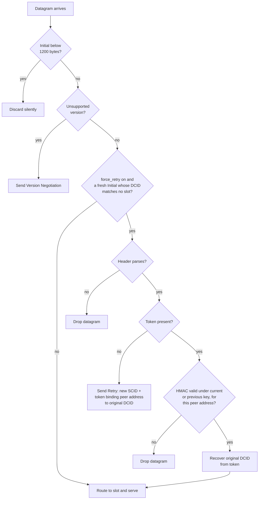
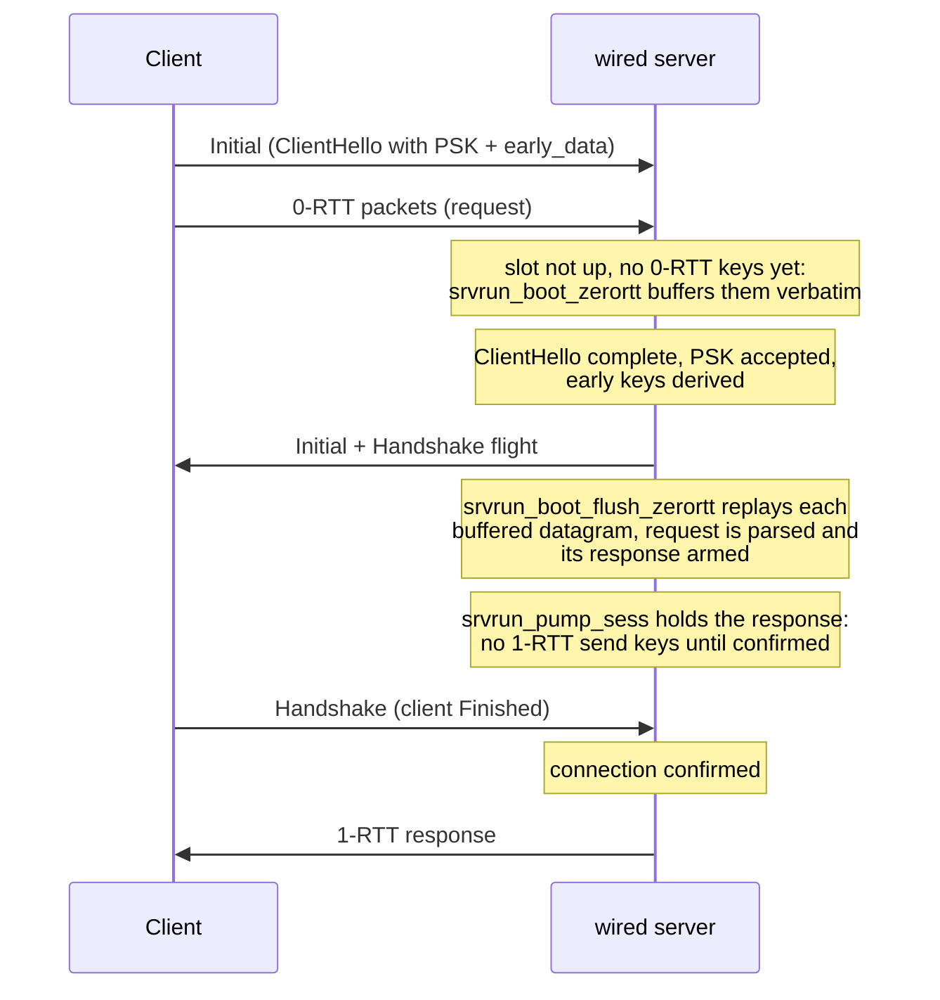
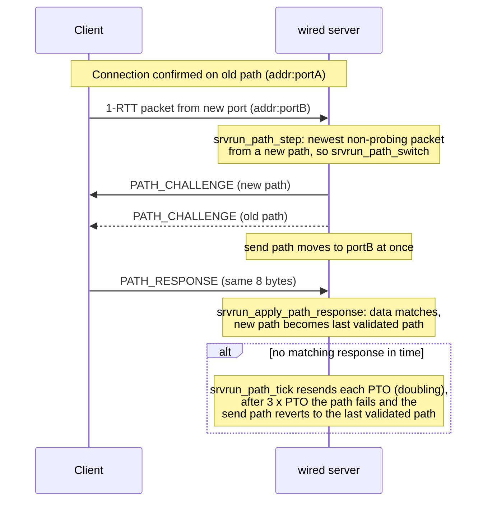

# 相互運用性テストの経緯

[ドキュメント](../README.md) › [試験と品質](README.md) › 相互運用性テストの経緯

| 項目 | 内容 |
|---|---|
| 目的 | 相互運用性テストのテストケースごとに、過去の失敗、根本原因、修正、確認の実行を記録する |
| 読む人 | テストケースの失敗を調べる、または関係するサーバーの処理を変えるコントリビューター |
| 前提文書 | [相互運用性テストの結果](interop.md) |
| 関連文書 | [テストの範囲](coverage.md) |

## 1. QUIC

### 1.1 `transfer`

| 項目 | 内容 |
|---|---|
| 期間 | 2026-08-05(DPLPMTUD を組み込んだ日)から 2026-08-09 まで `✕` |
| 根本原因 | PMTU で引き上げたチャンクサイズで切り出したフルサイズの断片が、送信キューからバイトを取り出した後で固定長の平文バッファーをあふれさせた。そのバイトは損失検出から見えない場所で失われ、再送されなかった |
| 確認 | 修正後に 5 回連続で合格。Cubic を既定にしたビルドでも 3 回中 3 回合格 |

経緯の全体は [実装の比較](../performance/comparison.md) にある。

### 1.2 `multiplexing`

| 項目 | 内容 |
|---|---|
| 以前の結果 | 判定なし(1999 ファイルの 98% で、60 秒のタイムアウトに間に合わない) |
| 根本原因 | スループット不足ではなかった。応答済みのリクエストストリームの遅れた再送が、再組み立てスロットを再び占有した(「ゾンビ」)。テーブルが満ちると新しいストリームのフレームを通知なしに捨て、そのパケットにも ACK を返していたので、クライアントは再送せず、リクエストは終わらなかった |
| 修正 | 応答して解放したストリーム ID を接続ごとに記録し、その遅れた重複を捨てる(RFC 9000 §3.2)。通知するストリームの上限をテーブルの容量に合わせ、上限とテーブルを常にそろえる |
| 確認 | 2026-08-05 から合格 |

再組み立てスロットはストリームのバイトを順に集めるテーブルの 1 要素である。

### 1.3 `handshakeloss` と `handshakecorruption`

ハンドシェイクのパケットが失われたとき、サーバーはそれらをすべては再送していなかった。サーバー側で 3 つの穴をふさいだ。

| 穴 | 起きていたこと |
|---|---|
| ブートフライト(サーバーの最初のハンドシェイクフライト)の再送 | まだ送っていない末尾だけを再送していたので、Handshake データグラムが 1 つ失われるとハンドシェイクが進まなくなった |
| 一度だけ送る確認パケット(SETTINGS + チケット + HANDSHAKE_DONE) | 失われても再送しなかった |
| 複数のパケットに分かれ、まだそろっていない ClientHello | ACK を返していなかったので、クライアントの 5 秒のハンドシェイクのアイドルタイマーが切れた |

修正後は 30% のバースト損失のもとで 50 回のハンドシェイクがすべて完了する。`handshakecorruption` は同じシナリオを破損のもとで実行し、同じ修正で合格する。

### 1.4 `amplificationlimit`

| 項目 | 内容 |
|---|---|
| 失敗 | 2026-10-27 に msquic でファイルが欠落して不合格([#178](https://github.com/Hakkadaikon/wired/issues/178)) |
| 根本原因 | サーバー側の停止。PTO のとき wired はキャッシュしたデータグラムを丸ごと再送するだけで、そのどれもが残りの増幅攻撃対策の予算より大きかった。テストケースが msquic の再送を落としているあいだ、サーバーは何も送らなかった |
| 修正 | 予算がすべての再送を阻むとき、予算に収まる小さな Handshake PING を送る |
| 確認 | ローカルで 5 回中 5 回合格。次の CI 実行待ち |

### 1.5 `retry`

`--force-retry` のサーバーモードはトークンのない Initial パケットすべてに Retry を送る(RFC 9000 §8.1.2)。受け入れる前に、提示されたトークンの HMAC(RFC 9000 §8.1.1)とアドレスの結び付きを検証し、無効なトークンを持つデータグラムは捨てる。

Retry Integrity Tag は RFC 9001 Appendix A.4 のベクターに固定している。Retry を有効にする方法は guide の [ハンドシェイクと可観測性のつまみ](https://hakkadaikon.github.io/wired/guide/ja/ops/handshake-knobs/) にある。

トークンはクライアントの元の DCID を平文で持つ(`odcid_len || odcid || HMAC-SHA256`)。サーバーはハンドシェイクを終えるのにクライアントごとのメモリを使わない。サーバーは次の 2 つの値を最初から最後まで別のフィールドに持つ。

| 値 | 用途 |
|---|---|
| Retry 自身の SCID | Initial の鍵導出 |
| トークンから取り出した元の DCID | `original_destination_connection_id` トランスポートパラメーター |

次の図は `srvrun_serve`(サイズの下限)と `srvrun_serve_sized`(それ以降すべて)での、データグラムごとの判定である。スロットはサーバーの接続ごとの状態の 1 要素で、「どのスロットにも一致しない」はその ID の接続をまだ持っていないことを指す。

判定は `srvrun_retry_gate` が行う。トークンが有効なのは、このピアのアドレスについて HMAC が現在または 1 つ前の鍵で一致するとき(`srvrun_retry_token_ok`)である。

### 1.6 `resumption`

実際の 2 回目のハンドシェイクでの PSK によるセッション再開を、ClientHello の受信経路とサーバーフライトの組み立てに組み込んでいる。有効にする方法は guide の [ハンドシェイクと可観測性のつまみ](https://hakkadaikon.github.io/wired/guide/ja/ops/handshake-knobs/) にある。

次の 3 点が RFC 8446 と合っていないと、実際のクライアントは再開したハンドシェイクを拒否する。

| 細部 | 仕様 |
|---|---|
| `resumption_master_secret` のトランスクリプト | サーバーの Finished で止めず、クライアントの Finished までを対象にする(RFC 8446 §7.1。鍵スケジュールが導出する 4 つのシークレットのうち、これだけがサーバーの Finished より先まで続く) |
| PSK を受け入れたときの ServerHello | `pre_shared_key`(`selected_identity`)を必ず返す(RFC 8446 §4.1.3/§4.2.11) |
| PSK ハンドシェイクの Certificate/CertificateVerify | 送らない(RFC 8446 §4.4) |

確認: 相互運用性テストに 2 回連続で合格し、`handshake`/`transfer`/`retry`/`http3` も合格のままである。

### 1.7 `zerortt`

セッション再開で用意した PSK と鍵スケジュールの上で、0-RTT データを受け取って処理する。0-RTT にはセッション再開が要るので、有効にする方法は 1.6 と同じページにある。

| 処理 | 内容 |
|---|---|
| 鍵の導出前に届いた 0-RTT データグラム | ブートアキュムレーター層(ハンドシェイク中の接続ごとのバッファー)にそのまま溜め、鍵を導出したら再生する(RFC 9001 §4.6.1)。鍵は ClientHello を処理して PSK を受け入れた後にだけ導出する |
| パケット番号の復元 | 0-RTT は 1-RTT とアプリケーションデータのパケット番号空間(RFC 9000 §12.3)を共有し、ロングヘッダーを使う。その暗号化レベルのパケットをすべてショートヘッダーとみなさず、ヘッダーの形で分岐する |
| 0-RTT で届いたリクエストへのレスポンス | サーバー自身の 1-RTT 送信鍵ができるまで遅らせる。この鍵は Finished を含むトランスクリプトから導出する |
| 同時ストリームのテーブル | ランナーの zerortt で一度に来る 40 ファイルに合わせ、数項目から引き上げた。WebTransport のストリーム上限も同じトレードオフを選んでいる |

確認: 相互運用性テストに 2 回連続で合格し、`handshake`/`transfer`/`retry`/`resumption`/`http3` も合格のままである。

リクエストは再生中(`srvrun_boot_flush_zerortt`)に解析する。クライアントの Finished でハンドシェイクが確定するまで、`srvrun_pump_sess` は何も送らない。

### 1.8 `ecn`

RFC 9000 §13.4 の次の 3 つを実装し、単体テストしている。送信時の ECT(0) の印、受信時に IP ヘッダーから読む印(IP_TOS 制御メッセージ)、1-RTT の ACK で報告する累積 ECN カウントである。quic-go の相互運用性クライアントは `unsupported test case: ecn` を宣言するので、ランナーの結果は `?` になる。

ngtcp2 をクライアントにすると、ある修正の後エンドツーエンドで合格する(`✓(E)`、2026-08-21)。修正前は、サーバーの Initial 空間の ACK が ECN カウントを持たず、クライアントはパスが ECN に対応していないと判断していた。

### 1.9 `ipv6`

ソケット層はデュアルスタックである(AF_INET6 のソケット 1 つ、IPV6_V6ONLY はオフ、IPv4 のピアは v4-mapped)。ほかのテストケースは IPv4 のまま動く。

### 1.10 `v2`

QUIC バージョン 2(RFC 9369)を実装し、単体テストしている。鍵導出、ロングヘッダーの型ビット、Version Negotiation の受け入れリストはバージョンを引数に取る。実際の ClientHello を持つ v2 の Initial パケットを受け入れ、v2 で応答する。

quic-go の相互運用性クライアントは `unsupported test case: v2`(exit 127)を宣言する。

サーバーは自分から接続のバージョンを切り替えず、クライアントの Initial パケットのバージョンで応答する(RFC 9368 §2)。ランナーの TestCaseV2 のチェックは、v1 で始めた接続を v2 へ移すサーバーを想定している。この違いの影響は、それを試すクライアントが現れるまで確かめられない。

確認: v2 を入れた後のリグレッション確認(handshake/transfer/http3/retry/ipv6)はすべて合格し、v1 の経路に影響がないことを確かめた。ngtcp2 と picoquic をクライアントにすると、RFC 9368/9369 のバージョンネゴシエーションでエンドツーエンドに合格する(`✓(V2)`、2026-08-21)。

### 1.11 `rebind-port` / `rebind-addr`

NAT が接続の途中でクライアントのポートやアドレスを変える場合を模擬する。サーバーは確定した接続のピアアドレスを再バインドに合わせて追い、新しいパスに PATH_CHALLENGE を送り、一致する PATH_RESPONSE を検証する(RFC 9000 §8.2/§9.3)。

2026-10-27 より前の実行の不合格は、ランナーの解析ツール(pyshark/tshark)が新しいパスの最初のパケットを復号できなかったことによる。ショートヘッダーのパケットは DCID の長さを持たないので、デコーダーは同じ UDP の会話で先に届いたロングヘッダーのパケットから長さを知る必要がある。再バインドで変わった送信元ポートには、そのパケットが届かない。2026-10-27 の CI 実行では、両テストケースともこれらを実行するすべてのクライアントで合格した。

サーバーは新旧両方のパスにチャレンジを送り、送信先をすぐ新しいパスへ移す。一致する PATH_RESPONSE が 3 PTO のあいだに届かなければ、最後に検証したパスへ戻す。

### 1.12 `connectionmigration`

サーバー側は `rebind-*` と同じ PATH_CHALLENGE/PATH_RESPONSE の処理を使い、ファイル転送は完了する。

| 実行 | 結果 |
|---|---|
| 2026-10-27 より前、quic-go | 不合格。クライアントがパスを変えていなかった(ランナーのログ: "Server saw only a single path in use") |
| 2026-08-21、ngtcp2 | 合格(`✓(CM)`)。移行したことを確かめた(ランナーのログ: "DCID changed during active migration") |
| 2026-10-27 | quic-go とほか 8 種のクライアントで不合格、ngtcp2、picoquic、aioquic、neqo、lsquic で合格。quic-go 以外の不合格は調査していない |

## 2. WebTransport

### 2.1 `transfer-bidirectional-send`

| 項目 | 内容 |
|---|---|
| 失敗 | 2026-10-27 に webtransport-go で不合格([#180](https://github.com/Hakkadaikon/wired/issues/180))。ワイヤー上でデータが失われたのではなく、停止した |
| 根本原因 | シミュレーターの損失で quic-go の再送が小さな断片に分かれた。サーバーの WebTransport の受信ウィンドウは受信したバイトを最大 8 個の離れた範囲で記録し、9 個目が届くといちばん遠い範囲を捨てていた。そのバイトは確認応答済みなのでクライアントは再送せず、ウィンドウは穴の先へ進めず、ストリームのクレジットが止まった |
| 調べ方 | CI 実行はテストごとのログを残していなかった。ローカルで再現し、クライアントの qlog で、すべてのバイトが確認応答済みで、クライアントがストリームの上限で止まり "no recent network activity" で終了したことを確かめた |
| 修正 | リクエストのウィンドウと同じく、受信したバイトをすべてビットマップで記録する |
| 確認 | ローカルで 5 回中 5 回合格。次の CI 実行待ち |

### 2.2 `transfer-unidirectional-send`

| 項目 | 内容 |
|---|---|
| 根本原因 | サーバーのラウンドロビンのポンプが、セッションの 2xx レスポンスをワイヤーに出す前に、WebTransport の印を付けたストリームを送っていた。draft-ietf-webtrans-http3-15 §3.2 は 2xx を先に送ることを求める。ngtcp2-webtransport クライアントは順序の違うストリームを通知なしに捨てていた |
| 見つけ方 | ngtcp2 自身のサーバーと比べた。ngtcp2 のサーバーは 2xx とそのストリームを同じパケットで、2xx を先にして送っていた |
| 修正 | 2026-08-23(`ee13cc7`) |
| 確認 | ngtcp2 で合格。同じ日のローカルでの逐次再実行で webtransport-go でも合格 |

### 2.3 そのほかに見つかったバグ

WebTransport の実行で、次の 2 件の相互運用性のバグを見つけて修正した。

- QPACK のリテラルフィールドラインのバッファー分割
- WebTransport のストリームシグナルの長さ
