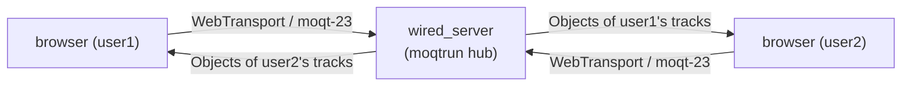
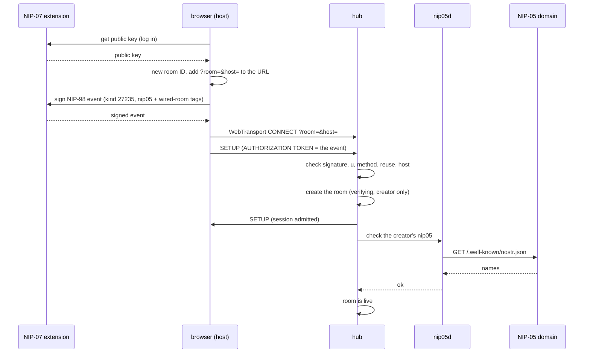
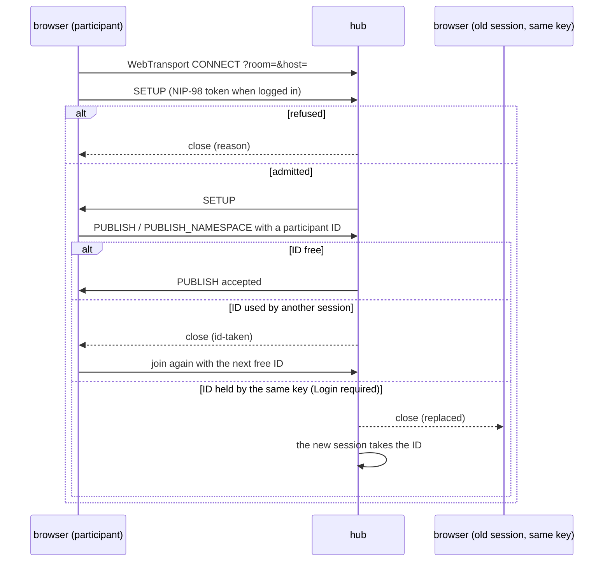
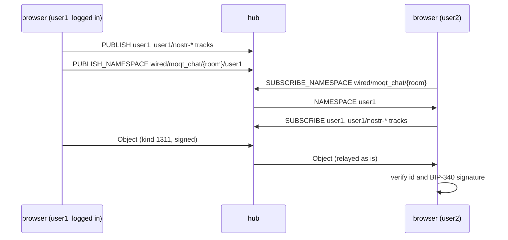
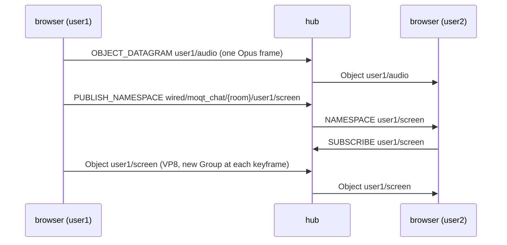
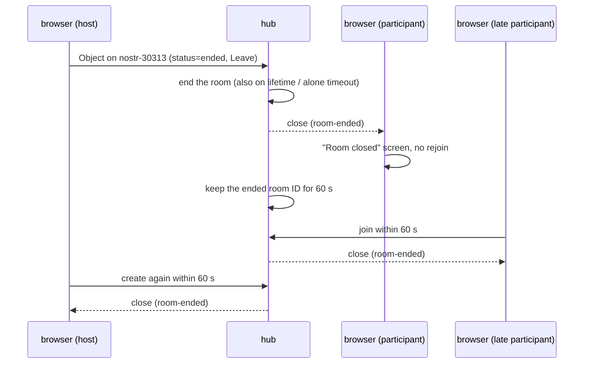

# moqt_chat

[wired](../../README.md) › moqt_chat

| 項目 | 内容 |
|---|---|
| 目的 | MoQT で作ったチャットと音声通話のルームの構成を示す |
| 読む人 | moqt_chat のサーバーとフロントエンドを動かす・変更するコントリビューター |
| 前提文書 | [MoQT draft-23 の要件台帳](../../docs/features/draft-moq-transport-23.md) |
| 関連文書 | [MoQT Track 切り替え](../../docs/features/moqt-track-switching.md)、[moqt_chat のリソース監視](../../docs/performance/monitoring.md) |

## 1. 文書の構成

| 文書 | 中身 |
|---|---|
| この文書 | 全体の構成、作成から終わりまでの流れ、Track の一覧、ディレクトリ |
| [MoQT の使い方](wire.md) | セッション、名前空間の発見、履歴、Object の形、Track 切り替え |
| [サーバー](server.md) | ビルドと起動、設定、ハブの上限、GOAWAY による再起動、ルーム |
| [フロントエンド](frontend.md) | 開発サーバー、GitHub Pages、Biome、カメラと動画 |
| [e2e テスト](e2e.md) | 負荷テスト、安定性のシナリオ、そのほかの確認 |

## 2. 全体の構成

サーバーは libc を使わない WebTransport サーバーである。`src/app/moqt/run`(`moqtrun.h`)のハブを UDP につなぐ。参加者が送るチャットのメッセージと Opus の音声フレームを、ほかの参加者全員に中継する。

| 項目 | 値 |
|---|---|
| MoQT のドラフト | draft-ietf-moq-transport-23。クライアントは `moqt-23` だけを提示する |
| ルーム | ページの URL の `?room=<id>&host=<pubkey>` で決まる。1 つのハブに 3 つまでのルームが入り、1 つのルームに 4 人まで入れる。ルームを作るには Nostr のログインと NIP-05 が要り、ハブは nip05d で NIP-05 を確かめる([フロントエンド](frontend.md) 2.1 節、[サーバー](server.md) 5 節) |
| 参加者 ID | `user1`〜`user4` の 4 つ(`CANDIDATE_PARTICIPANT_IDS`、`moqtClient.ts`) |
| 名前空間 | `wired/moqt_chat/<ルーム ID>` |
| フロントエンド | Next.js と React の静的エクスポート。GitHub Pages にだけデプロイする |

## 3. 作成から終わりまでの流れ

### 3.1 ログインとルームの作成

ルームを作った人がホストになる。ログインには NIP-07 の拡張機能を使い、秘密鍵はページに渡らない。"Create room" は、kind 0 のプロフィールに `nip05` があるときだけ押せる。

nip05d の確認の結果が 3 秒以内に来なければ、ハブはルームを終える。トークンの形は [MoQT の使い方 2.1](wire.md#21-setup-の-authorization-token) にある。作成の条件は [サーバー 5.1](server.md#51-作成と参加) にある。

### 3.2 参加

参加者は共有のリンク(`?room=<id>&host=<pubkey>`)でページを開く。ログインしたページは、接続のたびに NIP-98 のイベントを SETUP で送る。Login required のルームは、トークンのない参加を断る。

ハブが参加を断るときの理由は [MoQT の使い方 2.2](wire.md#22-閉じるときの理由) にある。4 つの ID がすべて使えないときに、ページは終わりの画面を出す。Open のルームでは同じ鍵でも ID を引き継がない。

### 3.3 チャットとルームのイベント

参加者は自分の Track を名前空間 `wired/moqt_chat/<ルーム ID>` に配信し、ほかの参加者の Track を購読する。ページは、拡張機能が署名した Nostr のイベントの JSON を 1 つの Object で送る。kind と Track の対応は 4 章にある。

ハブは中継のときにイベントを確かめない。公開のリレーには kind 0 の REQ だけを送り、EVENT も AUTH も送らない([フロントエンド](frontend.md#プロフィールのリレー))。

### 3.4 音声、カメラ、画面共有

音声は Opus、カメラと画面共有は VP8 で、それぞれ別の Track で配信する。ハブは届いた Object をその Track の購読者全員に送る。

データグラムに入らない音声のフレームは、ストリームで送る。ハブは、チャット以外の Track の Object を送れないときに捨てる。カメラの Track は `<id>/camera` である。

### 3.5 ルームの終わり

ルームは、ホストの退出、寿命、1 人だけの状態の継続、だれもいない状態の継続、NIP-05 の確認の失敗のどれかで終わる。条件と時間は [サーバー 5.2](server.md#52-ルームの終わり) にある。だれもいない状態で終えたときは、閉じるセッションがない。

ハブは GOAWAY を送らず、セッションを直接閉じる。GOAWAY を受けたページは再接続するからである。確認中のまま終えたルームは記録しないので、すぐに作り直せる。

## 4. Track

参加者は名前空間 `wired/moqt_chat/<ルーム ID>` の下に、次の Track を配信する。Track Alias は参加者 ID の添字(`user1` が 0)に表のオフセットを足した値である。

| Track 名 | 中身 | Track Alias | 配信する条件 |
|---|---|---|---|
| `<id>` | チャット | 0〜3 | 常に |
| `<id>/audio` | 音声(Opus) | 4〜7 | 常に |
| `<id>/screen` | 画面共有(VP8、高レート) | 10〜13 | 画面共有の間 |
| `<id>/screen-lo` | 画面共有(VP8、低レート) | 14〜17 | 画面共有の間で、ハブが Track 切り替えを提示したとき |
| `<id>/camera` | カメラか動画ファイル(VP8) | 18〜21 | カメラか動画ファイルを送る間 |
| `<id>/nostr-presence` | Nostr の 10312(presence) | 22〜25 | 常に(イベントはログイン中だけ) |
| `<id>/nostr-30312` | Nostr の 30312(meeting space) | 26〜29 | 常に(イベントはログイン中だけ) |
| `<id>/nostr-30313` | Nostr の 30313(meeting) | 30〜33 | 常に(イベントはログイン中だけ) |
| `<id>/nostr-react` | Nostr の 7(リアクション)、5(削除) | 34〜37 | 常に(イベントはログイン中だけ) |

ハブは Track Alias 0〜3(`CHAT_ALIAS_LIMIT`、`wired_server.c`)を確実に中継し、それ以外の Track は送れないときに捨てる。各 Track の Object の形は [MoQT の使い方](wire.md) に書く。

## 5. ディレクトリ

| パス | 中身 |
|---|---|
| `server/wired_server.c` | ハブの初期化、WebTransport のコールバックの接続、証明書、CLI |
| `server/access.c` | Origin の許可リスト |
| `server/room*.c`、`server/room.h` | ルーム。入室、参加者 ID、名前空間の閉じ込め、NIP-98、nip05d との通信、ルームの終わり |
| `nip05d/` | NIP-05 を照合する Go の補助プロセス |
| `server/live.c` | `wired_moqt_io` の `send_uni2`。セッションごとのリングに送信を溜める |
| `server/relay.c` | セッションの数え上げ、GOAWAY、10 秒ごとの中継の統計のログ |
| `server/moqt_chat.h` | サーバーの各ファイルが共有する宣言 |
| `server/Dockerfile`、`server/docker-compose.yml` | `just up` が作って動かす `scratch` イメージ |
| `frontend/src/lib/moqtWire.ts`、`moqtClient.ts` | ワイヤーのコーデック。セッション、リクエストストリーム、名前空間の発見、履歴、GOAWAY |
| `frontend/src/lib/moqtScreenWire.ts`、`moqtScreenClient.ts` | 画面共有とカメラの Track、別版、Track 切り替え |
| `frontend/src/lib/moqtVoiceWire.ts`、`moqtVoiceClient.ts` | 音声の Object の形と、音声の Track の配信と購読 |
| `frontend/src/lib/*Pipeline.ts`、`jitterBuffer.ts`、`playbackSink.ts`、`audioContextGate.ts` | マイクの取り込みから Opus のエンコード、Object までと、受信側のジッター吸収、デコード、再生 |
| `frontend/src/app/page.tsx`、`src/stores/moqtChatStore.ts`、`src/hooks/useMoqtChat.ts` | UI |
| `e2e/` | ヘッドレスの Chrome を使う e2e テストのハーネス |
| `testvectors/moqt_golden.json` | C と TypeScript が共有するゴールデンベクター |
| `justfile` | ビルド、起動、フロントエンド、e2e のレシピ |

ワイヤーのコーデックは C(`src/app/moqt/vi`、`kvp`、`ctl`、`data`)と TypeScript(`moqtWire.ts`)で別々に実装している。両方を `testvectors/moqt_golden.json`(draft-19 のフレーミング)で固定する。フロントエンドは draft-23 の vi64 の Length で制御メッセージを組み直し、draft-23 との差分はドラフトの本文から導いたベクターで固定する。
