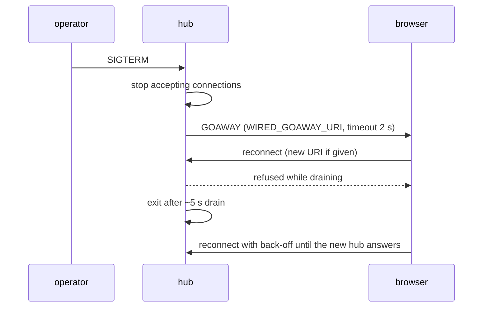

# サーバー

[wired](../../README.md) › [moqt_chat](README.md) › サーバー

| 項目 | 内容 |
|---|---|
| 目的 | moqt_chat の `wired_server` のビルド、起動、設定、上限を示す |
| 読む人 | サーバーを動かす・変更するコントリビューター |
| 前提文書 | [moqt_chat](README.md) |
| 関連文書 | [MoQT の使い方](wire.md)、[フロントエンド](frontend.md)、[moqt_chat のリソース監視](../../docs/performance/monitoring.md) |

## 1. ビルドと起動

レシピは `examples/moqt_chat/justfile` にある。

| コマンド | 動作 |
|---|---|
| `just build` | リポジトリのルートで `just build` を通し、`just ninja examples/moqt_chat/server/wired_server` でサーバーを作る |
| `just up` | `just build` のあと、Docker のイメージを作ってフォアグラウンドで動かす。Ctrl-C で止まる |
| `just up -d` | 同じ動作をデタッチして行う。ログは `server/` で `docker compose logs -f` で見る |
| `just down` | コンテナを止めて消す |

Docker を使わないときは、リポジトリのルートで次を実行する。

1. `just ninja examples/moqt_chat/server/wired_server` でバイナリを作る。
2. nip05d を起動する(`nip05d -tcp 127.0.0.1:4480`。[nip05d](nip05d/README.md))。
3. `examples/moqt_chat/server/wired_server --public-url https://<host>:4433 --nip05 127.0.0.1:4480` を実行する。`--public-url` がないと起動しない。

### 1.1 コンテナ

| 項目 | 内容 |
|---|---|
| ベースイメージ | `scratch`。イメージにあるのは `wired_server` だけである。nip05d は別のサービス(`nip05d/Dockerfile`)で、CA のバンドルと一緒に scratch に置く |
| バイナリ | `-ffreestanding -nostdlib -static` でリンクした静的バイナリ |
| ファイルシステム | 既定では実行中に読まない。自己署名の証明書は起動ごとにメモリで作る |
| ネットワーク | `network_mode: host`(`server/docker-compose.yml`)。ホストの `4433/udp` で直接待ち受ける |
| 引数 | `--san-ipv4 ${WIRED_SAN_IPV4:-127.0.0.1} --public-url ${WIRED_PUBLIC_URL:-https://127.0.0.1:4433} --nip05 127.0.0.1:4480`。`just up` は `WIRED_PUBLIC_URL` を `https://<IP SAN>:4433` にする。ドメイン名で接続させるときは `WIRED_PUBLIC_URL` を渡す |

Docker のブリッジとポートの割り当て(`-p 4433:4433/udp`)では、QUIC のハンドシェイクが終わらない。そのためホストのネットワークを使う。

`docker-compose.yml` の `build:` はディスクにある `wired_server` をイメージに入れるだけである。ソースを変えたら `just up` を使う。

### 1.2 証明書の IP アドレス

`just up` は、このホストの既定の経路の送信元アドレスを、自己署名の証明書の IP SAN にする。起動時に `cert IP SAN: ...` と出力する。ブラウザーは `https://<そのアドレス>:4433/` に接続する。

| 接続先 | 結果 |
|---|---|
| `https://<IP SAN のアドレス>:4433/` | 接続する |
| `https://localhost:4433/` | 接続する。証明書は `localhost` も含む |
| ほかの IP アドレス(`--san-ipv4` を渡したときの `127.0.0.1` を含む) | 421 を返す(RFC 9110 7.4)。Chrome は `net::ERR_METHOD_NOT_SUPPORTED` を出す |

NAT の内側では、既定の経路のアドレスはプライベートアドレスになる。クライアントが接続するアドレスを `WIRED_SAN_IPV4=<公開 IP> just up` で渡す。

### 1.3 単一プロセス

ハブはピアの表、リクエストストリーム、Object のキャッシュを 1 つのプロセスのメモリに持つ。`--workers`、`--cores`、`--ifindex` は渡さない。ワーカーごとに別のルームができる。

## 2. 設定

| フラグ / 環境変数 | 既定値 | 動作 |
|---|---|---|
| `--port N` | 4433 | UDP のポート |
| `--san-ipv4 a.b.c.d` / `WIRED_SAN_IPV4`(`just up` だけが読む) | 127.0.0.1(`just up` ではこのホストのアドレス) | 自己署名の証明書の IP SAN。ほかの IP アドレスへの WebTransport の CONNECT には 421 を返す |
| `--cc cubic\|bbr` | `cubic` | 新しい接続の輻輳制御。ほかの値(`newreno` を含む)は使い方のエラーで終了する |
| `--cert PATH` / `WIRED_CERT` | なし(メモリの自己署名の証明書) | 送る証明書チェーンの PEM。リーフを先頭に置く |
| `--key PATH` / `WIRED_KEY` | なし | 証明書の P-256 の秘密鍵の PEM。`--cert` と一緒に必要 |
| `WIRED_ALLOWED_ORIGINS` | なし(すべての Origin を受ける) | カンマ区切りの Origin の一覧(例 `https://chat.example,https://hakkadaikon.github.io`)。ほかの Origin からの WebTransport の CONNECT には 403 を返す(draft-ietf-webtrans-http3-15 3.1) |
| `--goaway-uri URI` / `WIRED_GOAWAY_URI` | なし(同じ URI に再接続する) | 終了時の GOAWAY に入れる New Session URI。8192 バイトまで |
| `--public-url URL` | なし(必須) | ブラウザーが接続する URL の scheme と authority(例 `https://chat.example:4433`)。NIP-98 の `u` と比べる([MoQT の使い方 2.1](wire.md#21-setup-の-authorization-token))。ないと起動しない |
| `--nip05 127.x.x.x:port` | なし | nip05d のアドレス。ループバックだけを受け付ける。ないとルームを作れない(作成はすべて 3 秒後に `nip05-unverified` で終わる) |
| `--room-lifetime S` | 18000(5 時間) | ルームを作ってから終えるまでの秒数 |
| `--room-alone-timeout S` | 1800(30 分) | 1 人だけの状態がこの秒数続くとルームを終える |
| `--room-empty-grace S` | 60 | だれもいない状態がこの秒数続くとルームを終える |
| `--room-allow LIST` | なし(だれでも作れる) | ルームを作れる NIP-05 のドメインか公開鍵(64 桁の hex)のカンマ区切りの一覧 |
| `--qlog PATH` | なし | qlog の出力先 |
| `--keylog PATH` | なし | NSS の鍵ログの出力先 |

### 2.1 証明書の再読み込み

`--cert` と `--key` を渡したときは、`kill -HUP <pid>` で両方のファイルを読み直す。

| 対象 | 使う証明書 |
|---|---|
| 再読み込みのあとに開いた接続 | 新しい証明書 |
| 開いている接続 | 変わらない |
| 読み込みに失敗したとき | 古い証明書のまま |

### 2.2 自己署名の証明書のフィンガープリント

起動時に、自己署名の証明書の SHA-256 フィンガープリントを出力する。

```
cert sha-256 fingerprint: b4:6d:57:7b:de:f6:70:d6:f1:f9:e9:91:c3:a3:6a:db:15:e8:7d:39:34:24:a4:54:89:ed:de:43:22:39:70:88
```

証明書の有効期間の起点は UTC の日の始まりである(`day_start_secs`、`wired_server.c`)。同じ UTC の日に再起動してもフィンガープリントは変わらず、フロントエンドの自動再参加は同じハッシュを使い続ける。UTC の 0 時を過ぎるとフィンガープリントが変わるので、そのときは今の起動のログから写す。

## 3. ハブの上限

サーバーは SDK を `-DWIRED_PROFILE_MOQT_ROOM`(`src/common/profile/moqt_room.h`)でビルドしたものを使う(`just ninja examples/moqt_chat/server/wired_server`、オブジェクトは `build/profile/moqt_room/`)。下の値はこのプロファイルの値で、SDK の既定は Track 5、リクエストストリーム 128 / 32、fill 8 + 8、WebTransport の双方向 24 本と単方向 6 本である。

| 項目 | 値 | 上限を超えたとき |
|---|---|---|
| Object のキャッシュ | 1 MiB(`MOQT_CACHE_BYTES`)。全 Track で 1 つの領域を使い、古い Group から丸ごと捨てる | 1 MiB を超える Group(1 MiB を超える添付ファイル)はキャッシュしない。途中参加の履歴にも入らない |
| ルーム | 3(`WIRED_MOQT_CHAT_MAX_ROOMS`)、1 つのルームに 4 人 | 4 つ目の作成を `no-room-slots`、5 人目を `room-full` で断る |
| 接続 | 16(3 ルーム × 4 人と予備 4。`scripts/just/flags.sh` のプロファイルのフラグ) | 新しい接続を断る。ブラウザーには理由が届かず、再接続を続ける |
| 名前空間 | セッションのルームの下だけ([MoQT の使い方 2.3](wire.md#23-ルームへの閉じ込め)) | 告知と購読を UNAUTHORIZED で拒否する |
| リクエストストリーム | ハブ全体で 576(`WIRED_MOQTRUN_MAX_REQS`)、セッションあたり 67(`WIRED_MOQTRUN_MAX_REQS_PER_SESSION`。40 と途中参加の fill 27) | 新しいリクエストストリームを EXCESSIVE_LOAD でリセットする |
| fill | 41 スロットと待ちの 41 スロット(`WIRED_MOQTRUN_MAX_FETCHES`) | [MoQT の使い方 4.1](wire.md#41-fill-の枠が足りないとき) |
| 参加者あたりの Track | 9(`WIRED_MOQTRUN_MAX_TRACKS_PER_PEER`) | PUBLISH を拒否する |
| WebTransport のストリーム | 1 セッションでクライアントの双方向 47 本、単方向 9 本(`H3SETTINGS_WT_INIT_STREAMS_BIDI_VALUE`、`_UNI_VALUE`) | 超えたセッションを WT_FLOW_CONTROL_ERROR で閉じる |

キャッシュは全ルームの全 Track で共有する。画面共有の Group が多いと、チャットの履歴は先に押し出される。あるルームの画面共有が、別のルームの履歴を押し出すこともある。リクエストストリームと fill の枠もハブ全体で 1 つなので、混んだルームはほかのルームの途中参加を遅らせることがある。

### 3.1 リクエストストリームの数

4 人のルームで、1 つのセッションが同時に開くリクエストストリームの最大は 40 である。fill は SUBSCRIBE のリクエストに乗るので、別の枠を使わない。

| リクエスト | 数 | 内訳 |
|---|---|---|
| PUBLISH | 9 | チャット、音声、`screen`、`screen-lo`、`camera`、`nostr-presence`、`nostr-30312`、`nostr-30313`、`nostr-react` |
| PUBLISH_NAMESPACE | 3 | `<id>`、`<id>/screen`、`<id>/camera` |
| SUBSCRIBE_NAMESPACE | 1 | `wired/moqt_chat/<room>` |
| SUBSCRIBE | 27 | ほかの 3 人 × 9 Track(Auto で `screen` と `screen-lo` の両方を購読するとき) |
| 合計 | 40 | 1 つのルームで 160 |

セッションあたりの上限 67 とハブ全体の上限 576(3 ルームで 480 と途中参加の fill)に収まる。参加者 ID を 4 つにしているのはこの上限のためである。

## 4. GOAWAY による再起動

SIGTERM(`docker compose stop`、`kill <pid>`)を受けると、サーバーは次の順に動く。



| 項目 | 値 |
|---|---|
| GOAWAY のタイムアウト | 2000 ms(`GOAWAY_TIMEOUT_MS`、`relay.c`)。過ぎても開いているセッションはハブが閉じる |
| SDK のドレイン | 約 5 秒(`SRVRUN_DRAIN_TICKS`) |
| 再接続の間隔 | 1、2、4、8、10 秒(`reconnectDelayMs`、`useMoqtChat.ts`)。5 回で止める |

ブラウザーは GOAWAY か WebTransport のドレインを受けるとすぐに再接続し、新しいセッションですべてを配信、告知、購読し直す。同じ UTC の日の再起動では、フィンガープリントが同じなので固定したハッシュがそのまま使える。

## 5. ルーム

ハブは最大 3 つのルームを持ち、1 つのルームに 4 人まで入れる。ルームは名前空間 `wired/moqt_chat/<room>/...` で、ハブはセッションをそのルームの中に閉じ込める([MoQT の使い方 2.3](wire.md#23-ルームへの閉じ込め))。コードは `server/room*.c` にあり、`server/room.h` の先頭にファイルの分担がある。

### 5.1 作成と参加

| 場合 | ハブの動作 |
|---|---|
| `?room=&host=` のない接続 | すぐに閉じる |
| SETUP を 5 秒以内に送らない | 理由なしで閉じる |
| 作成 | NIP-98 のトークンに `nip05` と `wired-room` のタグがあり、署名者がリンクの `host` と同じ。ルームは「確認中」で始まり、作成者だけが入れる。nip05d が `ok` を返すと開く。3 秒以内に `ok` がなければ `nip05-unverified` で終える |
| 参加 | 開いているルームで、`host` がルームのホストと同じ。Login required のルームはトークンが要る |
| 作成の制限 | 確認中か開いているルームは、作成者の公開鍵ごと、NIP-05 のドメインごとに 1 つ。`--room-allow` があれば、そこに載ったドメインか公開鍵だけが作れる |
| NIP-98 の確認 | 1 回のステップで BIP-340 の検証は 8 回まで。超えたら `server-busy`。使ったトークンの id は、入室を認めたときだけ記録する |

ログはトークンを出さない。出すのは次の行である。

```
moqt room: create qJ3AFX slot=0 mode=open
moqt room: live qJ3AFX slot=0 nip05=ok
moqt room: end qJ3AFX slot=0 host
moqt rooms: admitted=5 refused malformed-auth=0 ... room-full=1 id-taken=1 ...
```

`end` のあとの語は終えた理由で、`nip05`、`host`(ホストの 30313 の ended)、`lifetime`、`alone`、`empty` のどれかである。

### 5.2 ルームの終わり

| 理由 | 条件 | 閉じるときの理由 |
|---|---|---|
| ホストが終える | ホストが署名した 30313 の `status=ended`(ホストが Leave を押したとき) | `room-ended` |
| 寿命 | 作成から `--room-lifetime`(5 時間) | `room-ended` |
| 1 人だけ | 1 人の状態が `--room-alone-timeout`(30 分)続く | `room-ended` |
| だれもいない | 0 人の状態が `--room-empty-grace`(60 秒)続く。作成者の回線が一瞬切れても終わらないための猶予 | (メンバーはいない) |
| NIP-05 | 3 秒以内に確かめられない | `nip05-unverified` |

ルームを終えるとき、ハブはメンバー全員のセッションを理由付きで直接閉じる。GOAWAY は送らない。クライアントは終わりの画面を出し、再参加しない。開いた(live になった)ルームの ID は、終えてから 60 秒間(`CHATROOM_GONE_MS`)作り直せない。閉じる知らせを受け取れずに再接続したホストのページが作成のタグ付きで来ても、`room-ended` で断る。作成のタグのない参加者は、この間も `no-such-room` で断られる。確認中のまま終えたルーム(NIP-05 の失敗を含む)は記録せず、すぐに作り直せる。記録は 6 件(ルームの上限の 2 倍)までで、満杯なら最も古いものから消す。

### 5.3 制限

| 制限 | 内容 |
|---|---|
| 再起動でルームが終わる | ルームはメモリにしかない。ハブを再起動すると、すべてのルームが消える。作成したページが同じタブのまま再接続すると、同じ ID のルームを作り直す。それより先に再接続した参加者は `no-such-room` の終わりの画面を出すので、ルームが開いてから参加し直す |
| 強制終了した参加者 | 強制終了したブラウザーのセッションは、QUIC のアイドルタイムアウト(30 秒。サーバーが広告する max_idle_timeout、`STP_DEFAULT_IDLE_TIMEOUT_MS`)まで残り、参加者 ID と席を持ち続ける。Login required のルームでは、同じ鍵の新しいセッションが ID を引き継ぎ、古いセッションを `replaced` で閉じる。満員でも同じ鍵なら入室を認め、入室の時点で古いセッションと入れ替えるので、人数は 4 を超えない。Open のルームでは引き継がず、クライアントが次の空いている ID で入り直す。満員の Open のルームでは、古いセッションが消えるまで `room-full` になる |
| 容量とキャッシュの共有 | リクエストストリーム、fill の枠、Object のキャッシュはハブ全体で 1 つである。混んだルームがほかのルームの途中参加を遅らせ、履歴を押し出すことがある(3 章) |
| ドメインを多く持つ人 | 作成の制限はドメインごとに 1 つなので、ドメインを 3 つ持つ人は 3 つのルームを 5 時間ふさげる。ほかの人のドメインを名乗った作成は、照合の 3 秒の間そのドメインをふさぐ。運用者は `--room-allow` で作れる人を絞れる |
| NIP-05 への依存 | ルームの作成には nip05d と、作成者のドメインの `/.well-known/nostr.json` が要る。どちらかに届かないと、作成は `nip05-unverified` で終わる。すでに開いているルームには影響しない |
| 接続の上限 | 接続の表は 16 である(3 章)。満杯の間に来た接続には理由を返せない |

