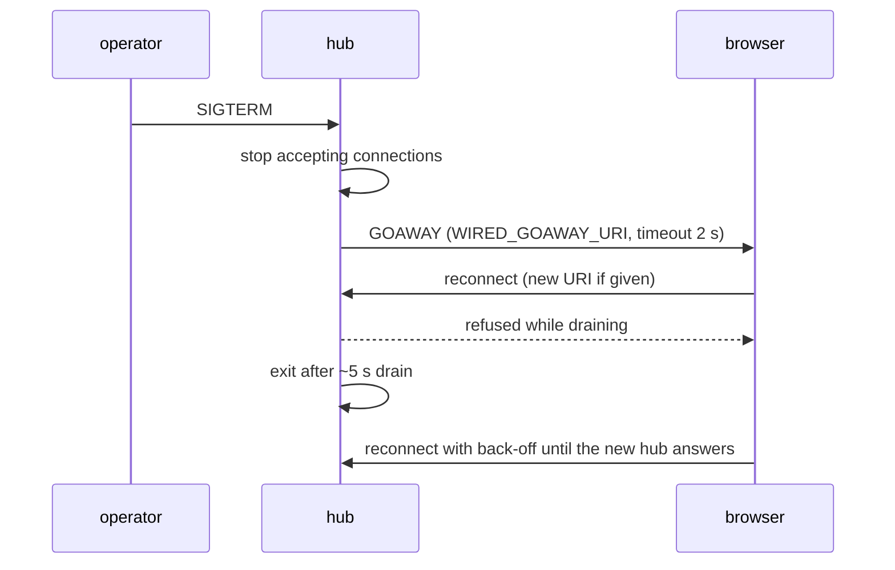

# サーバー

[wired](../../README.md) › [moqt_chat](README.md) › サーバー

| 項目 | 内容 |
|---|---|
| 目的 | moqt_chat の `wired_server` のビルド、起動、設定、上限を示す |
| 読む人 | サーバーを動かす・変更するコントリビューター |
| 前提文書 | [moqt_chat](README.md) |
| 関連文書 | [MoQT の使い方](wire.md)、[フロントエンド](frontend.md)、[moqt_chat のリソース監視](../../docs/performance/monitoring.md) |

## 1. ビルドと起動

レシピは `examples/moqt_chat/justfile` にある。

| コマンド | 動作 |
|---|---|
| `just build` | リポジトリのルートで `just build` を通し、`just ninja examples/moqt_chat/server/wired_server` でサーバーを作る |
| `just up` | `just build` のあと、Docker のイメージを作ってフォアグラウンドで動かす。Ctrl-C で止まる |
| `just up -d` | 同じ動作をデタッチして行う。ログは `server/` で `docker compose logs -f` で見る |
| `just down` | コンテナを止めて消す |

Docker を使わないときは、リポジトリのルートで次を実行する。

1. `just ninja examples/moqt_chat/server/wired_server` でバイナリを作る。
2. `examples/moqt_chat/server/wired_server` を実行する。

### 1.1 コンテナ

| 項目 | 内容 |
|---|---|
| ベースイメージ | `scratch`。イメージにあるのは `wired_server` だけである |
| バイナリ | `-ffreestanding -nostdlib -static` でリンクした静的バイナリ |
| ファイルシステム | 既定では実行中に読まない。自己署名の証明書は起動ごとにメモリで作る |
| ネットワーク | `network_mode: host`(`server/docker-compose.yml`)。ホストの `4433/udp` で直接待ち受ける |
| 引数 | `--san-ipv4 ${WIRED_SAN_IPV4:-127.0.0.1}` |

Docker のブリッジとポートの割り当て(`-p 4433:4433/udp`)では、QUIC のハンドシェイクが終わらない。そのためホストのネットワークを使う。

`docker-compose.yml` の `build:` はディスクにある `wired_server` をイメージに入れるだけである。ソースを変えたら `just up` を使う。

### 1.2 証明書の IP アドレス

`just up` は、このホストの既定の経路の送信元アドレスを、自己署名の証明書の IP SAN にする。起動時に `cert IP SAN: ...` と出力する。ブラウザーは `https://<そのアドレス>:4433/` に接続する。

| 接続先 | 結果 |
|---|---|
| `https://<IP SAN のアドレス>:4433/` | 接続する |
| `https://localhost:4433/` | 接続する。証明書は `localhost` も含む |
| ほかの IP アドレス(`--san-ipv4` を渡したときの `127.0.0.1` を含む) | 421 を返す(RFC 9110 7.4)。Chrome は `net::ERR_METHOD_NOT_SUPPORTED` を出す |

NAT の内側では、既定の経路のアドレスはプライベートアドレスになる。クライアントが接続するアドレスを `WIRED_SAN_IPV4=<公開 IP> just up` で渡す。

### 1.3 単一プロセス

ハブはピアの表、リクエストストリーム、Object のキャッシュを 1 つのプロセスのメモリに持つ。`--workers`、`--cores`、`--ifindex` は渡さない。ワーカーごとに別のルームができる。

## 2. 設定

| フラグ / 環境変数 | 既定値 | 動作 |
|---|---|---|
| `--port N` | 4433 | UDP のポート |
| `--san-ipv4 a.b.c.d` / `WIRED_SAN_IPV4`(`just up` だけが読む) | 127.0.0.1(`just up` ではこのホストのアドレス) | 自己署名の証明書の IP SAN。ほかの IP アドレスへの WebTransport の CONNECT には 421 を返す |
| `--cc cubic\|bbr` | `cubic` | 新しい接続の輻輳制御。ほかの値(`newreno` を含む)は使い方のエラーで終了する |
| `--cert PATH` / `WIRED_CERT` | なし(メモリの自己署名の証明書) | 送る証明書チェーンの PEM。リーフを先頭に置く |
| `--key PATH` / `WIRED_KEY` | なし | 証明書の P-256 の秘密鍵の PEM。`--cert` と一緒に必要 |
| `WIRED_ALLOWED_ORIGINS` | なし(すべての Origin を受ける) | カンマ区切りの Origin の一覧(例 `https://chat.example,https://hakkadaikon.github.io`)。ほかの Origin からの WebTransport の CONNECT には 403 を返す(draft-ietf-webtrans-http3-15 3.1) |
| `--goaway-uri URI` / `WIRED_GOAWAY_URI` | なし(同じ URI に再接続する) | 終了時の GOAWAY に入れる New Session URI。8192 バイトまで |
| `--qlog PATH` | なし | qlog の出力先 |
| `--keylog PATH` | なし | NSS の鍵ログの出力先 |

### 2.1 証明書の再読み込み

`--cert` と `--key` を渡したときは、`kill -HUP <pid>` で両方のファイルを読み直す。

| 対象 | 使う証明書 |
|---|---|
| 再読み込みのあとに開いた接続 | 新しい証明書 |
| 開いている接続 | 変わらない |
| 読み込みに失敗したとき | 古い証明書のまま |

### 2.2 自己署名の証明書のフィンガープリント

起動時に、自己署名の証明書の SHA-256 フィンガープリントを出力する。

```
cert sha-256 fingerprint: b4:6d:57:7b:de:f6:70:d6:f1:f9:e9:91:c3:a3:6a:db:15:e8:7d:39:34:24:a4:54:89:ed:de:43:22:39:70:88
```

証明書の有効期間の起点は UTC の日の始まりである(`day_start_secs`、`wired_server.c`)。同じ UTC の日に再起動してもフィンガープリントは変わらず、フロントエンドの自動再参加は同じハッシュを使い続ける。UTC の 0 時を過ぎるとフィンガープリントが変わるので、そのときは今の起動のログから写す。

## 3. ハブの上限

| 項目 | 値 | 上限を超えたとき |
|---|---|---|
| Object のキャッシュ | 1 MiB(`MOQT_CACHE_BYTES`)。全 Track で 1 つの領域を使い、古い Group から丸ごと捨てる | 1 MiB を超える Group(1 MiB を超える添付ファイル)はキャッシュしない。途中参加の履歴にも入らない |
| 名前空間 | `wired/moqt_chat` の下だけ(`chat_authorize_room_ns`、`access.c`) | 告知と購読を UNAUTHORIZED で拒否する |
| リクエストストリーム | セッションあたり 32、ハブ全体で 128(`WIRED_MOQTRUN_MAX_REQS`) | 新しいリクエストストリームを EXCESSIVE_LOAD でリセットする |
| fill | 8 スロットと待ちの 8 スロット(`WIRED_MOQTRUN_MAX_FETCHES`) | [MoQT の使い方 4.1](wire.md#41-fill-の枠が足りないとき) |
| 参加者あたりの Track | 5(`WIRED_MOQTRUN_MAX_TRACKS_PER_PEER`) | PUBLISH を拒否する |

キャッシュは全 Track で共有する。画面共有の Group が多いと、チャットの履歴は先に押し出される。

### 3.1 リクエストストリームの数

4 人のルームで、1 つのセッションが同時に開くリクエストストリームの最大は 24 である。fill は SUBSCRIBE のリクエストに乗るので、別の枠を使わない。

| リクエスト | 数 | 内訳 |
|---|---|---|
| PUBLISH | 5 | チャット、音声、`screen`、`screen-lo`、`camera` |
| PUBLISH_NAMESPACE | 3 | `<id>`、`<id>/screen`、`<id>/camera` |
| SUBSCRIBE_NAMESPACE | 1 | `wired/moqt_chat` |
| SUBSCRIBE | 15 | ほかの 3 人 × 5 Track(Auto で `screen` と `screen-lo` の両方を購読するとき) |
| 合計 | 24 | ハブ全体で 96 |

セッションあたりの上限 32 とハブ全体の上限 128 に収まる。参加者 ID を 4 つにしているのはこの上限のためである。

## 4. GOAWAY による再起動

SIGTERM(`docker compose stop`、`kill <pid>`)を受けると、サーバーは次の順に動く。



| 項目 | 値 |
|---|---|
| GOAWAY のタイムアウト | 2000 ms(`GOAWAY_TIMEOUT_MS`、`relay.c`)。過ぎても開いているセッションはハブが閉じる |
| SDK のドレイン | 約 5 秒(`SRVRUN_DRAIN_TICKS`) |
| 再接続の間隔 | 1、2、4、8、10 秒(`reconnectDelayMs`、`useMoqtChat.ts`)。5 回で止める |

ブラウザーは GOAWAY か WebTransport のドレインを受けるとすぐに再接続し、新しいセッションですべてを配信、告知、購読し直す。同じ UTC の日の再起動では、フィンガープリントが同じなので固定したハッシュがそのまま使える。
