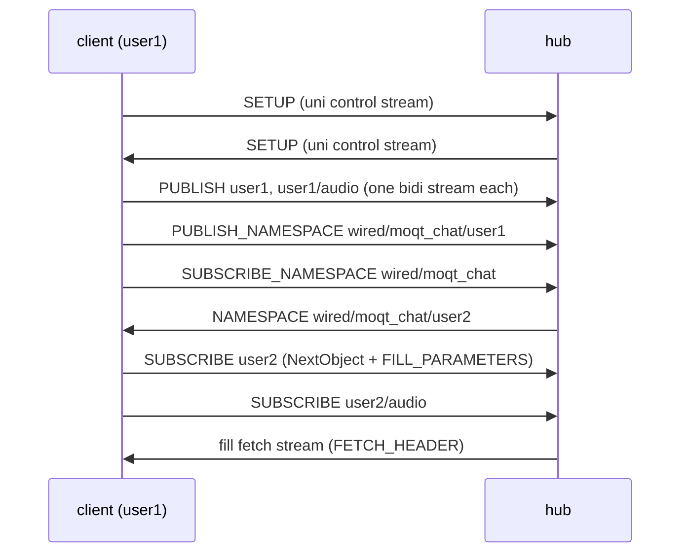

# MoQT の使い方

[wired](../../README.md) › [moqt_chat](README.md) › MoQT の使い方

| 項目 | 内容 |
|---|---|
| 目的 | moqt_chat のクライアントとハブがワイヤーで交わすメッセージと Object の形を示す |
| 読む人 | フロントエンドの MoQT の処理とハブを変更するコントリビューター |
| 前提文書 | [moqt_chat](README.md)、[MoQT draft-23 の要件台帳](../../docs/features/draft-moq-transport-23.md) |
| 関連文書 | [MoQT Track 切り替え](../../docs/features/moqt-track-switching.md)、[サーバー](server.md) |

節番号は draft-ietf-moq-transport-23 の節である。

## 1. ドラフトの選択

| 側 | 動作 |
|---|---|
| サーバー | `wired_moqt_wt_protocols` の `moqt-23 moqt-22 moqt-19 moqt-18` を `opt.run.wt_protocols` で提示する |
| クライアント | `new WebTransport(...)` に `protocols: ["moqt-23"]` を渡す |
| クライアントの拒否 | `wt.protocol` が `moqt-23` でなければ `connect` を `hub did not negotiate moqt-23` で拒否し、画面に "Could not connect" を出す |

## 2. セッションとリクエスト

両側が単方向の制御ストリームを開き、SETUP(ストリーム型 0x2F00、9.1、セッションの初期化は 6.3)を送る。サーバーの制御ストリームは終了時に GOAWAY(9.2)も運ぶ。

PUBLISH、SUBSCRIBE、PUBLISH_NAMESPACE、SUBSCRIBE_NAMESPACE は、クライアントが開く双方向ストリームを 1 つずつ使う(6.4.2)。リクエストの返答は同じストリームで返る。リクエストを取り消すときは、そのストリームをリセットする。

## 3. 名前空間の発見(4.1〜4.2)

| 受け取るもの | クライアントの動作 |
|---|---|
| ピアの NAMESPACE | ピアを参加者の一覧に加え、チャット、Nostr の 4 つ(5.2 節)、音声の Track を購読する |
| ピアの NAMESPACE_DONE | ピアを一覧から外し、その購読を取り消す |

画面共有の間は、送る側が `wired/moqt_chat/<id>/screen` も告知する。カメラの間は `wired/moqt_chat/<id>/camera` を告知する。クライアントはポーリングしない。

## 4. 履歴と途中参加(3.4〜3.5)

| Track | SUBSCRIBE のフィルター | FILL_PARAMETERS の LOCATION_FILTER | 受け取る履歴 |
|---|---|---|---|
| チャット | NextObject(0x05、9.19.9) | RelativeStart 65(`CHAT_HISTORY_GROUPS` 64 + 1) | 最新の Group と、その前の 64 Group |
| 画面共有、カメラ | NextObject | RelativeStart 1 | 最新の Group |
| `nostr-presence`、`nostr-30312`、`nostr-30313` | NextObject | RelativeStart 1 | 最新の Group。置き換え型のイベントの、いまの状態だけ |
| `nostr-react` | NextObject | RelativeStart 65 | チャットと同じ深さ |

FILL_PARAMETERS(0x23、9.19.15)は、Length を持たない Parameter の数と Parameter の並びである。fill はサーバーが開く単方向ストリームで届き、その FETCH_HEADER(11.4.1)が SUBSCRIBE の Request ID を指す。

画面共有とカメラは、キーフレームごとに新しい Group を始める。途中参加した購読者は最新の Group をキーフレームから受け取るので、最初のフレームをすぐにデコードできる。

### 4.1 fill の枠が足りないとき

ハブの fill の表は 16 スロット(`WIRED_MOQTRUN_MAX_FETCHES`)と待ちの 16 スロットである(SDK の既定は 8 と 8。moqt_chat のサーバーは `-DWIRED_PROFILE_MOQT_ROOM` でビルドする)。4 人のルームに途中参加すると、ほかの 3 人 × 9 Track で最大 27 の fill を同時に頼む。両方が埋まると、ハブは履歴付きの SUBSCRIBE 全体を REQUEST_ERROR INTERNAL_ERROR で拒否する。受け付けた fill には fill のストリームを開く必要があるので(3.4.1)、ハブは返答の前に判断する。

クライアントはその SUBSCRIBE を FILL_PARAMETERS なしで 1 回だけ再送する。ピアのメッセージは履歴なしで届く。draft-23 が定めていない REQUEST_ERROR のコードは、INTERNAL_ERROR として扱う(13)。

## 5. Object

| 中身 | Object の形 | 中継 |
|---|---|---|
| チャットのメッセージ | 1 つの Group に 1 つの Object | 確実に中継する |
| 添付ファイル | 1 つの Group に、15 KiB(`MAX_ATTACHMENT_CHUNK_BYTES`)ずつの Object | 確実に中継する |
| 音声 | Opus の 1 フレームを 1 つの OBJECT_DATAGRAM。データグラムに入らないフレームはストリーム | 送れないときは捨てる |
| 画面共有、カメラ | VP8 のフレーム。キーフレームで新しい Group | 送れないときは捨てる |

ハブは SUBGROUP のバイト列をそのまま購読者全員に送る(`moqtrun.c` の `moqtrun_relay_object`)。ハブが 1 つの Object に持つのは 16384 バイト(`WIRED_MOQTRUN_RELAY_FRAG_MAX`)までである。

添付ファイルは専用の Group に入れる。ハブは購読の Location Filter を、確実な中継の途中参加の再送にだけ当てる。そのため、添付ファイルの Group は全体が再送されるか、まったく再送されないかのどちらかになる。

### 5.1 添付ファイルの上限

| 項目 | 値 | 場所 |
|---|---|---|
| 1 ファイルの上限 | 50 MiB | `ATTACHMENT_MAX_BYTES`(`attachmentValidation.ts`) |
| 組み立てのタイムアウト | 宣言されたサイズに比例する | `attachmentTimeoutMs`(`moqtAttachmentWire.ts`) |

50 MiB はこのアプリケーションの上限で、プロトコルの上限ではない。

### 5.2 Nostr のイベント

Nostr のイベントは参加者の名前空間 `wired/moqt_chat/<id>` の下の Track で運ぶ。1 つのイベントが 1 つの Group の 1 つの Object になる。ペイロードは、拡張機能が署名して返したイベントの JSON そのものである。どの Track に載せるかは kind で決まる(`moqNostr.ts` の `NOSTR_TRACKS`、`trackForKind`)。

| Track 名 | kind | Track Alias | 途中参加の fill |
|---|---|---|---|
| `<id>`(チャット) | 1311 | 0〜3 | 64 Group 前まで |
| `<id>/nostr-presence` | 10312(presence) | 22〜25 | 最新の Group だけ |
| `<id>/nostr-30312` | 30312(meeting space) | 26〜29 | 最新の Group だけ |
| `<id>/nostr-30313` | 30313(meeting) | 30〜33 | 最新の Group だけ |
| `<id>/nostr-react` | 7(リアクション)、5(削除) | 34〜37 | 64 Group 前まで |

Track Alias はカメラの範囲(18〜21)の上に、Track ごとに参加者 4 人分を並べる(`nostrTrackAlias`)。Nostr の 4 Track は音声の Track のあと、名前空間の告知の前に PUBLISH する(`publishNostrTracks`)。ハブの Track の枠が足りないときに、拒否されるのが音声ではなく Nostr の Track になるようにするためである。チャットの Track では、添付の印(0xFD、0xFE)とニックネームの印(0x00)のどれでもなく、`{` で始まるペイロードを Nostr のイベントとして扱う(`classifyChatPayload`)。

`moqNostr.ts` の `MoqNostr` は NIP-01 の操作を次のように MoQ に写す。

| NIP-01 | MoQ |
|---|---|
| EVENT(送信) | 自分の、その kind の Track の Object 1 つ(`publish`)。どの Track にも載らない kind は拒否する |
| OK | Object の送信が受け付けられた(`publish` の Promise が解決する)。接続していないとき(`sendNostrEvent` が "not connected" で reject)やストリームの失敗は、理由付きの reject |
| REQ のフィルター | ピアの Track の購読と、その履歴の fill(4 節)。kind、`#a`、`authors`、`since` はクライアントで照らし、`limit` は履歴にだけ当てる。`#a` のないフィルターは、どの `a` にも当たる |
| EOSE | `onHistoryEnd`。NIP-01 の EOSE と違い、`subscribe` を呼んだその場で、それまでに受け取った分を渡した直後に呼ぶ。ピアの購読の fill はたいていそのあとに届き、ライブのイベントとして渡る |
| CLOSE | `subscribe` が返す関数で購読を外す |

受け取ったペイロードはすべて `verifyEvent`(id と BIP-340 の署名)を通し、不正なものは数えて捨てる。届いた Track が運ぶ kind でないもの、64 KiB を超えるペイロード、`created_at` が 10 分より先のもの、セッションの開始より 1 日以上前のライブのイベントも捨てる。fill(`live` が false)は古くてもよい。同じ id は 2 度目から無視するので、fill の再送で履歴と `limit` がふくらまない。

| kind の範囲(NIP-01) | MoQ の写し方 | 状態 |
|---|---|---|
| regular(1、2、4〜44、1000〜9999) | イベントごとに 1 つの Group。履歴にすべて残す | 実装済み(1311、7、5) |
| replaceable(0、3、10000〜19999)、addressable(30000〜39999) | 専用の Track で、fill は最新の Group だけ。受け取る側も鍵(kind、pubkey、addressable は `d`)ごとに最新の 1 つだけを残す。`created_at` が新しい方、同じなら id が小さい方を残す。最新の印は履歴の上限(512)と別に持つので、古いイベントを再送されても勝たない | 実装済み(10312、30312、30313) |
| ephemeral(20000〜29999) | 履歴を残さない(データグラム) | 未実装。`publish` は拒否する |

ハブはイベントを確かめずに中継する。不正なイベントはクライアントが捨てるが、履歴(fill)の枠は占める。

### 5.3 NIP-53 の meeting space

ルームは NIP-53 の meeting space である。座標は `30312:<ホストの pubkey>:<d>` で、ホストはビルド時の `NEXT_PUBLIC_NOSTR_HOST`、`d` は `NEXT_PUBLIC_NOSTR_SPACE_D`(既定 `wired-moqt-chat`)で決まる。ホストのいないルームでも座標は決まり、画面は設定の `d` を出す。どのイベントも公開リレーには送らない。

| kind | 送る人 | タグ | 受け取る側の確認(`nostrRoom.ts`) |
|---|---|---|---|
| 30312 space | ホスト。参加したとき | `d`、`room`、`status` open、`service`(ページの URL)、`["p", ホスト, "", "Host"]` | pubkey と `d` が座標と一致し、`room`、`service`、Host の `p` があり、`status` が open、private、closed のどれか |
| 30313 meeting | ホスト。参加したとき(セッションごとに新しい `d`、status live)、参加者が変わったとき(2 秒まとめて `current_participants` を更新)、退出したとき(status ended、`ends`) | `d`、`a`(space の座標)、`title`、`starts`、`status`、`current_participants` | ホストの pubkey、`a` が自分の space、`d`、`title`、数字の `starts`、`status` が planned、live、ended のどれか |
| 10312 presence | ログインした全員。参加したとき、60 秒ごと、挙手を切り替えたとき | `["a", space, "", "root"]`、挙手中は `["hand", "1"]`、`["wired-participant", <参加者 ID>]` | `a` が自分の space で、3 分以内のもの |
| 7 リアクション(NIP-25) | ログインした人。同じ投稿に同じ内容は 1 回だけ送る | `e`(対象の id)、`p`(対象の作者)、`k` 1311。content は `+`、`-`、絵文字 | 最後の `e` と最後の `p` が対象の投稿と作者に一致する。content は 1〜32 文字。(pubkey、content)ごとに 1 回だけ数え、1 人あたり 4 種類まで、1 つの数は 999 まで |
| 5 削除(NIP-09) | 投稿の作者 | `e`(対象の id)、`k` 1311 | 削除の pubkey が対象の作者と同じときだけ従う。対象の投稿は「Deleted by the author」の行になる |

同じ秒に 2 回送っても新しい方が勝つように、送る側は `created_at` を前回より必ず大きくする。拡張機能が返したイベントの `created_at` が頼んだ値と違えば送らない。

presence と kind 1311 には、署名した人の参加者 ID を `["wired-participant", <ID>]` で入れる。このタグは NIP-53 にない、このアプリケーションのタグである。参加者 ID と pubkey を対応付けるのは、イベントを運んだ Track の持ち主の ID とこのタグが一致するときだけである。ほかの人の署名済みイベントを自分の Track で運び直しても、その人の pubkey にはならない。presence は fill で届いたものも 3 分以内なら使うので、まだ投稿していない人の名前も一覧に出る。

30312 と 30313 はホストの pubkey のものだけを最新の印(`MoqNostr` の `#latest`)に入れる。最新の印と presence はそれぞれ 512 件までで、古いものから捨てる。退出時の ended はセッションを閉じる前に最大 1.5 秒待って送る。ページを閉じたとき(pagehide)にも送ろうとするが、たいてい届かない。

削除はクライアントの表示を変えるだけで、ハブの履歴には元のイベントが残る。あとから参加した人は元の投稿と削除の両方を fill で受け取り、削除を当てて表示する。受け取った削除はリアクションの上限(512 件)とは別に、投稿 4096 件分まで覚える。ただし削除は `nostr-react` でリアクションと同じ fill(65 Group)に入るので、それより古い削除はあとから参加した人に届かないことがある。

ホストが ended を送れずに去ると、最後の live の 30313 が fill で残る。あとから参加した人には、それが最大 24 時間ほど LIVE と出る。ただし、`starts` が受け取った最新の 30312 の `created_at` より前の live は、前のセッションのものとして表示しない。ホストは参加するたびに 30312 を送り、新しい meeting の `starts` をその `created_at` にそろえる。

ハブが Nostr の Track の PUBLISH を 1 つでも拒んだときは、presence も space も meeting も送らない(拒まれた Track では送らない)。ルームの見出しに "Room events unavailable" と出る。ピアの Nostr の Track の SUBSCRIBE が拒まれたときは、3 秒後に 1 回だけ送り直す。それも拒まれると、そのピアの Nostr のイベントは次の参加まで届かない。30312 はホストの参加ごとに 1 回しか送らないので、この場合は space の名前が出ない。

**NIP-53 との違い:** NIP-53 は meeting space のチャットを定めていない。ここでは kind 1311 に `["a", "30312:<ホスト>:<d>", "", "root"]`(space)を付け、meeting が live のときは `["a", "30313:<ホスト>:<meeting の d>"]` も付ける。受け取る側は、`a` が自分の space に一致する 1311 を受け入れる。

## 6. Track 切り替え(実験的)

画面共有の高レートと低レートの別版を、ハブの Track 切り替えで選ぶ。使うのは moqtail 互換の SWITCH_FROM(0x24)と SSTS(SWITCHING_SET_ASSIGNMENT 0x41、Setup Option SSTS_ALGORITHMS 0x3F01)の拡張である。どのコードポイントも draft-23 にはない。draft-23 の Setup Option 0x09 は MAX_CONTROL_MESSAGE_SIZE である。

ワイヤーの形式とハブの規則は [MoQT Track 切り替え](../../docs/features/moqt-track-switching.md)、足りない点は [既知の制限](../../docs/security/limitations/moqt-switching.md) に書く。

### 6.1 別版

| 別版 | Track 名 | 上限 | Track Alias |
|---|---|---|---|
| hi | `<id>/screen` | なし | 10〜13(添字 + 10) |
| lo | `<id>/screen-lo` | 幅 640 px、350 kbps(`screenSharePipeline.ts`) | 14〜17(添字 + 14) |

両方の別版を同じ取り込みのフレームから作り、キーフレームの判断も 1 回で共有する。そのため hi の Group g と lo の Group g は同じフレームから始まる。ハブが lo の PUBLISH を拒否したときは、送る側は lo のエンコーダーを動かさない。

### 6.2 画質の選択

| 選択 | 購読 | 切り替え |
|---|---|---|
| Auto(既定) | 両方の別版を 1 つの switching set で購読する。ハブが Group ごとにどちらかを転送する | ハブがネゴシエーションしたアルゴリズムで選ぶ |
| High / Low | 1 つの別版だけを購読する | SWITCH_FROM {Soft, Publish Done} 付きの SUBSCRIBE 1 つ |
| Auto との間 | — | 購読を取り消して購読し直す |

Auto の switching set の値は次のとおりである。

| 値 | 内容 |
|---|---|
| Set ID | 送る側の参加者 ID の添字 |
| しきい値 | hi 2000 kbps、lo 400 kbps |
| Weight | 1 |
| Activate | 2 |
| アルゴリズム | backpressure(0xff01)を優先し、なければ default(0)。どちらもネゴシエーションされなければ hi だけを購読する |

Auto では両方の別版が参加者ごとの 1 つのデコーダーに入る。デコーダーの手前で、もう一方の別版の同じ Group と、切り替え前の別版の残りを捨てる。

High と Low の間の切り替えでは、ハブが古い購読を Group の境界で PUBLISH_DONE 0x3(拡張の "switched"。draft-23 にはないコード)で終える。タイルの表示は、その SUBSCRIBE が受け付けられてから変わる。画面共有の各タイルにはデコード中の別版を HI か LO のバッジで出す。

### 6.3 ハブの設定

ハブは、サーバーが拡張を有効にするまで何も提示しない。設定は `wired_moqt_init` のあとに行う。

| フィールド | 内容 | `server/wired_server.c` の値 |
|---|---|---|
| `wired_moqt_hub.switch_track` | SWITCH_FROM を有効にする | 1 |
| `ssts_algs`、`ssts_alg_n` | SSTS のアルゴリズムの一覧 | {0xff01(backpressure)、0(default)} |
| `ssts_cap_kbps` | default のアルゴリズムの帯域 | 0(上限なし) |

クライアントは、ハブの SETUP に SSTS_ALGORITHMS があるときだけ別版を使う。ないときは `<id>/screen` だけを配信・購読し、switching set も、この Group の選別も使わない。画質の選択と HI / LO のバッジも出さない。
