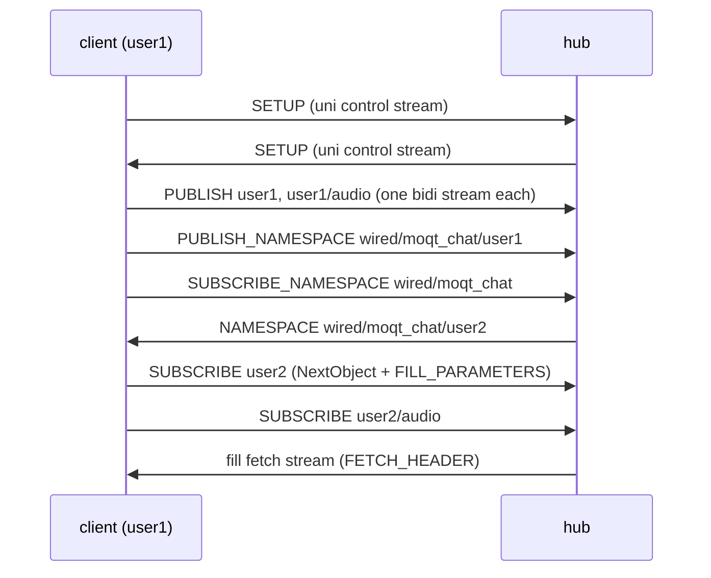

# MoQT の使い方

[wired](../../README.md) › [moqt_chat](README.md) › MoQT の使い方

| 項目 | 内容 |
|---|---|
| 目的 | moqt_chat のクライアントとハブがワイヤーで交わすメッセージと Object の形を示す |
| 読む人 | フロントエンドの MoQT の処理とハブを変更するコントリビューター |
| 前提文書 | [moqt_chat](README.md)、[MoQT draft-23 の要件台帳](../../docs/features/draft-moq-transport-23.md) |
| 関連文書 | [MoQT Track 切り替え](../../docs/features/moqt-track-switching.md)、[サーバー](server.md) |

節番号は draft-ietf-moq-transport-23 の節である。

## 1. ドラフトの選択

| 側 | 動作 |
|---|---|
| サーバー | `wired_moqt_wt_protocols` の `moqt-23 moqt-22 moqt-19 moqt-18` を `opt.run.wt_protocols` で提示する |
| クライアント | `new WebTransport(...)` に `protocols: ["moqt-23"]` を渡す |
| クライアントの拒否 | `wt.protocol` が `moqt-23` でなければ `connect` を `hub did not negotiate moqt-23` で拒否し、画面に "Could not connect" を出す |

## 2. セッションとリクエスト

両側が単方向の制御ストリームを開き、SETUP(ストリーム型 0x2F00、9.1、セッションの初期化は 6.3)を送る。サーバーの制御ストリームは終了時に GOAWAY(9.2)も運ぶ。

PUBLISH、SUBSCRIBE、PUBLISH_NAMESPACE、SUBSCRIBE_NAMESPACE は、クライアントが開く双方向ストリームを 1 つずつ使う(6.4.2)。リクエストの返答は同じストリームで返る。リクエストを取り消すときは、そのストリームをリセットする。

## 3. 名前空間の発見(4.1〜4.2)

| 受け取るもの | クライアントの動作 |
|---|---|
| ピアの NAMESPACE | ピアを参加者の一覧に加え、チャットと音声の Track を購読する |
| ピアの NAMESPACE_DONE | ピアを一覧から外し、その購読を取り消す |

画面共有の間は、送る側が `wired/moqt_chat/<id>/screen` も告知する。カメラの間は `wired/moqt_chat/<id>/camera` を告知する。クライアントはポーリングしない。

## 4. 履歴と途中参加(3.4〜3.5)

| Track | SUBSCRIBE のフィルター | FILL_PARAMETERS の LOCATION_FILTER | 受け取る履歴 |
|---|---|---|---|
| チャット | NextObject(0x05、9.19.9) | RelativeStart 65(`CHAT_HISTORY_GROUPS` 64 + 1) | 最新の Group と、その前の 64 Group |
| 画面共有、カメラ | NextObject | RelativeStart 1 | 最新の Group |

FILL_PARAMETERS(0x23、9.19.15)は、Length を持たない Parameter の数と Parameter の並びである。fill はサーバーが開く単方向ストリームで届き、その FETCH_HEADER(11.4.1)が SUBSCRIBE の Request ID を指す。

画面共有とカメラは、キーフレームごとに新しい Group を始める。途中参加した購読者は最新の Group をキーフレームから受け取るので、最初のフレームをすぐにデコードできる。

### 4.1 fill の枠が足りないとき

ハブの fill の表は 8 スロット(`WIRED_MOQTRUN_MAX_FETCHES`)と待ちの 8 スロットである。両方が埋まると、ハブは履歴付きの SUBSCRIBE 全体を REQUEST_ERROR INTERNAL_ERROR で拒否する。受け付けた fill には fill のストリームを開く必要があるので(3.4.1)、ハブは返答の前に判断する。

クライアントはその SUBSCRIBE を FILL_PARAMETERS なしで 1 回だけ再送する。ピアのメッセージは履歴なしで届く。draft-23 が定めていない REQUEST_ERROR のコードは、INTERNAL_ERROR として扱う(13)。

## 5. Object

| 中身 | Object の形 | 中継 |
|---|---|---|
| チャットのメッセージ | 1 つの Group に 1 つの Object | 確実に中継する |
| 添付ファイル | 1 つの Group に、15 KiB(`MAX_ATTACHMENT_CHUNK_BYTES`)ずつの Object | 確実に中継する |
| 音声 | Opus の 1 フレームを 1 つの OBJECT_DATAGRAM。データグラムに入らないフレームはストリーム | 送れないときは捨てる |
| 画面共有、カメラ | VP8 のフレーム。キーフレームで新しい Group | 送れないときは捨てる |

ハブは SUBGROUP のバイト列をそのまま購読者全員に送る(`moqtrun.c` の `moqtrun_relay_object`)。ハブが 1 つの Object に持つのは 16384 バイト(`WIRED_MOQTRUN_RELAY_FRAG_MAX`)までである。

添付ファイルは専用の Group に入れる。ハブは購読の Location Filter を、確実な中継の途中参加の再送にだけ当てる。そのため、添付ファイルの Group は全体が再送されるか、まったく再送されないかのどちらかになる。

### 5.1 添付ファイルの上限

| 項目 | 値 | 場所 |
|---|---|---|
| 1 ファイルの上限 | 50 MiB | `ATTACHMENT_MAX_BYTES`(`attachmentValidation.ts`) |
| 組み立てのタイムアウト | 宣言されたサイズに比例する | `attachmentTimeoutMs`(`moqtAttachmentWire.ts`) |

50 MiB はこのアプリケーションの上限で、プロトコルの上限ではない。

## 6. Track 切り替え(実験的)

画面共有の高レートと低レートの別版を、ハブの Track 切り替えで選ぶ。使うのは moqtail 互換の SWITCH_FROM(0x24)と SSTS(SWITCHING_SET_ASSIGNMENT 0x41、Setup Option SSTS_ALGORITHMS 0x3F01)の拡張である。どのコードポイントも draft-23 にはない。draft-23 の Setup Option 0x09 は MAX_CONTROL_MESSAGE_SIZE である。

ワイヤーの形式とハブの規則は [MoQT Track 切り替え](../../docs/features/moqt-track-switching.md)、足りない点は [既知の制限](../../docs/security/limitations/moqt-switching.md) に書く。

### 6.1 別版

| 別版 | Track 名 | 上限 | Track Alias |
|---|---|---|---|
| hi | `<id>/screen` | なし | 10〜13(添字 + 10) |
| lo | `<id>/screen-lo` | 幅 640 px、350 kbps(`screenSharePipeline.ts`) | 14〜17(添字 + 14) |

両方の別版を同じ取り込みのフレームから作り、キーフレームの判断も 1 回で共有する。そのため hi の Group g と lo の Group g は同じフレームから始まる。ハブが lo の PUBLISH を拒否したときは、送る側は lo のエンコーダーを動かさない。

### 6.2 画質の選択

| 選択 | 購読 | 切り替え |
|---|---|---|
| Auto(既定) | 両方の別版を 1 つの switching set で購読する。ハブが Group ごとにどちらかを転送する | ハブがネゴシエーションしたアルゴリズムで選ぶ |
| High / Low | 1 つの別版だけを購読する | SWITCH_FROM {Soft, Publish Done} 付きの SUBSCRIBE 1 つ |
| Auto との間 | — | 購読を取り消して購読し直す |

Auto の switching set の値は次のとおりである。

| 値 | 内容 |
|---|---|
| Set ID | 送る側の参加者 ID の添字 |
| しきい値 | hi 2000 kbps、lo 400 kbps |
| Weight | 1 |
| Activate | 2 |
| アルゴリズム | backpressure(0xff01)を優先し、なければ default(0)。どちらもネゴシエーションされなければ hi だけを購読する |

Auto では両方の別版が参加者ごとの 1 つのデコーダーに入る。デコーダーの手前で、もう一方の別版の同じ Group と、切り替え前の別版の残りを捨てる。

High と Low の間の切り替えでは、ハブが古い購読を Group の境界で PUBLISH_DONE 0x3 で終える。タイルの表示は、その SUBSCRIBE が受け付けられてから変わる。画面共有の各タイルにはデコード中の別版を HI か LO のバッジで出す。

### 6.3 ハブの設定

ハブは、サーバーが拡張を有効にするまで何も提示しない。設定は `wired_moqt_init` のあとに行う。

| フィールド | 内容 | `server/wired_server.c` の値 |
|---|---|---|
| `wired_moqt_hub.switch_track` | SWITCH_FROM を有効にする | 1 |
| `ssts_algs`、`ssts_alg_n` | SSTS のアルゴリズムの一覧 | {0xff01(backpressure)、0(default)} |
| `ssts_cap_kbps` | default のアルゴリズムの帯域 | 0(上限なし) |

クライアントは、ハブの SETUP に SSTS_ALGORITHMS があるときだけ別版を使う。ないときは `<id>/screen` だけを配信・購読し、switching set も、この Group の選別も使わない。画質の選択と HI / LO のバッジも出さない。
